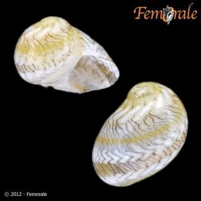

## ESTRUCTURA DE FICHA DE INVERTEBRADO

---

## Invertebrados — Acuario de Agua Fría / Goldfish

> **Advertencia**: Los goldfish comen casi cualquier invertebrado pequeño. Solo sobreviven los que tienen protección dura (opérculo).

---

### Caracol Nerite (Neritina spp.)
**Familia**: Neritidae
**Origen**: Indo-Pacífico, ríos tropicales
**Tamaño**: 1 – 2.5 cm
**Temperatura**: 22 – 28°C
**pH**: 6.5 – 8.5
**GH / KH / TDS**: GH 6-18 / KH 4-10
**Dificultad**: ★☆☆☆☆
**Tipo de agua**: dulce
**Comportamiento**: pacífico
**Compatible con peces**: con goldfish (el opérculo duro los protege de ser aplastados)
**Dieta**: algívoro
**Reproducción**: pone huevos en cristal (no eclosionan en agua dulce)
**Notas**: El opérculo duro protege al Nerite de los goldfish, aunque los de cuerpo redondo con bocas grandes a veces los molestan. Limpia el cristal de algas eficazmente. Temperatura algo baja para este caracol — funciona mejor a 22-25°C.
