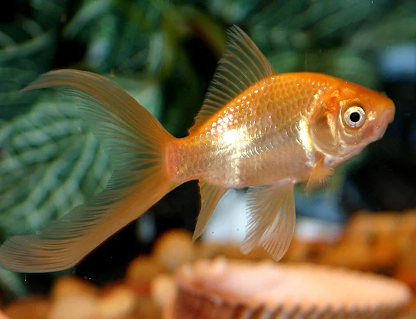
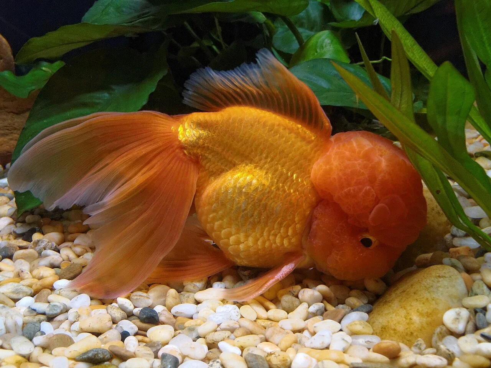
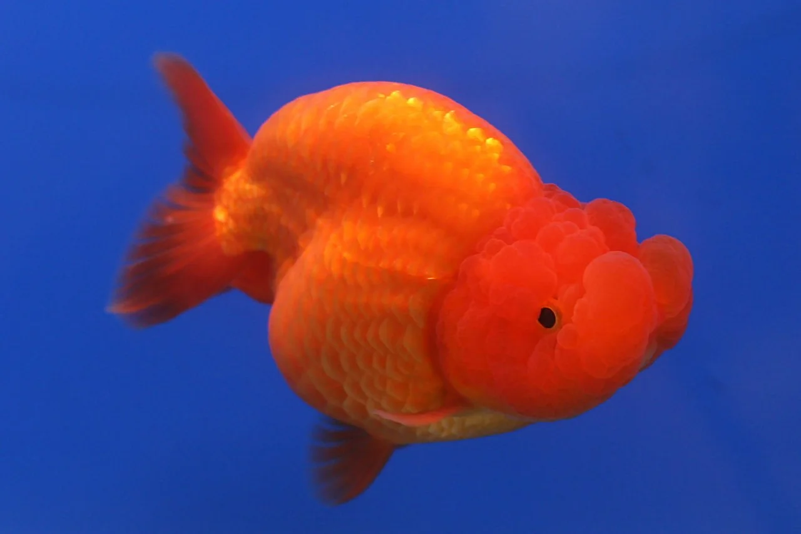
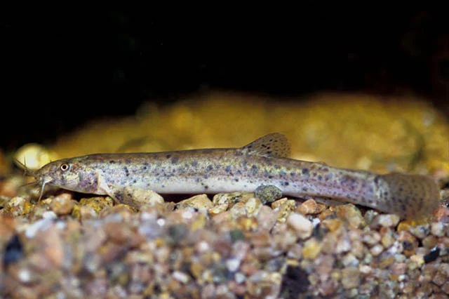
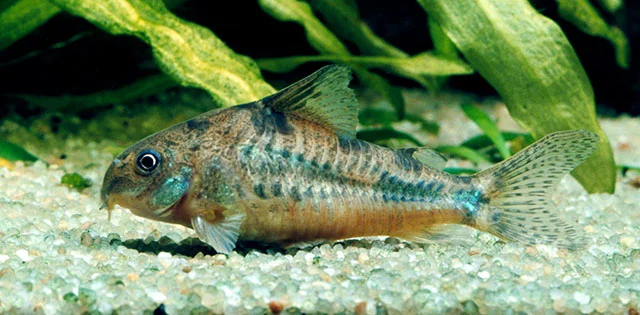

## ESTRUCTURA DE FICHA DE PEZ DULCE

---

## Peces habituales — Acuario de Agua Fría / Goldfish

---

### Goldfish Cometail / Común (Carassius auratus)

**Familia**: Cyprinidae
**Origen**: China (domesticado desde el siglo IX; pez original: Carassius auratus gibelio)
**Tamaño**: 25 – 35 cm (en acuario grande)
**Temperatura**: 10 – 20°C
**pH**: 7.0 – 8.0
**GH**: 8 – 20 °dGH
**Dureza**: media – dura
**Dificultad**: ★★☆☆☆
**Tipo de agua**: dulce fría
**Nivel de nado**: medio
**Comportamiento**: pacífico
**Mínimo de individuos**: 2+ (animal social)
**Tamaño de acuario mínimo**: 120 L por pez
**Dieta**: omnívoro
**Reproducción**: ovíparo
**Notas**: El goldfish de cuerpo alargado. Nadador rápido. Compatible solo con otros goldfish de cuerpo alargado (no mezclar con fancy goldfish de cuerpo redondo). Puede vivir más de 20 años. Produce mucha materia orgánica: filtración muy potente obligatoria (8-10x volumen/hora).

---

### Goldfish Fantail / Ryukin (Carassius auratus)

**Familia**: Cyprinidae
**Origen**: China (selección doméstica)
**Tamaño**: 15 – 20 cm
**Temperatura**: 15 – 22°C
**pH**: 7.0 – 8.0
**GH**: 8 – 20 °dGH
**Dureza**: media – dura
**Dificultad**: ★★☆☆☆
**Tipo de agua**: dulce fría
**Nivel de nado**: medio (nadador lento)
**Comportamiento**: pacífico
**Mínimo de individuos**: 2+
**Tamaño de acuario mínimo**: 80 L por pez
**Dieta**: omnívoro
**Reproducción**: ovíparo
**Notas**: Cuerpo redondeado con aleta caudal doble. Nadador lento: NO mezclar con goldfish de cuerpo alargado (les quitarán toda la comida). Más delicado que el Cometail.

---

### Goldfish Oranda (Carassius auratus)

**Familia**: Cyprinidae
**Origen**: China (selección doméstica)
**Tamaño**: 20 – 30 cm
**Temperatura**: 16 – 22°C
**pH**: 7.0 – 8.0
**GH**: 8 – 20 °dGH
**Dureza**: media – dura
**Dificultad**: ★★★☆☆
**Tipo de agua**: dulce fría
**Nivel de nado**: medio (muy lento)
**Comportamiento**: pacífico
**Mínimo de individuos**: 2+
**Tamaño de acuario mínimo**: 80 L por pez
**Dieta**: omnívoro
**Reproducción**: ovíparo
**Notas**: El "wen" (cresta carnosa en la cabeza) es su característica. El wen puede obstruir los ojos si crece en exceso. Solo con otros fancy goldfish de cuerpo redondo. Muy popular en acuariofilia oriental.

---

### Goldfish Ranchu / Lionhead (Carassius auratus)

**Familia**: Cyprinidae
**Origen**: Japón / China (selección doméstica)
**Tamaño**: 15 – 20 cm
**Temperatura**: 16 – 22°C
**pH**: 7.0 – 8.0
**GH**: 8 – 20 °dGH
**Dureza**: media – dura
**Dificultad**: ★★★☆☆
**Tipo de agua**: dulce fría
**Nivel de nado**: fondo – medio (muy lento)
**Comportamiento**: pacífico
**Mínimo de individuos**: 2+
**Tamaño de acuario mínimo**: 80 L por pez
**Dieta**: omnívoro
**Reproducción**: ovíparo
**Notas**: Sin aleta dorsal. El cruce japonés (Ranchu) y el chino (Lionhead) son similares. Nadadores muy lentos que exploran el fondo buscando comida. Muy susceptibles a infecciones bacterianas si la calidad del agua baja.

---

### Goldfish Ojo de Telescopio / Black Moor (Carassius auratus)

**Familia**: Cyprinidae
**Origen**: China (selección doméstica)
**Tamaño**: 15 – 20 cm
**Temperatura**: 16 – 22°C
**pH**: 7.0 – 8.0
**GH**: 8 – 20 °dGH
**Dureza**: media – dura
**Dificultad**: ★★★☆☆
**Tipo de agua**: dulce fría
**Nivel de nado**: medio (lento)
**Comportamiento**: pacífico
**Mínimo de individuos**: 2+
**Tamaño de acuario mínimo**: 80 L por pez
**Dieta**: omnívoro
**Reproducción**: ovíparo
**Notas**: Los ojos protrusos son frágiles: sin decoraciones con bordes afilados. Visión muy reducida: dificultades para encontrar comida con peces de visión normal. Solo con otros fancy goldfish.

---

### Loach Dojo / Loach del Tiempo (Misgurnus anguillicaudatus)

**Familia**: Cobitidae
**Origen**: Asia Oriental (China, Japón, Corea)
**Tamaño**: 25 cm
**Temperatura**: 10 – 23°C
**pH**: 6.5 – 8.0
**GH**: 5 – 15 °dGH
**Dureza**: blanda – dura
**Dificultad**: ★★☆☆☆
**Tipo de agua**: dulce fría – subtropical
**Nivel de nado**: fondo
**Comportamiento**: muy pacífico
**Mínimo de individuos**: 2+
**Tamaño de acuario mínimo**: 120 L
**Dieta**: omnívoro (tabletas, tubifex, verduras)
**Reproducción**: ovíparo
**Notas**: Compatible con goldfish en temperatura. Se vuelve inquieto antes de tormentas (detecta cambios de presión atmosférica). Necesita arena fina para excavar. Puede respirar aire atmosférico.

---

### Corydoras Paleatus (Corydoras Moteado)

**Familia**: Callichthyidae
**Origen**: Cuencas del Paraná y Uruguay (Argentina, Brasil)
**Tamaño**: 7 cm
**Temperatura**: 18 – 24°C
**pH**: 6.0 – 7.5
**GH**: 3 – 15 °dGH
**Dureza**: blanda – media
**Dificultad**: ★☆☆☆☆
**Tipo de agua**: subtropical
**Nivel de nado**: fondo
**Comportamiento**: pacífico
**Mínimo de individuos**: 6
**Tamaño de acuario mínimo**: 80 L
**Dieta**: omnívoro (detritívoro de fondo)
**Reproducción**: ovíparo
**Notas**: El Corydoras más tolerante a bajas temperaturas. Compatible con goldfish en rangos de temperatura moderados (18-22°C). Usa arena fina para no dañar los barbillones.
