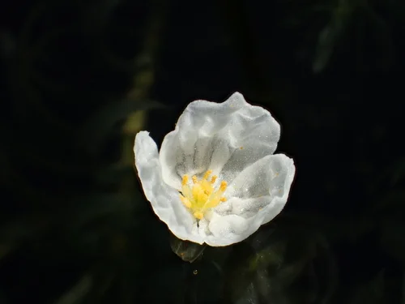

## ESTRUCTURA DE FICHA DE PLANTA

---

## Plantas — Acuario de Agua Fría / Goldfish

> **Advertencia**: Los goldfish comen o arrancan casi todas las plantas blandas. Solo sobreviven las plantas de hojas duras o las de crecimiento muy rápido.

---

### Anubias Barteri (Anubias barteri var. barteri)

**Familia**: Araceae
**Origen**: Camerún, Nigeria, Costa de Marfil
**Tamaño**: 20 – 40 cm
**Temperatura**: 20 – 30°C
**pH**: 5.5 – 9.0
**GH**: 0 – 20 °dGH
**Dificultad**: ★☆☆☆☆
**Luz**: muy baja – media
**CO2**: no necesario
**Fertilización**: baja
**Crecimiento**: muy lento
**Posición**: plano medio – trasera, fijada en roca o madera
**Sustrato**: NO enterrar
**Propagación**: división del rizoma
**Notas**: Las hojas duras y amargas disuaden a los goldfish de comerla. No siempre infalible con goldfish muy glotones. Tolera agua dura y alcalina perfectamente.

---

### Anubias Nana (Anubias barteri var. nana)

**Familia**: Araceae
**Origen**: Camerún, Nigeria
**Tamaño**: 5 – 15 cm
**Temperatura**: 20 – 30°C
**pH**: 5.5 – 9.0
**GH**: 0 – 20 °dGH
**Dificultad**: ★☆☆☆☆
**Luz**: muy baja – media
**CO2**: no necesario
**Fertilización**: baja
**Crecimiento**: muy lento
**Posición**: primer plano, fijada en roca o madera
**Sustrato**: NO enterrar
**Propagación**: división del rizoma
**Notas**: Mismos cuidados que A. barteri. Las hojas duras la protegen de los goldfish, aunque algunos ejemplares especialmente voraces la atacan de todas formas.

---

### Vallisneria Espiral (Vallisneria spiralis)

**Familia**: Hydrocharitaceae
**Origen**: Subtropical y tropical (cosmopolita)
**Tamaño**: 30 – 60 cm
**Temperatura**: 15 – 30°C
**pH**: 6.0 – 9.0
**GH**: 5 – 25 °dGH
**Dificultad**: ★☆☆☆☆
**Luz**: media
**CO2**: no necesario
**Fertilización**: baja – media
**Crecimiento**: muy rápido
**Posición**: trasera
**Sustrato**: inerte
**Propagación**: estolones laterales
**Notas**: Crece tan rápido como el goldfish la come, manteniéndose viable. Tolera perfectamente agua dura y alcalina. Buena estrategia plantarla en cantidad para que el goldfish la ramonee sin agotarla.

---

### Musgo de Java (Taxiphyllum barbieri)

**Familia**: Hypnaceae
**Origen**: Asia del Sur y Sudeste Asiático
**Tamaño**: tapiz de 2 – 5 cm
**Temperatura**: 15 – 30°C
**pH**: 5.0 – 9.0
**GH**: 0 – 20 °dGH
**Dificultad**: ★☆☆☆☆
**Luz**: muy baja – alta
**CO2**: no necesario
**Fertilización**: baja
**Crecimiento**: lento – medio
**Posición**: fijado en roca o madera
**Sustrato**: no aplica
**Propagación**: división
**Notas**: Los goldfish lo comen como complemento de la dieta. No sobrevive como ornamental principal pero puede mantenerse como snack natural. Aporta algo de naturalidad.

---

### Elodea / Hierba de Agua (Egeria densa)

**Familia**: Hydrocharitaceae
**Origen**: Brasil, Argentina
**Tamaño**: tallo hasta 3 metros (se recorta)
**Temperatura**: 10 – 26°C
**pH**: 6.0 – 8.5
**GH**: 5 – 25 °dGH
**Dificultad**: ★☆☆☆☆
**Luz**: media
**CO2**: no necesario
**Fertilización**: baja
**Crecimiento**: muy rápido
**Posición**: plano medio – trasera
**Sustrato**: inerte o flotando
**Propagación**: esquejes
**Notas**: Compatible con las bajas temperaturas del goldfish. El goldfish la come, pero crece tan rápido que se mantiene. Excelente absorbente de nitratos. Especie invasora: nunca tirar al exterior.
