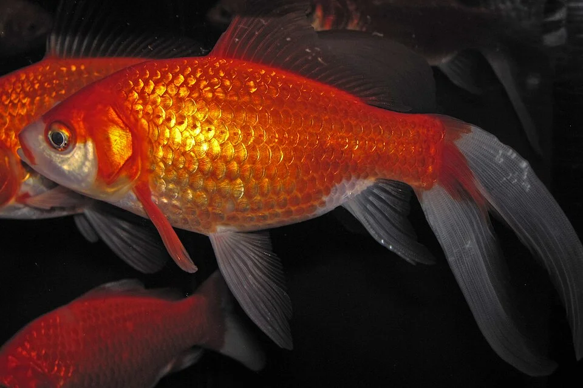

# ACUARIO DE AGUA FRÍA / GOLDFISH

**Dificultad general**: ★★☆☆☆
**Coste de setup**: bajo – medio
**Tamaño mínimo recomendado**: 80 L por pez (goldfish de cuerpo redondo), 120 L por pez (cometail, shubunkin)
**Para quién es**: principiante – intermedio (fácil de mantener pero necesita espacio y filtración potente)

---

## Descripción

Los peces de agua fría, principalmente Goldfish (Carassius auratus) y Koi (Cyprinus rubrofuscus), son los más criados en el mundo. Son resistentes pero generan grandes cantidades de desechos: necesitan acuarios grandes y filtración muy potente. Son incompatibles con peces tropicales.

---

## Parámetros del agua

| Parámetro | Rango |
|-----------|-------|
| Temperatura | 10 – 22°C (sin calefactor en clima templado) |
| pH | 7.0 – 8.0 |
| GH | 8 – 20 °dGH |
| KH | 5 – 12 °dKH |
| NH3 | 0 ppm |
| NO3 | < 40 ppm |

---

## Tipos de Goldfish y sus necesidades

| Tipo | Cuerpo | Acuario mínimo | Temperatura |
|------|--------|----------------|-------------|
| Cometail / Común | Alargado, rápido | 120 L/pez | 10-20°C |
| Shubunkin | Alargado, moteado | 120 L/pez | 10-20°C |
| Fantail / Ryukin | Redondeado | 80 L/pez | 15-22°C |
| Oranda / Ranchu / Lionhead | Muy redondeado | 80 L/pez | 16-22°C |
| Ojo de telescopio (Black Moor) | Ojos salientes | 80 L/pez | 16-22°C |

**Regla de oro**: los de cuerpo redondo (fancy goldfish) son nadadores lentos y torpes, NO mezclar con goldfish de cuerpo alargado (que nadan rápido y les comerán toda la comida).

---

## Equipamiento necesario

| Equipo | Especificaciones |
|--------|-----------------|
| Filtro | Externo o interior potente; 8-10x el volumen/hora |
| Iluminación | LED básico; 8-10h/día |
| Termómetro | Digital independiente |
| Sustrato | Grava gruesa o arena gruesa (los goldfish excavan) |
| Decoración | Rocas, raíces; plantas resistentes o artificiales |

**Nota sobre filtración:** El goldfish produce 3-5 veces más desechos que un pez tropical del mismo tamaño. Sin filtración adecuada → picos de amoniaco → muerte.

---

## Plantas en acuario de goldfish

Difícil: los goldfish comen casi todas las plantas. Opciones resistentes:
- Anubias (hojas duras, no las comen habitualmente)
- Vallisneria (crece tan rápido como la comen)
- Musgo de Java (lo comen pero como complemento de la dieta)
- Alternativa: plantas de plástico bien hechas

---

## Algas comunes — cuáles son, por qué aparecen, cómo eliminarlas

### Alga Parda / Diatomas
**Comportamiento:** Igual que en otros acuarios: aparece en los primeros meses. Los mismos goldfish la ramonean del cristal y decoración con algo de entusiasmo.
**Solución:** Esperar. Los propios goldfish la controlan parcialmente.

---

### Alga Pelo Verde (GHA)
**Comportamiento:** Con la alta carga de nutrientes del goldfish, el GHA puede proliferar rápidamente, especialmente si hay luz.
**Solución:**
- Reducir el fotoperiodo (8h máximo)
- Caracoles Nerite (para el cristal; el goldfish no puede comerlos fácilmente)
- Cambios de agua más frecuentes para bajar NO3
- Evitar luz solar directa en el acuario

---

### Alga Verde del Agua (Bloom)
**Comportamiento:** Muy frecuente en acuarios de goldfish exteriores (estanques) y en acuarios con luz solar directa. El agua se vuelve verde por las algas unicelulares.
**Nota curiosa:** En estanques exteriores el "agua verde" es benigna para los peces (los goldfish la comen como complemento). En acuarios interiores es indeseable.
**Solución:**
- Esterilizador UV (el mejor método)
- Cubrir el acuario de la luz solar directa
- Cambios de agua + plantas flotantes que compitan por nutrientes

---

### Cianobacterias
**Comportamiento:** Frecuentes por el alto nitrato y la carga orgánica. Temperaturas más bajas del agua fría ralentizan su crecimiento pero no lo impiden.
**Solución:** Mejor filtración, aspirar fondo exhaustivamente, mejorar la circulación.

---

## Errores más comunes

- Acuario demasiado pequeño (el error más común): los fancy goldfish necesitan al menos 80L POR PEZ
- Mezclar goldfish con peces tropicales (incompatibles en temperatura)
- Filtración insuficiente para la carga orgánica del goldfish
- Sobrealimentar (son comedores voraces que siempre parecen tener hambre)
- Usar agua muy blanda o ácida (prefieren agua dura y alcalina)

---

## Consejos clave

- Más espacio siempre es mejor: cuantos más litros por pez, más sano estará
- La filtración es más crítica que en cualquier otro tipo de acuario dulce
- Los goldfish de cuerpo redondeado (fancy) son más delicados que los de cuerpo alargado
- Alimentar pequeñas cantidades varias veces al día mejor que una cantidad grande
- Revisar amoniaco y nitritos semanalmente los primeros meses
