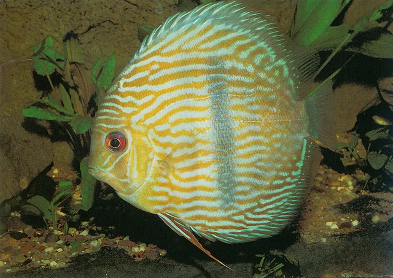
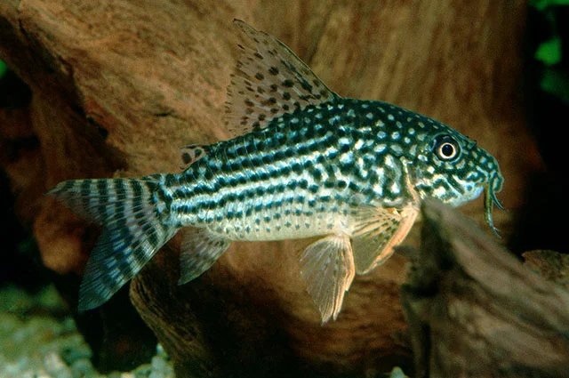

## ESTRUCTURA DE FICHA DE PEZ DULCE

---

## Peces habituales — Acuario de Discus

Peces compatibles con las exigentes condiciones del acuario de Discus: agua blanda, muy ácida y temperatura de 28-32°C. La lista de compatibles es muy corta.

---

### Disco (Symphysodon spp.)

**Familia**: Cichlidae
**Origen**: Cuenca Amazónica (Río Negro, Tapajós, Tefé)
**Tamaño**: 20 cm
**Temperatura**: 28 – 32°C
**pH**: 5.5 – 6.8
**GH**: 0 – 4 °dGH
**Dureza**: muy blanda
**Dificultad**: ★★★★★
**Tipo de agua**: dulce tropical (agua negra)
**Nivel de nado**: medio
**Comportamiento**: pacífico (jerarquía interna entre ellos)
**Mínimo de individuos**: 5 – 6
**Tamaño de acuario mínimo**: 250 L (acuario alto)
**Dieta**: carnívoro – omnívoro
**Reproducción**: ovíparo (guardianes del sustrato; crías se alimentan del moco parental)
**Notas**: El rey del acuario tropical. Las crías se alimentan durante 2 semanas del slime coat (moco) de los padres: no separar la familia. Cambios de agua del 30% cada 2-3 días. La temperatura de 30°C limita mucho las plantas compatibles. Muchas variedades: cobalt blue, red turquoise, pigeon blood, leopard.

---

### Corydoras Sterbai (Corydoras de Sterba)

**Familia**: Callichthyidae
**Origen**: Río Guaporé (Brasil, Bolivia)
**Tamaño**: 6.5 cm
**Temperatura**: 26 – 30°C
**pH**: 6.0 – 7.5
**GH**: 2 – 12 °dGH
**Dureza**: blanda – media
**Dificultad**: ★★☆☆☆
**Tipo de agua**: dulce tropical
**Nivel de nado**: fondo
**Comportamiento**: pacífico
**Mínimo de individuos**: 6
**Tamaño de acuario mínimo**: 80 L
**Dieta**: omnívoro (detritívoro de fondo)
**Reproducción**: ovíparo
**Notas**: **El único Corydoras que aguanta las temperaturas del acuario de Discus (28-30°C).** Patrón de puntos blancos sobre fondo oscuro con aletas naranja. Imprescindible como limpiador del fondo en el Discus.

---

### Neón Cardinal (Paracheirodon axelrodi)

**Familia**: Characidae
**Origen**: Río Negro y Orinoco (Venezuela, Brasil)
**Tamaño**: 5 cm
**Temperatura**: 23 – 28°C
**pH**: 4.5 – 7.0
**GH**: 0 – 6 °dGH
**Dureza**: muy blanda
**Dificultad**: ★★☆☆☆
**Tipo de agua**: dulce tropical
**Nivel de nado**: medio
**Comportamiento**: pacífico
**Mínimo de individuos**: 10+
**Tamaño de acuario mínimo**: 80 L
**Dieta**: omnívoro
**Reproducción**: ovíparo
**Notas**: El único tetra realmente compatible con el Discus en agua muy blanda y ácida. Los Discus no suelen comerlos si son adultos (>2 cm). Espectacular en banco denso bajo la "sombrilla" del Discus.

---

### Ancistrus sp.

**Familia**: Loricariidae
**Origen**: Sudamérica
**Tamaño**: 12 – 15 cm
**Temperatura**: 23 – 27°C
**pH**: 6.0 – 7.5
**GH**: 2 – 15 °dGH
**Dureza**: blanda – media
**Dificultad**: ★☆☆☆☆
**Tipo de agua**: dulce tropical
**Nivel de nado**: fondo
**Comportamiento**: pacífico
**Mínimo de individuos**: 1
**Tamaño de acuario mínimo**: 80 L
**Dieta**: herbívoro – omnívoro (algívoro)
**Reproducción**: ovíparo (cueva)
**Notas**: Compatible con el Discus si la temperatura no supera los 27-28°C. Limpia el cristal de algas. Necesita madera. La temperatura alta del acuario de Discus está en el límite superior del rango del Ancistrus.
