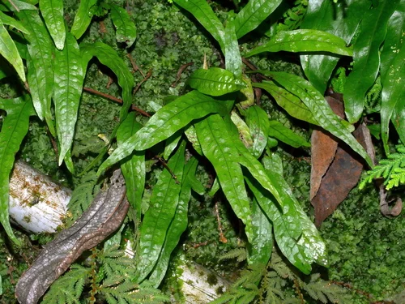

## ESTRUCTURA DE FICHA DE PLANTA

---

## Plantas — Acuario de Discus

Las altas temperaturas (28-32°C) limitan enormemente las plantas viables. Solo las plantas más resistentes al calor sobreviven en el acuario de Discus.

> **Nota importante**: La mayoría de plantas acuáticas tienen un máximo de 28°C. Por encima de esa temperatura las plantas se debilitan y las algas proliferan. El acuario de Discus planta es un setup avanzado y comprometido.

---

### Anubias Nana (Anubias barteri var. nana)

**Familia**: Araceae
**Origen**: Camerún, Nigeria
**Tamaño**: 5 – 15 cm
**Temperatura**: 20 – 30°C
**pH**: 5.5 – 9.0
**GH**: 0 – 20 °dGH
**Dificultad**: ★☆☆☆☆
**Luz**: muy baja – media
**CO2**: no necesario
**Fertilización**: baja
**Crecimiento**: muy lento
**Posición**: fijada en roca o madera
**Sustrato**: NO enterrar
**Propagación**: división del rizoma
**Notas**: Una de las pocas plantas que tolera 30°C. El rizoma nunca se entierra. Crece despacio pero es muy estable. Puede acumular GSA con exceso de luz.

---

### Musgo de Java (Taxiphyllum barbieri)

**Familia**: Hypnaceae
**Origen**: Asia del Sur y Sudeste Asiático
**Tamaño**: tapiz de 2 – 5 cm
**Temperatura**: 15 – 30°C
**pH**: 5.0 – 9.0
**GH**: 0 – 20 °dGH
**Dificultad**: ★☆☆☆☆
**Luz**: muy baja – alta
**CO2**: no necesario
**Fertilización**: baja
**Crecimiento**: lento
**Posición**: fijado en roca o madera
**Sustrato**: no aplica
**Propagación**: división
**Notas**: Tolera hasta 30°C. Crece algo más lento a alta temperatura. Esencial para crías de Discus.

---

### Helecho de Java (Microsorum pteropus)

**Familia**: Polypodiaceae
**Origen**: Sudeste Asiático
**Tamaño**: 20 – 50 cm
**Temperatura**: 18 – 30°C
**pH**: 5.0 – 8.0
**GH**: 0 – 20 °dGH
**Dificultad**: ★☆☆☆☆
**Luz**: muy baja – media
**CO2**: no necesario
**Fertilización**: baja
**Crecimiento**: lento
**Posición**: plano medio – trasera, fijado
**Sustrato**: NO enterrar
**Propagación**: división del rizoma
**Notas**: Tolera hasta 30°C. Una de las pocas plantas de tamaño medio viable en el Discus.

---

> **Para un Discus sin plantas**: Muchos criadores profesionales mantienen los Discus en acuarios sin plantas (bare bottom o con fondo desnudo) para facilitar la limpieza y los cambios de agua frecuentes. Esta es una opción completamente válida y común.
