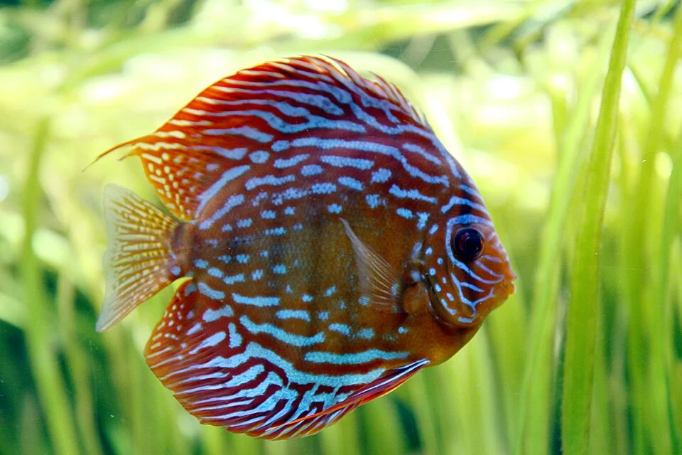

# ACUARIO DE DISCUS

**Dificultad general**: ★★★★★
**Coste de setup**: alto – muy alto
**Tamaño mínimo recomendado**: 250 L (alto, mínimo 50 cm de altura)
**Para quién es**: experto con experiencia previa en ciclidos

---

## Descripción

El acuario más exigente de agua dulce. El Discus (Symphysodon spp.) es el "rey" del acuario tropical: un pez extraordinariamente bello, con un comportamiento social complejo y crías que se alimentan del propio moco de sus padres. Requiere agua blanda, muy ácida y caliente, con cambios frecuentes y altos estándares de calidad.

---

## Parámetros del agua

| Parámetro | Rango |
|-----------|-------|
| Temperatura | 28 – 32°C |
| pH | 5.5 – 6.8 |
| GH | 0 – 6 °dGH |
| KH | 0 – 3 °dKH |
| NH3 | 0 ppm (tolerancia cero) |
| NO2 | 0 ppm |
| NO3 | < 10 ppm (idealmente < 5) |

---

## Equipamiento necesario

- Filtro externo potente (Eheim Pro, Fluval) + prefiltro para carga orgánica
- Calefactor de titanio fiable (doble calefactor recomendado para seguridad)
- Sistema de osmosis inversa (el agua dura es incompatible)
- UV esterilizador (reduce patógenos en agua cálida)
- Termómetro digital independiente
- Sustrato de arena fina oscura (reduce el estrés; fondo oscuro intensifica los colores)

---

## Protocolo de cambios de agua

- **30% cada 2-3 días** como mínimo
- Muchos criadores hacen 50% diario
- El agua nueva debe estar a la MISMA temperatura (el choque térmico es letal)
- Usar agua RODI remineralizada con minerales para agua blanda

---

## Compañeros compatibles

Pocos peces toleran 30°C: **Corydoras sterbai** (el único Corydoras que aguanta esa temperatura), Ancistrus, y tetras cardinals (si el pH es compatible). Los peces payaso de agua dulce (Botia) NO toleran estas temperaturas.

---

## Algas comunes — cuáles son, por qué aparecen, cómo eliminarlas

Las temperaturas altas y el agua blanda y ácida crean un entorno donde las algas se comportan de forma algo diferente.

### Alga Parda / Diatomas
**Comportamiento en Discus:** Aparece como en cualquier acuario nuevo pero tiende a persistir más en agua muy blanda y ácida (las bacterias nitrificantes también se establecen más despacio). Los cambios de agua frecuentes la controlan bien.
**Solución:** Otocinclus, cambios de agua, limpiar cristal regularmente.

---

### Cianobacterias
**Comportamiento en Discus:** Frecuentes en este tipo de acuario por los altos niveles de materia orgánica (el Discus es sucio y comer mucho es esencial). Las temperaturas altas favorecen su proliferación.
**Solución:** Aumentar la circulación del agua. Cambios de agua más frecuentes. Aspirar el fondo exhaustivamente en cada cambio. Reducir la alimentación.

---

### GHA (Alga Pelo Verde)
**Comportamiento en Discus:** Si aparece, se desarrolla rápidamente con la luz y temperatura altas. Los Discus no son comedores de algas.
**Solución:** Reducir fotoperiodo. Introducir Otocinclus o gambas Amano si la temperatura lo permite.

---

## Enfermedades relacionadas con la calidad del agua

- **Ennegrecer del cuerpo**: primer síntoma de estrés (NO3 alto, cambio de temperatura, pez nuevo)
- **HLLE**: hoyo en la cabeza — déficit nutricional + calidad de agua baja + Hexamita
- **Lombriz de la cabeza (Hexamita)**: muy común en Discus; tratamiento con metronidazol

---

## Errores más comunes

- Agua del grifo sin tratar (necesita RODI obligatoriamente)
- NO3 alto (toleran muy mal los nitratos; < 10 ppm es clave)
- Temperatura demasiado baja (< 28°C causa problemas inmunológicos)
- Sobrecargar el acuario (son sucios; menos peces de los que parece posible)
- Mezclar con peces incompatibles en temperatura

---

## Consejos clave

- El Discus es el pez que más estrés causa al acuarista: solo para personas con mucha experiencia y tiempo
- El acuario de Discus sin plantas es más fácil de mantener (facilita cambios de agua frecuentes)
- Comprar Discus criados en cautividad: más resistentes y adaptados al agua del grifo tratada
- Los cambios de agua son más importantes que cualquier otro aspecto del mantenimiento
- Siempre mantener el termómetro digital independiente para detectar fallos del calefactor
