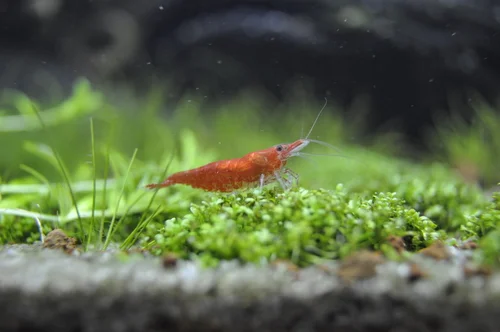
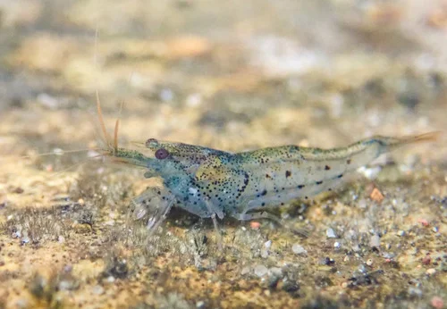

## ESTRUCTURA DE FICHA DE INVERTEBRADO

```
### Nombre Común (Nombre científico)
**Familia**:
**Origen**:
**Tamaño**: adulto
**Temperatura**: °C
**pH**:
**GH / KH / TDS**: (agua dulce) o Salinidad (marino)
**Dificultad**: ★ a ★★★★★
**Tipo de agua**: dulce / marino / salobre
**Comportamiento**: pacífico / semiagrresivo / agresivo
**Compatible con peces**: sí / no / depende (indicar cuáles)
**Dieta**: detritívoro / algívoro / carnívoro / omnívoro / filtrador
**Reproducción**: breve descripción
**Notas**:
```

---

## Invertebrados — Acuario de Gambas

> El acuario de gambas está diseñado para que los invertebrados sean los protagonistas. Se distinguen dos grandes grupos según sus requerimientos de agua: **Neocaridina** (agua neutra a dura) y **Caridina** (agua blanda y ácida con sustrato activo). No mezclar gambas de distintas variedades de la misma especie para evitar cruzamientos que diluyan el color.

---

## Gambas Neocaridina (agua neutra – dura)

### Cherry Shrimp / Gamba Cherry (Neocaridina davidi "Red")


**Familia**: Atyidae
**Origen**: Taiwán (selección doméstica desde N. davidi silvestre de China)
**Tamaño**: 2 – 3 cm (hembra ligeramente más grande)
**Temperatura**: 16 – 26°C (óptimo 20-24°C)
**pH**: 6.8 – 7.8
**GH / KH / TDS**: GH 6-10 °dGH / KH 2-8 °dKH / TDS 150-250 ppm
**Dificultad**: ★☆☆☆☆
**Tipo de agua**: dulce
**Comportamiento**: pacífico
**Compatible con peces**: solo con nano-peces de boca muy pequeña (Boraras, Celestichthys); cualquier pez mayor la cazará
**Dieta**: omnívora detritívora (biofilm, algas, restos vegetales, pellets)
**Reproducción**: ovípara; hembra lleva huevos bajo el abdomen 3-4 semanas; crías idénticas a adultos pero en miniatura
**Notas**: La gamba más popular y fácil del hobby. Se reproduce sin intervención. El rojo es más intenso en hembras adultas sanas. Gradación de calidad: Sakura < Cherry < Fire Red < Painted Fire Red (según densidad de color). El macho es más pequeño, transparente o ligeramente rosado. Sustrato inerte recomendado. Las gambas ramonean constantemente sobre musgo y plantas buscando biofilm.

---

### Blue Velvet (Neocaridina davidi "Blue Velvet")


**Familia**: Atyidae
**Origen**: Selección doméstica de N. davidi
**Tamaño**: 2 – 3 cm
**Temperatura**: 16 – 26°C
**pH**: 6.8 – 7.8
**GH / KH / TDS**: GH 6-10 / KH 2-8 / TDS 150-250 ppm
**Dificultad**: ★☆☆☆☆
**Tipo de agua**: dulce
**Comportamiento**: pacífico
**Compatible con peces**: igual que Cherry Shrimp
**Dieta**: omnívora detritívora
**Reproducción**: igual que Cherry Shrimp
**Notas**: Mismos cuidados exactos que la Cherry Red. El azul intenso es más difícil de obtener que el rojo. Los especímenes de calidad "Blue Dream" son más caros. No mezclar con otras variedades Neocaridina para mantener la línea de color (los cruces producen gambas transparentes o marrones).

---

### Yellow Fire Shrimp (Neocaridina davidi "Yellow")


**Familia**: Atyidae
**Origen**: Selección doméstica
**Tamaño**: 2 – 3 cm
**Temperatura**: 16 – 26°C
**pH**: 6.8 – 7.8
**GH / KH / TDS**: GH 6-10 / KH 2-8 / TDS 150-250 ppm
**Dificultad**: ★☆☆☆☆
**Tipo de agua**: dulce
**Comportamiento**: pacífico
**Compatible con peces**: igual que Cherry Shrimp
**Dieta**: omnívora detritívora
**Reproducción**: igual que Cherry Shrimp
**Notas**: Amarillo limón brillante, especialmente vistosa sobre sustratos oscuros. Mismos cuidados que Cherry Red. Los especímenes de mayor calidad tienen el amarillo sólido sin transparencias. No mezclar con otras variedades Neocaridina.

---

## Gambas Caridina (agua blanda y ácida — sustrato activo)

### Crystal Red Bee / CRS (Caridina cantonensis "Crystal Red")


**Familia**: Atyidae
**Origen**: Selección doméstica de Caridina cantonensis (China/Japón)
**Tamaño**: 2 – 3 cm
**Temperatura**: 22 – 25°C
**pH**: 6.2 – 6.8
**GH / KH / TDS**: GH 4-6 °dGH / KH 0-1 °dKH / TDS 100-150 ppm
**Dificultad**: ★★★★☆
**Tipo de agua**: dulce (agua blanda y ligeramente ácida)
**Comportamiento**: pacífico
**Compatible con peces**: ningún pez; solo acuario dedicado a gambas
**Dieta**: omnívora detritívora (biofilm, algas, hojas de catappa, pellets específicos)
**Reproducción**: ovípara; hembra lleva huevos 4-5 semanas; camadas de 15-30 crías
**Notas**: Requiere sustrato activo (ADA Amazonia, Tropica Soil, Fluval Stratum) que acidifica y ablanda el agua. Sin sustrato activo el mantenimiento de parámetros es muy difícil. El sustrato pierde buffering en 12-18 meses y debe renovarse. Clasificación de calidad: SSS > SS > S > A > B > C. Extremadamente sensibles al cobre (incluso en trazas): nunca usar medicamentos con cobre ni agua de tuberías de cobre sin verificar.

---

### Crystal Black Bee / CBS (Caridina cantonensis "Crystal Black")


**Familia**: Atyidae
**Origen**: Selección doméstica de Caridina cantonensis
**Tamaño**: 2 – 3 cm
**Temperatura**: 22 – 25°C
**pH**: 6.2 – 6.8
**GH / KH / TDS**: GH 4-6 / KH 0-1 / TDS 100-150 ppm
**Dificultad**: ★★★★☆
**Tipo de agua**: dulce (agua blanda y ácida)
**Comportamiento**: pacífico
**Compatible con peces**: ninguno; acuario mono-especie
**Dieta**: omnívora detritívora
**Reproducción**: igual que CRS
**Notas**: Mismos cuidados y requerimientos que la CRS. Blanco y negro en vez de rojo y blanco. La misma clasificación de calidad (SSS-C). Se pueden mantener CRS y CBS juntos; se cruzan entre sí produciendo variedades mezcladas.

---

### Taiwan Bee — Blue Bolt (Caridina cantonensis "Blue Bolt")
**Familia**: Atyidae
**Origen**: Selección doméstica compleja (cruce de Crystal Red y Crystal Black)
**Tamaño**: 2 – 3 cm
**Temperatura**: 22 – 25°C
**pH**: 6.0 – 6.8
**GH / KH / TDS**: GH 4-6 / KH 0-1 / TDS 100-140 ppm
**Dificultad**: ★★★★★
**Tipo de agua**: dulce (agua ultra pura)
**Comportamiento**: pacífico
**Compatible con peces**: ninguno; acuario mono-especie
**Dieta**: omnívora detritívora
**Reproducción**: ovípara; camadas pequeñas (10-20 crías)
**Notas**: Color azul y blanco muy llamativo. Las Taiwan Bee (Panda, King Kong, Blue Bolt, Shadow Panda) son los más valorados del hobby. Requieren agua aún más pura que las CBS/CRS. Sustrato activo de alta calidad imprescindible. Solo para expertos en gambas Caridina con experiencia previa en CBS.

---

## Gambas de apoyo y limpieza

### Amano Shrimp / Gamba de Amano (Caridina multidentata)


**Familia**: Atyidae
**Origen**: Japón, Corea, China (ríos costeros)
**Tamaño**: 4 – 5 cm
**Temperatura**: 18 – 26°C
**pH**: 6.0 – 7.5
**GH / KH / TDS**: GH 4-14 / KH 2-10 / TDS 100-300 ppm
**Dificultad**: ★★☆☆☆
**Tipo de agua**: dulce (ciclo larval marino)
**Comportamiento**: pacífico
**Compatible con peces**: peces pacíficos que no la persigan; no apta con gambas Caridina exigentes (parámetros distintos)
**Dieta**: principalmente algívora (algas filamentosas, GSA, BBA) y detritívora
**Reproducción**: ovípara; larvas requieren agua marina — no se reproducen en acuario dulce
**Notas**: La mejor comedora de algas del acuario de agua dulce. Come algas filamentosas, punto verde y BBA con gran eficiencia. No se reproducen en agua dulce (hay que comprar adultos). Más grandes y activas que Neocaridina. Muy apreciadas en aquascapes para control de algas.

---

### Ghost Shrimp / Gamba Fantasma (Palaemonetes paludosus)


**Familia**: Palaemonidae
**Origen**: Norteamérica del Este (ríos del sureste de EEUU)
**Tamaño**: 3 – 5 cm
**Temperatura**: 18 – 28°C
**pH**: 7.0 – 8.0
**GH / KH / TDS**: GH 6-15 / KH 3-8 / TDS 150-400 ppm
**Dificultad**: ★☆☆☆☆
**Tipo de agua**: dulce
**Comportamiento**: pacífico – semiagrresivo (puede cazar peces muy pequeños o enfermos)
**Compatible con peces**: peces medianos y grandes que no la coman; NO con gambas Neocaridina pequeñas (puede atacarlas)
**Dieta**: omnívora oportunista
**Reproducción**: ovípara; crías con fase larval planctónica (difícil de criar)
**Notas**: Completamente transparente. Muy barata y resistente. En acuarios de gambas pequeñas puede resultar un predador. Usada frecuentemente como alimento vivo para peces grandes. Menos ornamental que Neocaridina y Caridina. Tolerante a parámetros amplios.
