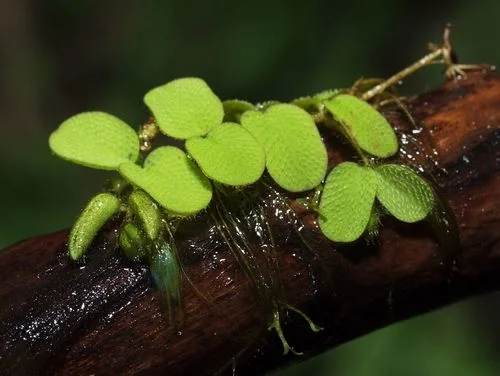
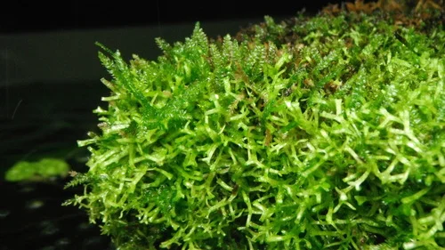

## ESTRUCTURA DE FICHA DE PLANTA

```
### Nombre Común (Nombre científico)
**Familia**:
**Origen**:
**Tamaño**: altura máxima en acuario
**Temperatura**: °C
**pH**:
**GH**: °dGH
**Dificultad**: ★ a ★★★★★
**Luz**: muy baja / baja / media / alta / muy alta
**CO2**: no necesario / recomendable / imprescindible
**Fertilización**: baja / media / alta
**Crecimiento**: muy lento / lento / medio / rápido / muy rápido
**Posición**: primer plano / plano medio / trasera / flotante / fijada en roca o madera
**Sustrato**: inerte / nutritivo recomendado / nutritivo imprescindible
**Propagación**: esquejes / estolones / rizoma / esporas
```

---

## Plantas — Acuario de Gambas

> Las plantas son fundamentales en el acuario de gambas: el biofilm que crece sobre hojas y musgos es su principal fuente de alimento. Las gambas ramonean constantemente sobre superficies vegetales. Plantas de hoja fina y musgos son los más valorados.

---

### Musgo de Java (Taxiphyllum barbieri)


**Familia**: Hypnaceae
**Origen**: Asia del Sur y Sudeste Asiático
**Tamaño**: tapiz de 2 – 5 cm
**Temperatura**: 15 – 30°C
**pH**: 5.0 – 9.0
**GH**: 0 – 20 °dGH
**Dificultad**: ★☆☆☆☆
**Luz**: muy baja – alta
**CO2**: no necesario
**Fertilización**: baja
**Crecimiento**: lento – medio
**Posición**: fijado en roca, madera o como tapiz de fondo
**Sustrato**: no aplica
**Propagación**: división
**Notas**: La planta más importante del acuario de gambas. El biofilm que coloniza sus filamentos es el alimento principal de las gambas y crías. Las crías recién nacidas encuentran refugio y comida en el musgo. Imprescindible.

---

### Anubias Nana (Anubias barteri var. nana)


**Familia**: Araceae
**Origen**: Camerún, Nigeria
**Tamaño**: 5 – 15 cm
**Temperatura**: 20 – 30°C
**pH**: 5.5 – 9.0
**GH**: 0 – 20 °dGH
**Dificultad**: ★☆☆☆☆
**Luz**: muy baja – media
**CO2**: no necesario
**Fertilización**: baja
**Crecimiento**: muy lento
**Posición**: primer plano – plano medio, fijada en roca o madera
**Sustrato**: NO enterrar
**Propagación**: división del rizoma
**Notas**: Las gambas ramonean constantemente sobre las hojas de Anubias buscando biofilm. Tolera parámetros amplios, compatible tanto con Neocaridina como con Caridina. No enterrar el rizoma.

---

### Helecho de Java (Microsorum pteropus)


**Familia**: Polypodiaceae
**Origen**: Sudeste Asiático
**Tamaño**: 20 – 50 cm
**Temperatura**: 18 – 30°C
**pH**: 5.0 – 8.0
**GH**: 0 – 20 °dGH
**Dificultad**: ★☆☆☆☆
**Luz**: muy baja – media
**CO2**: no necesario
**Fertilización**: baja
**Crecimiento**: lento
**Posición**: plano medio – trasera, fijado en roca o madera
**Sustrato**: NO enterrar
**Propagación**: división del rizoma; plántulas en hojas maduras
**Notas**: Muy resistente y de hoja robusta. Las gambas y crías se esconden entre sus frondes. Compatible con todos los parámetros de gambas dulceacuícolas.

---

### Cryptocoryne Wendtii (Cryptocoryne wendtii)


**Familia**: Araceae
**Origen**: Sri Lanka
**Tamaño**: 10 – 30 cm
**Temperatura**: 20 – 30°C
**pH**: 6.0 – 8.0
**GH**: 2 – 18 °dGH
**Dificultad**: ★☆☆☆☆
**Luz**: muy baja – media
**CO2**: no necesario
**Fertilización**: baja (principalmente raíces)
**Crecimiento**: lento
**Posición**: plano medio
**Sustrato**: nutritivo recomendado
**Propagación**: estolones laterales
**Notas**: Excelente para el fondo del acuario de gambas. Las hojas anchas ofrecen superficie para biofilm. Los estolones y raíces crean escondites entre la grava. Compatible con Neocaridina; para Caridina exigente asegurar pH correcto.

---

### Salvinia (Salvinia natans / S. auriculata)


**Familia**: Salviniaceae
**Origen**: Europa, Asia, América (cosmopolita)
**Tamaño**: hojas de 1 – 2 cm; se extiende por la superficie
**Temperatura**: 18 – 30°C
**pH**: 5.5 – 8.0
**GH**: 0 – 15 °dGH
**Dificultad**: ★☆☆☆☆
**Luz**: media – alta
**CO2**: no necesario
**Fertilización**: baja (absorbe directamente del agua)
**Crecimiento**: muy rápido
**Posición**: flotante
**Sustrato**: no aplica
**Propagación**: división
**Notas**: Planta flotante que filtra nitratos, reduce la luz (útil para gambas que prefieren poca luz) y crea zonas de refugio en la superficie. Las gambas suben a la superficie a forrajear en las raíces. Controlar para que no cubra toda la superficie e impida el intercambio gaseoso.

---

### Musgo Navidad / Christmas Moss (Vesicularia montagnei)


**Familia**: Hypnaceae
**Origen**: Asia tropical
**Tamaño**: tapiz de 3 – 8 cm
**Temperatura**: 20 – 28°C
**pH**: 5.5 – 7.5
**GH**: 0 – 12 °dGH
**Dificultad**: ★★☆☆☆
**Luz**: baja – media
**CO2**: recomendable
**Fertilización**: baja
**Crecimiento**: lento
**Posición**: fijado en roca o madera, o como tapiz
**Sustrato**: no aplica
**Propagación**: división
**Notas**: Sus ramas en forma de árbol de Navidad lo hacen muy ornamental. Muy apreciado en acuarios de gambas de alta gama (Caridina). Produce más biofilm que el Musgo de Java por la mayor superficie específica de sus filamentos.
