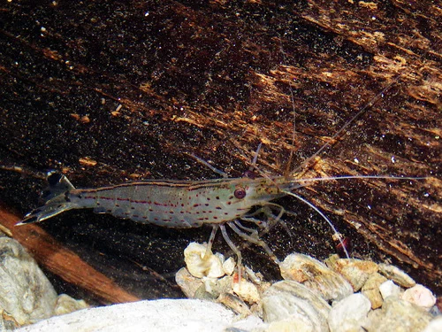

## ESTRUCTURA DE FICHA DE INVERTEBRADO

---

## Invertebrados habituales — Acuario Dulce Tropical de Comunidad

---

### Cherry Shrimp / Gamba Cherry (Neocaridina davidi "Red")

**Familia**: Atyidae
**Origen**: Taiwán
**Tamaño**: 2 – 3 cm
**Temperatura**: 16 – 26°C (óptimo 20-24°C)
**pH**: 6.8 – 7.8
**GH / KH / TDS**: GH 6-10 °dGH / KH 2-8 °dKH / TDS 150-250 ppm
**Dificultad**: ★☆☆☆☆
**Tipo de agua**: dulce
**Comportamiento**: pacífico
**Compatible con peces**: Solo peces muy pequeños (Boraras, Danio margaritatus). Cualquier pez > 3 cm puede comerla.
**Dieta**: omnívora detritívora (biofilm, algas, restos vegetales, pellets)
**Reproducción**: ovípara; la hembra lleva los huevos bajo el abdomen 3-4 semanas
**Notas**: La gamba más popular y fácil. Se reproduce sin intervención. El musgo de Java es fundamental para su bienestar. No mezclar con otras variedades Neocaridina para mantener la línea de color.

---

### Amano Shrimp / Gamba de Amano (Caridina multidentata)

**Familia**: Atyidae
**Origen**: Japón, Corea, China
**Tamaño**: 4 – 5 cm
**Temperatura**: 18 – 26°C
**pH**: 6.0 – 7.5
**GH / KH / TDS**: GH 4-14 / KH 2-10 / TDS 100-300 ppm
**Dificultad**: ★★☆☆☆
**Tipo de agua**: dulce
**Comportamiento**: pacífico
**Compatible con peces**: peces pacíficos que no la persigan
**Dieta**: principalmente algívora (algas filamentosas, BBA, GSA) y detritívora
**Reproducción**: ovípara; las larvas requieren agua marina → no se reproducen en dulce
**Notas**: La mejor comedora de algas de agua dulce. Come GHA, punto verde y BBA. No se reproduce en agua dulce: hay que comprarlas directamente. Popularizadas por Takashi Amano.

---

### Caracol Nerite (Neritina spp.)

**Familia**: Neritidae
**Origen**: Indo-Pacífico, ríos tropicales
**Tamaño**: 1 – 2.5 cm
**Temperatura**: 22 – 28°C
**pH**: 6.5 – 8.5
**GH / KH / TDS**: GH 6-18 / KH 4-10
**Dificultad**: ★☆☆☆☆
**Tipo de agua**: dulce
**Comportamiento**: pacífico
**Compatible con peces**: todos (no los comen por el opérculo duro)
**Dieta**: algívoro (algas pegadas al cristal, diatomas)
**Reproducción**: pone huevos blancos en el cristal y decoración (no eclosionan en agua dulce)
**Notas**: El mejor caracol para control de algas en cristal y decoración. Los huevos son inestéticos pero inofensivos y no se reproducen en agua dulce. Variedades: Zebra, Tiger, Olive, Horned.

---

### Caracol Misterio (Pomacea bridgesii)

**Familia**: Ampullariidae
**Origen**: Bolivia, Brasil, Paraguay
**Tamaño**: 3 – 6 cm de diámetro
**Temperatura**: 20 – 28°C
**pH**: 7.0 – 8.0
**GH / KH / TDS**: GH 8-18 / KH 5-12
**Dificultad**: ★☆☆☆☆
**Tipo de agua**: dulce
**Comportamiento**: pacífico
**Compatible con peces**: todos los peces pacíficos
**Dieta**: detritívoro y algívoro (come restos de comida, algas, vegetales muertos)
**Reproducción**: pone masas de huevos rosados fuera del agua; se pueden retirar si no se desea reproducción
**Notas**: Gran limpiador del fondo. No come plantas sanas a diferencia de otros caracoles. Colores: dorado, azul, morado, blanco. Necesita acceso al aire sobre el agua. Sensible al cobre.
