## ESTRUCTURA DE FICHA DE PEZ DULCE

---

## Peces habituales — Acuario Dulce Tropical de Comunidad

---

### Neón Común (Paracheirodon innesi)

**Familia**: Characidae
**Origen**: Afluentes del Amazonas (Perú, Brasil, Colombia)
**Tamaño**: 4 cm
**Temperatura**: 20 – 26°C
**pH**: 5.5 – 7.5
**GH**: 1 – 10 °dGH
**Dureza**: blanda – media
**Dificultad**: ★☆☆☆☆
**Tipo de agua**: dulce tropical
**Nivel de nado**: medio
**Comportamiento**: pacífico
**Mínimo de individuos**: 6 (mejor 10+)
**Tamaño de acuario mínimo**: 60 L
**Dieta**: omnívoro
**Reproducción**: ovíparo
**Notas**: La banda azul iridiscente y la franja roja solo brillan con buena iluminación y fondo oscuro. Muy sensible al síndrome del neón (microsporidiosis). La franja roja solo llega hasta la mitad del cuerpo (a diferencia del Cardinal).

---

### Neón Cardinal (Paracheirodon axelrodi)
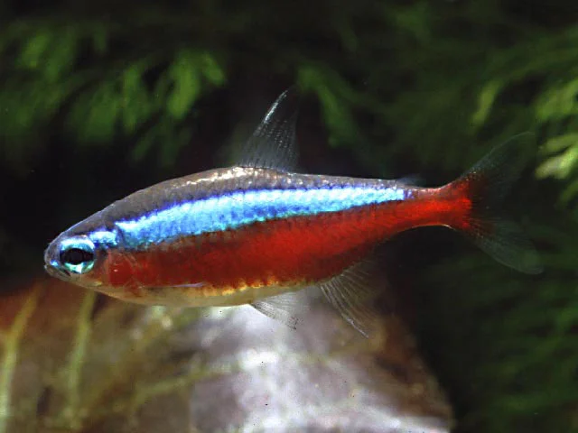

**Familia**: Characidae
**Origen**: Río Negro y Orinoco (Venezuela, Brasil)
**Tamaño**: 5 cm
**Temperatura**: 23 – 28°C
**pH**: 4.5 – 7.0
**GH**: 0 – 6 °dGH
**Dureza**: muy blanda
**Dificultad**: ★★☆☆☆
**Tipo de agua**: dulce tropical
**Nivel de nado**: medio
**Comportamiento**: pacífico
**Mínimo de individuos**: 6 – 10
**Tamaño de acuario mínimo**: 80 L
**Dieta**: omnívoro
**Reproducción**: ovíparo
**Notas**: La franja roja llega hasta la nariz. Espectacular en banco con madera y poca luz. Más sensible a parámetros que el Neón Común.

---

### Tetra de Fuego (Hyphessobrycon flammeus)
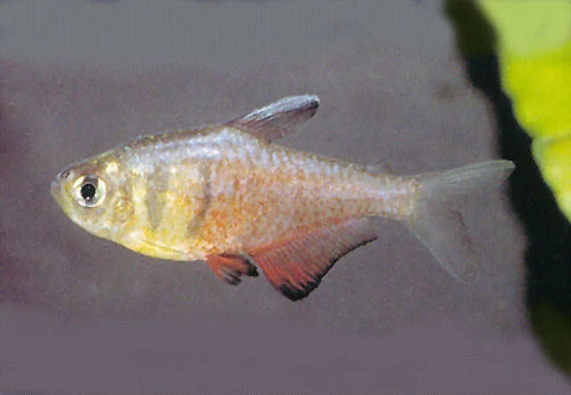

**Familia**: Characidae
**Origen**: Río de Janeiro (Brasil)
**Tamaño**: 4 cm
**Temperatura**: 22 – 28°C
**pH**: 6.0 – 7.5
**GH**: 2 – 15 °dGH
**Dureza**: blanda – media
**Dificultad**: ★☆☆☆☆
**Tipo de agua**: dulce tropical
**Nivel de nado**: medio
**Comportamiento**: pacífico (puede mordisquear aletas largas)
**Mínimo de individuos**: 6
**Tamaño de acuario mínimo**: 60 L
**Dieta**: omnívoro
**Reproducción**: ovíparo
**Notas**: Uno de los tetras más resistentes. La parte trasera del cuerpo es roja-anaranjada. Ideal para principiantes.

---

### Tetra Rummy Nose / Cabeza Roja (Hemigrammus bleheri)
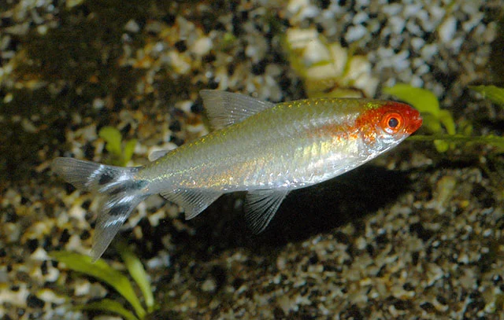

**Familia**: Characidae
**Origen**: Río Negro y Orinoco (Colombia, Brasil, Venezuela)
**Tamaño**: 5 cm
**Temperatura**: 24 – 28°C
**pH**: 5.5 – 7.0
**GH**: 2 – 8 °dGH
**Dureza**: blanda
**Dificultad**: ★★☆☆☆
**Tipo de agua**: dulce tropical
**Nivel de nado**: medio
**Comportamiento**: pacífico
**Mínimo de individuos**: 10 (schooling estricto)
**Tamaño de acuario mínimo**: 80 L
**Dieta**: omnívoro
**Reproducción**: ovíparo
**Notas**: La nariz roja es indicador de calidad del agua. Forma bancos muy compactos y sincronizados, uno de los espectáculos más bonitos del hobby.

---

### Tetra Fantasma Negro (Hyphessobrycon megalopterus)
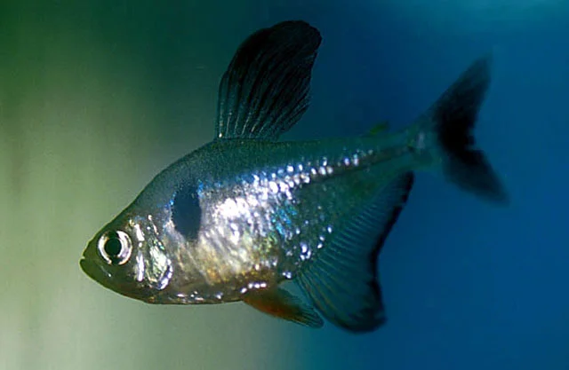

**Familia**: Characidae
**Origen**: Cuenca del río São Francisco y Paraná (Brasil)
**Tamaño**: 6 cm
**Temperatura**: 22 – 28°C
**pH**: 6.0 – 7.5
**GH**: 3 – 15 °dGH
**Dureza**: blanda – media
**Dificultad**: ★☆☆☆☆
**Tipo de agua**: dulce tropical
**Nivel de nado**: medio
**Comportamiento**: pacífico
**Mínimo de individuos**: 6
**Tamaño de acuario mínimo**: 80 L
**Dieta**: omnívoro
**Reproducción**: ovíparo
**Notas**: Color gris oscuro con reflejos metálicos. El macho adulto desarrolla aletas largas. Excelente contraste en acuarios plantados.

---

### Danio Cebra (Danio rerio)
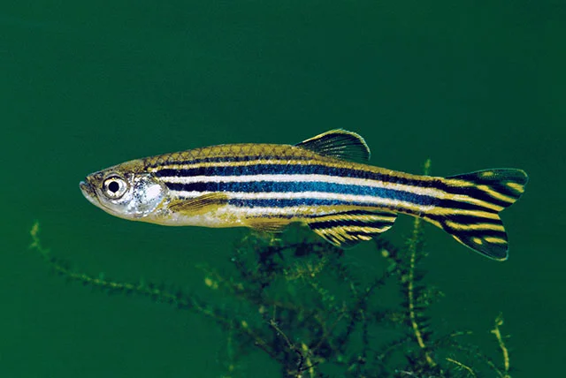

**Familia**: Danionidae
**Origen**: India, Nepal, Bangladés, Birmania
**Tamaño**: 5 cm
**Temperatura**: 18 – 28°C
**pH**: 6.0 – 8.0
**GH**: 5 – 20 °dGH
**Dureza**: blanda – dura (muy tolerante)
**Dificultad**: ★☆☆☆☆
**Tipo de agua**: subtropical – tropical
**Nivel de nado**: medio – superficie
**Comportamiento**: pacífico
**Mínimo de individuos**: 5
**Tamaño de acuario mínimo**: 60 L
**Dieta**: omnívoro
**Reproducción**: ovíparo
**Notas**: El pez más resistente del hobby. Tolera un rango extraordinario de condiciones. Ideal para madurar acuarios nuevos. Salta: usar tapa.

---

### Rasbora Arlequín (Trigonostigma heteromorpha)
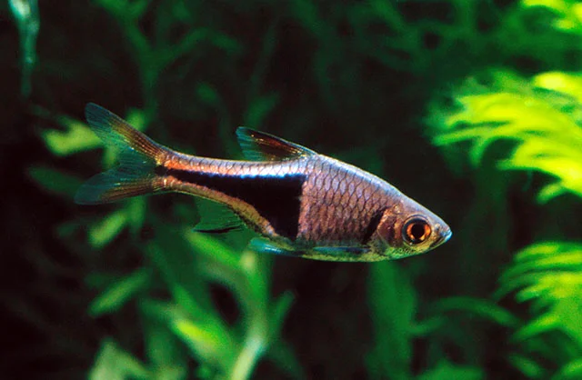

**Familia**: Cyprinidae
**Origen**: Tailandia, Malasia, Singapur, Sumatra
**Tamaño**: 4.5 cm
**Temperatura**: 23 – 28°C
**pH**: 6.0 – 7.5
**GH**: 1 – 12 °dGH
**Dureza**: blanda – media
**Dificultad**: ★☆☆☆☆
**Tipo de agua**: dulce tropical
**Nivel de nado**: medio
**Comportamiento**: pacífico
**Mínimo de individuos**: 6 – 8
**Tamaño de acuario mínimo**: 60 L
**Dieta**: omnívoro
**Reproducción**: ovíparo
**Notas**: La mancha negra triangular sobre la mitad posterior del cuerpo es su característica definitoria. Muy popular en acuarios plantados.

---

### Barbo Cherry (Pethia titteya)
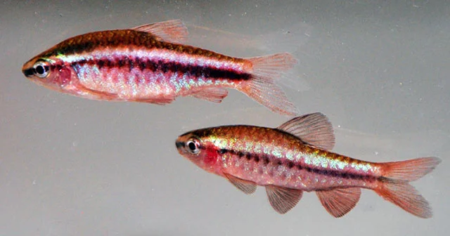

**Familia**: Cyprinidae
**Origen**: Sri Lanka
**Tamaño**: 5 cm
**Temperatura**: 23 – 27°C
**pH**: 6.0 – 7.5
**GH**: 2 – 12 °dGH
**Dureza**: blanda – media
**Dificultad**: ★☆☆☆☆
**Tipo de agua**: dulce tropical
**Nivel de nado**: medio – fondo
**Comportamiento**: pacífico
**Mínimo de individuos**: 6
**Tamaño de acuario mínimo**: 60 L
**Dieta**: omnívoro
**Reproducción**: ovíparo
**Notas**: El macho en celo es de un rojo cereza brillante. Mucho más tranquilo que el Barbo de Sumatra. Especie amenazada en su hábitat natural.

---

### Corydoras Aeneus (Corydoras Bronce)
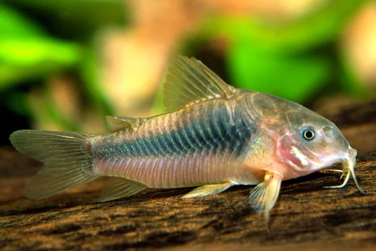

**Familia**: Callichthyidae
**Origen**: Trinidad, Venezuela, Colombia, Perú, Brasil
**Tamaño**: 7 cm
**Temperatura**: 22 – 28°C
**pH**: 6.0 – 7.5
**GH**: 3 – 15 °dGH
**Dureza**: blanda – media
**Dificultad**: ★☆☆☆☆
**Tipo de agua**: dulce tropical
**Nivel de nado**: fondo
**Comportamiento**: pacífico
**Mínimo de individuos**: 6
**Tamaño de acuario mínimo**: 80 L
**Dieta**: omnívoro (detritívoro de fondo)
**Reproducción**: ovíparo
**Notas**: El Corydoras más común y resistente. Color bronce-dorado. Sustrato de arena fina obligatorio para no dañar los barbillones. Compatible con casi cualquier pez pacífico.

---

### Corydoras Panda (Corydoras panda)

**Familia**: Callichthyidae
**Origen**: Río Ucayali (Perú)
**Tamaño**: 4.5 cm
**Temperatura**: 22 – 26°C
**pH**: 6.0 – 7.0
**GH**: 2 – 10 °dGH
**Dureza**: blanda – media
**Dificultad**: ★★☆☆☆
**Tipo de agua**: dulce tropical
**Nivel de nado**: fondo
**Comportamiento**: pacífico
**Mínimo de individuos**: 6
**Tamaño de acuario mínimo**: 60 L
**Dieta**: omnívoro (detritívoro de fondo)
**Reproducción**: ovíparo
**Notas**: Manchas negras en ojo, aleta dorsal y aleta caudal sobre fondo blanco. Uno de los Corydoras más vistosos para acuarios plantados.

---

### Ancistrus sp. (Ancistrus / Busycon)
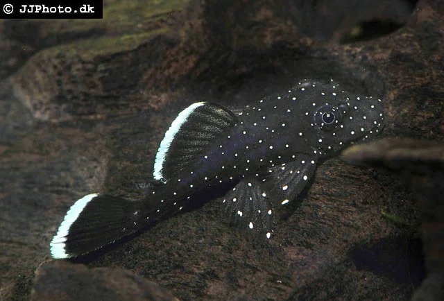

**Familia**: Loricariidae
**Origen**: Sudamérica (amplia distribución)
**Tamaño**: 12 – 15 cm
**Temperatura**: 23 – 27°C
**pH**: 6.0 – 7.5
**GH**: 2 – 15 °dGH
**Dureza**: blanda – media
**Dificultad**: ★☆☆☆☆
**Tipo de agua**: dulce tropical
**Nivel de nado**: fondo
**Comportamiento**: pacífico (territorial con otros Ancistrus del mismo sexo)
**Mínimo de individuos**: 1 (o pareja M+H)
**Tamaño de acuario mínimo**: 80 L
**Dieta**: herbívoro – omnívoro (algívoro)
**Reproducción**: ovíparo (cueva; cuidado paterno)
**Notas**: El pleco recomendado para acuarios pequeños-medianos. Se queda en 15 cm a diferencia del pleco común. Necesita madera para raer celulosa. Come algas del cristal, zucchini, pepino.

---

### Otocinclus (Otocinclus affinis / vittatus)

**Familia**: Loricariidae
**Origen**: Sudamérica (amplia distribución)
**Tamaño**: 4 – 5 cm
**Temperatura**: 20 – 26°C
**pH**: 6.0 – 7.5
**GH**: 3 – 15 °dGH
**Dureza**: blanda – media
**Dificultad**: ★★★☆☆
**Tipo de agua**: dulce tropical
**Nivel de nado**: fondo (se pega a cristal y plantas)
**Comportamiento**: pacífico
**Mínimo de individuos**: 3 – 6
**Tamaño de acuario mínimo**: 40 L
**Dieta**: herbívoro (algas verdes, biofilm)
**Reproducción**: ovíparo
**Notas**: Excelente comedor de algas verdes en cristal y plantas. Requiere acuario maduro con biofilm establecido. Muy frágil en acuarios nuevos. Convive perfectamente con gambas.

---

### Gurami Enano (Trichogaster lalius)
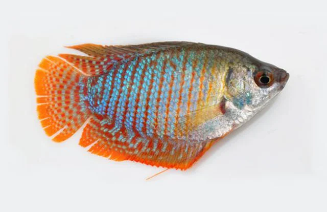

**Familia**: Osphronemidae
**Origen**: India, Bangladés, Pakistán
**Tamaño**: 5 cm
**Temperatura**: 24 – 28°C
**pH**: 6.0 – 7.5
**GH**: 3 – 15 °dGH
**Dureza**: blanda – media
**Dificultad**: ★★☆☆☆
**Tipo de agua**: dulce tropical
**Nivel de nado**: medio – superficie
**Comportamiento**: pacífico (macho semiagrresivo con otros gurami)
**Mínimo de individuos**: 1 macho + 1-2 hembras (o solo 1)
**Tamaño de acuario mínimo**: 60 L
**Dieta**: omnívoro
**Reproducción**: ovíparo (nido de burbujas)
**Notas**: El gurami más popular para acuarios pequeños. El macho tiene franjas azules y rojas. Susceptible al iridovirus (DGIV). Comprar de proveedores de confianza.

---

### Gurami de Miel (Trichogaster chuna)
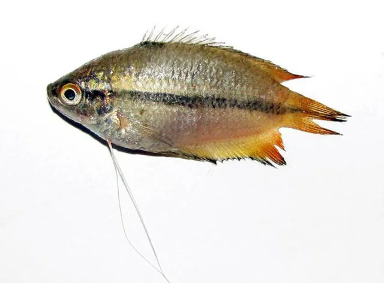

**Familia**: Osphronemidae
**Origen**: India, Bangladés
**Tamaño**: 5 cm
**Temperatura**: 22 – 28°C
**pH**: 6.0 – 7.5
**GH**: 3 – 15 °dGH
**Dureza**: blanda – media
**Dificultad**: ★☆☆☆☆
**Tipo de agua**: dulce tropical
**Nivel de nado**: medio – superficie
**Comportamiento**: pacífico (muy tranquilo)
**Mínimo de individuos**: 1 (o pareja)
**Tamaño de acuario mínimo**: 40 L
**Dieta**: omnívoro
**Reproducción**: ovíparo (nido de burbujas)
**Notas**: El gurami más tranquilo del hobby. El macho tiene coloración naranja-miel intensa en celo. Excelente para acuarios pacíficos pequeños.

---

### Guppy (Poecilia reticulata)
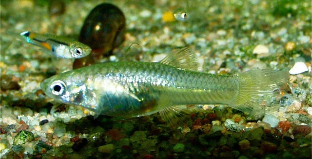

**Familia**: Poeciliidae
**Origen**: Trinidad, Venezuela, Barbados, Guyana
**Tamaño**: 3 cm (macho), 6 cm (hembra)
**Temperatura**: 22 – 28°C
**pH**: 6.8 – 7.8
**GH**: 8 – 20 °dGH
**Dureza**: media – dura
**Dificultad**: ★☆☆☆☆
**Tipo de agua**: dulce tropical
**Nivel de nado**: medio – superficie
**Comportamiento**: pacífico
**Mínimo de individuos**: 1 macho + 2-3 hembras
**Tamaño de acuario mínimo**: 40 L
**Dieta**: omnívoro
**Reproducción**: vivíparo
**Notas**: El pez más criado del mundo. Se reproducen sin intervención. Ratio 1M:2-3H para evitar acoso. Las crías nacen autónomas.

---

### Platy (Xiphophorus maculatus)
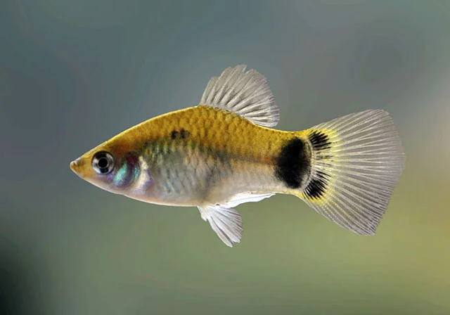

**Familia**: Poeciliidae
**Origen**: México, Guatemala, Honduras, Belice
**Tamaño**: 5 – 6 cm
**Temperatura**: 20 – 28°C
**pH**: 7.0 – 8.0
**GH**: 10 – 25 °dGH
**Dureza**: media – dura
**Dificultad**: ★☆☆☆☆
**Tipo de agua**: subtropical – tropical
**Nivel de nado**: medio
**Comportamiento**: pacífico
**Mínimo de individuos**: 3 (mejor 1M + 2H)
**Tamaño de acuario mínimo**: 60 L
**Dieta**: omnívoro
**Reproducción**: vivíparo
**Notas**: Más robusto que el Guppy, tolera agua dura y alcalina. Muchas variedades de color. Fácil de mantener y reproducir.

---

### Apistogramma cacatuoides (Ciclido Cacatúa)
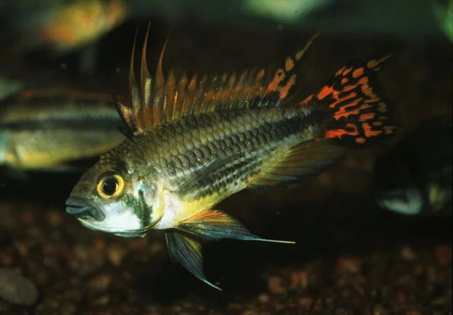

**Familia**: Cichlidae
**Origen**: Cuenca del Amazonas occidental (Perú, Colombia)
**Tamaño**: 9 cm (macho), 5 cm (hembra)
**Temperatura**: 24 – 28°C
**pH**: 6.0 – 7.5
**GH**: 2 – 12 °dGH
**Dureza**: blanda – media
**Dificultad**: ★★★☆☆
**Tipo de agua**: dulce tropical
**Nivel de nado**: fondo – medio
**Comportamiento**: semiagrresivo (territorial)
**Mínimo de individuos**: 1 macho + 2-3 hembras (harén)
**Tamaño de acuario mínimo**: 80 L
**Dieta**: carnívoro – omnívoro
**Reproducción**: ovíparo (cría en cueva)
**Notas**: El más tolerante de los Apistogramma. Proporcionar cuevas (cocos partidos, cerámicas). La hembra defiende el nido con gran intensidad. Siempre en ratio 1M:2-3H.
