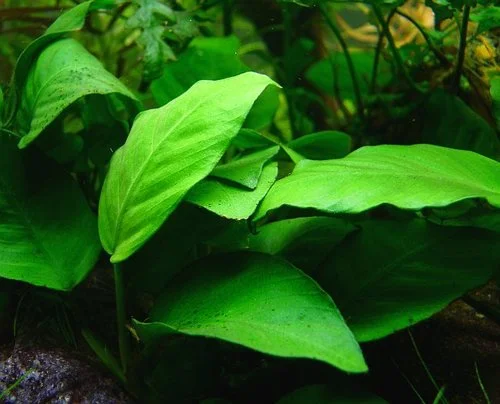
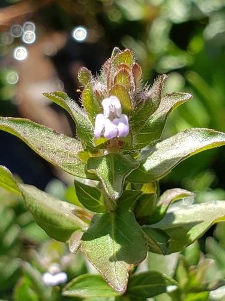

## ESTRUCTURA DE FICHA DE PLANTA

---

## Plantas habituales — Acuario Dulce Tropical de Comunidad

Plantas resistentes que no requieren CO2 ni iluminación especializada. Ideales para principiantes.

---

### Anubias Nana (Anubias barteri var. nana)

**Familia**: Araceae
**Origen**: Camerún, Nigeria (África Occidental)
**Tamaño**: 5 – 15 cm de alto
**Temperatura**: 20 – 30°C
**pH**: 5.5 – 9.0
**GH**: 0 – 20 °dGH
**Dificultad**: ★☆☆☆☆
**Luz**: muy baja – media
**CO2**: no necesario
**Fertilización**: baja
**Crecimiento**: muy lento (1-2 hojas/mes)
**Posición**: primer plano – plano medio, fijada en roca o madera
**Sustrato**: NO enterrar (crece fijada en roca o madera)
**Propagación**: división del rizoma
**Notas**: La planta más resistente del hobby. El rizoma NUNCA debe enterrarse: se pudre. Sujetar con hilo de algodón o cianoacrilato de gel.

---

### Anubias Barteri (Anubias barteri var. barteri)

**Familia**: Araceae
**Origen**: Camerún, Nigeria, Costa de Marfil
**Tamaño**: 20 – 40 cm
**Temperatura**: 20 – 30°C
**pH**: 5.5 – 9.0
**GH**: 0 – 20 °dGH
**Dificultad**: ★☆☆☆☆
**Luz**: muy baja – media
**CO2**: no necesario
**Fertilización**: baja
**Crecimiento**: muy lento
**Posición**: plano medio – trasera, fijada en roca o madera
**Sustrato**: NO enterrar
**Propagación**: división del rizoma
**Notas**: Versión grande de A. nana. Tolera agua dura, blanda, ácida o alcalina. Perfecta para acuarios con ciclidos.

---

### Musgo de Java (Taxiphyllum barbieri)

**Familia**: Hypnaceae
**Origen**: Asia del Sur y Sudeste Asiático
**Tamaño**: tapiz de 2 – 5 cm de grosor
**Temperatura**: 15 – 30°C
**pH**: 5.0 – 9.0
**GH**: 0 – 20 °dGH
**Dificultad**: ★☆☆☆☆
**Luz**: muy baja – alta
**CO2**: no necesario
**Fertilización**: baja
**Crecimiento**: lento – medio
**Posición**: fijado en roca, madera o como tapiz de fondo
**Sustrato**: no aplica (se fija en superficies)
**Propagación**: división de la mata
**Notas**: La planta más versátil del acuario. El biofilm que crece entre sus filamentos es alimento esencial para crías y gambas.

---

### Helecho de Java (Microsorum pteropus)

**Familia**: Polypodiaceae
**Origen**: Sudeste Asiático
**Tamaño**: 20 – 50 cm
**Temperatura**: 18 – 30°C
**pH**: 5.0 – 8.0
**GH**: 0 – 20 °dGH
**Dificultad**: ★☆☆☆☆
**Luz**: muy baja – media
**CO2**: no necesario
**Fertilización**: baja
**Crecimiento**: lento
**Posición**: plano medio – trasera, fijado en roca o madera
**Sustrato**: NO enterrar (rizoma)
**Propagación**: división del rizoma; plántulas en las hojas maduras
**Notas**: Las manchas marrones en el envés son esporangios, no enfermedad. Los ejemplares maduros producen plantitas directamente en las hojas.

---

### Cryptocoryne Wendtii (Cryptocoryne wendtii)

**Familia**: Araceae
**Origen**: Sri Lanka
**Tamaño**: 10 – 25 cm
**Temperatura**: 22 – 28°C
**pH**: 6.0 – 8.0
**GH**: 2 – 18 °dGH
**Dificultad**: ★★☆☆☆
**Luz**: baja – media
**CO2**: no necesario
**Fertilización**: media
**Crecimiento**: muy lento
**Posición**: primer plano – plano medio
**Sustrato**: nutritivo recomendado
**Propagación**: estolones (runners)
**Notas**: La Cryptocoryne más tolerante. Puede sufrir "Cryptocoryne melt" al llegar (las hojas se deshacen): es adaptación normal, rebrota en 2-3 semanas.

---

### Vallisneria Espiral (Vallisneria spiralis)

**Familia**: Hydrocharitaceae
**Origen**: Subtropical y tropical (cosmopolita)
**Tamaño**: 30 – 60 cm
**Temperatura**: 15 – 30°C
**pH**: 6.0 – 9.0
**GH**: 5 – 25 °dGH
**Dificultad**: ★☆☆☆☆
**Luz**: media
**CO2**: no necesario
**Fertilización**: baja – media
**Crecimiento**: rápido – muy rápido
**Posición**: trasera
**Sustrato**: inerte
**Propagación**: estolones laterales
**Notas**: La planta de trasera más fácil. INCOMPATIBLE con CO2 líquido (Easy Carbo/Excel). Necesita recorte frecuente cuando llega a la superficie.

---

### Hygrophila Polysperma

**Familia**: Acanthaceae
**Origen**: India, Sudeste Asiático
**Tamaño**: 20 – 50 cm
**Temperatura**: 20 – 30°C
**pH**: 5.5 – 8.0
**GH**: 0 – 20 °dGH
**Dificultad**: ★☆☆☆☆
**Luz**: media
**CO2**: no necesario
**Fertilización**: baja
**Crecimiento**: muy rápido
**Posición**: plano medio – trasera
**Sustrato**: inerte
**Propagación**: esquejes de tallo
**Notas**: Una de las plantas de tallo más resistentes. Excelente para principiantes y para absorber nitratos.
