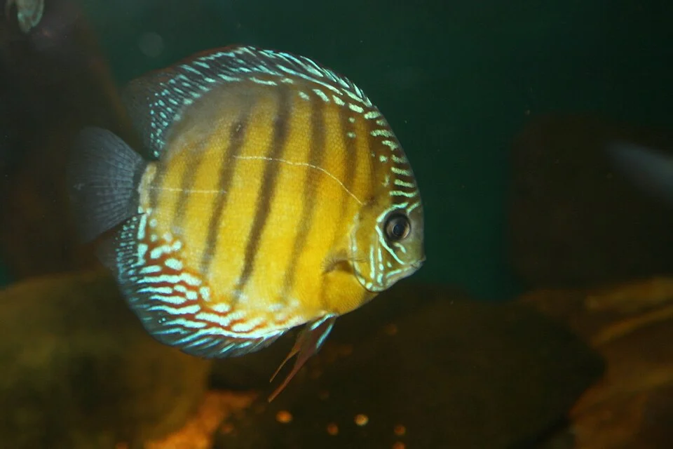

# ACUARIO DULCE TROPICAL DE COMUNIDAD

**Dificultad general**: ★★☆☆☆
**Coste de setup**: bajo – medio
**Tamaño mínimo recomendado**: 60 L
**Para quién es**: principiante con conocimientos básicos del ciclo del nitrógeno

---

## Descripción

El tipo de acuario más extendido en el mundo. Combina varias especies de peces tropicales de agua dulce que comparten rango de temperatura y temperamento. El objetivo es crear una comunidad estable y visualmente armoniosa sin entrar en las exigencias del plantado avanzado o el marino.

---

## Parámetros del agua

| Parámetro | Rango |
|-----------|-------|
| Temperatura | 24 – 27°C |
| pH | 6.5 – 7.5 |
| GH | 5 – 15 °dGH |
| KH | 3 – 8 °dKH |
| NH3 | 0 ppm |
| NO2 | 0 ppm |
| NO3 | < 40 ppm |

---

## Equipamiento necesario

| Equipo | Especificaciones |
|--------|-----------------|
| Filtro | Externo o interior; 5-8x el volumen/hora |
| Calefactor | 2-3W/L con termostato; marca fiable (Eheim Jäger) |
| Iluminación | LED o T8 básico; 8-10h/día |
| Termómetro | Digital independiente del calefactor |
| Sustrato | Arena fina o grava de acuario (inerte) |
| Decoración | Raíces, rocas, plantas naturales o artificiales |

---

## Algas comunes — cuáles son, por qué aparecen, cómo eliminarlas

### Alga Parda / Diatomas (Bacillariophyta)
**Aspecto**: Polvo o película marrón-ocre sobre cristal, sustrato, plantas y decoración. Parece suciedad.
**¿Por qué aparece?** Es la primera alga que sale en TODOS los acuarios nuevos (semanas 1-6). Causada por exceso de silicatos en el agua nueva, luz baja y filtro biológico aún inestable.
**¿Es peligrosa?** No. Es completamente normal y desaparece sola en 4-8 semanas cuando el ciclo del nitrógeno madura.
**Cómo eliminarla:**
- Esperar (desaparece sola)
- Otocinclus (se los comen ávidamente)
- Limpiar el cristal con rasqueta
- Aspirar del sustrato en los cambios de agua
- Aumentar ligeramente la iluminación

---

### Alga Verde en Cristal / Punto Verde (GSA — Green Spot Algae)
**Aspecto**: Puntos verdes pequeños y duros en el cristal frontal y en las hojas grandes de plantas lentas (Anubias).
**¿Por qué aparece?** Combinación de luz y bajo nivel de fosfatos (PO4 < 0.05 ppm). Paradójicamente, el PO4 demasiado bajo favorece las GSA porque las plantas no pueden competir y la alga se instala.
**¿Es peligrosa?** No. Solo estética.
**Cómo eliminarla:**
- Rasqueta metálica o magnético en el cristal (la única forma efectiva)
- Subir ligeramente el PO4 del agua
- Caracoles Nerite (se los comen bien)
- En hojas de Anubias: retirar las hojas muy afectadas

---

### Alga Pelo Verde / Filamentosa (GHA — Green Hair Algae)
**Aspecto**: Filamentos verdes de 1-10 cm que salen de sustratos, rocas, plantas y decoración. Parecen pelos o musgo fino.
**¿Por qué aparece?** Exceso de nutrientes (NO3 + PO4) combinado con luz intensa. Muy común en acuarios con sobrepoblación, sobrealimentación o poca vegetación.
**¿Es peligrosa?** No directamente, pero puede cubrir plantas y asfixiarlas. Muy molesta estéticamente.
**Cómo eliminarla:**
- Gambas Amano (las más eficaces: devoran GHA con entusiasmo)
- Retirar manualmente enroscando un palillo o cepillo de dientes
- Reducir la alimentación y la densidad de peces
- Aumentar la cantidad de plantas para competir
- Cambios de agua más frecuentes
- Reducir el fotoperiodo 1-2 horas
- Otocinclus (algo efectivos en GHA corta)

---

### Alga Negra / BBA (Black Brush Algae — Audouinella / Compsopogon)
**Aspecto**: Mechones negros o gris oscuro de 0.5-2 cm, con textura de cepillo o rastas. Muy duros y difíciles de eliminar mecánicamente. Aparece en bordes de hojas, raíces, difusores de CO2 y decoración.
**¿Por qué aparece?** En acuarios sin CO2: exceso de materia orgánica y flow irregular. En acuarios plantados con CO2: fluctuaciones del CO2 (el CO2 inyectado sube y baja en lugar de mantenerse estable).
**¿Es peligrosa?** No para los peces, pero es muy persistente y difícil de eliminar.
**Cómo eliminarla:**
1. Easy Carbo / Excel directamente sobre el BBA (fuera del agua con pipeta, o en el acuario apagando el filtro 5-10 min): el BBA se vuelve rojo/rosa en 48h y luego las gambas y peces lo comen
2. Gambas Amano: las mejores comedoras de BBA una vez que el alga empieza a morir
3. Siamés algívoro (*Crossocheilus oblongus*, NO el falso siamés): el único pez que come BBA viva activamente
4. Estabilizar el CO2 si el acuario es plantado (la causa más común)
5. Agua oxigenada (H₂O₂): aplicar con pipeta directamente (3% farmacéutico); eficaz pero puede dañar plantas delicadas

---

### Cianobacterias (Cyanobacteria — "Manta Azul")
**Aspecto**: Manta o película azul-verde, verde-turquesa, roja o marrón oscura que cubre el sustrato, rocas y plantas. Tiene un **olor muy característico** a tierra mojada o a charca. Se desprende en láminas al tocarla.
**¿Por qué aparece?** NO son algas (son bacterias fotosintéticas). Causas: bajo movimiento del agua en zonas del fondo, exceso de materia orgánica en el sustrato, desequilibrio de nitratos muy bajos con fosfatos altos (ratio N:P desequilibrado), acuario nuevo.
**¿Es peligrosa?** Algunas especies producen toxinas que pueden ser peligrosas en altas concentraciones para peces y gambas. Abordar rápidamente.
**Cómo eliminarla:**
1. Aumentar el movimiento del agua en zonas afectadas (apuntar la salida del filtro al fondo)
2. Aspirar físicamente con sifón en cada cambio de agua
3. Oscuridad total 3-5 días (tapar el acuario completamente): las cianobacterias necesitan luz
4. Eritromicina (antibiótico): muy eficaz, pero daña el filtro biológico → usar en cuarentena del acuario o con mucha precaución
5. H₂O₂ diluido aplicado directamente con la circulación apagada
6. Revisar la circulación: asegurar que no hay zonas muertas de agua

---

### Agua Verde (Bloom de Chlorella)
**Aspecto**: El agua se vuelve verde opaco como sopa de guisantes. Los peces apenas se ven a través del agua.
**¿Por qué aparece?** Proliferación masiva de algas unicelulares en el agua (Chlorella, Chlamydomonas). Causas: luz solar directa en el acuario, exceso de nutrientes, ausencia de filtro biológico.
**¿Es peligrosa?** Para los peces en sí, no directamente. Pero cuando el bloom colapsa, consume todo el O₂ y puede asfixiar a los peces.
**Cómo eliminarla:**
1. Esterilizador UV: el método más eficaz y permanente. La luz UV mata las algas unicelulares al pasar por la lámpara
2. Mover el acuario lejos de la luz solar directa
3. Cambios de agua frecuentes (50% cada 2 días)
4. Floculante (agua clarificante): agrupa las células para que el filtro las retire; solución temporal

---

## Errores más comunes

- Añadir peces antes de que el acuario haya madurado (mínimo 4-6 semanas)
- Mezclar especies incompatibles en temperatura o comportamiento
- Sobrealimentar → acumulación de NO3 → algas
- No hacer cambios de agua periódicos
- Comprar el pleco común creyendo que siempre es pequeño

---

## Consejos clave

- Madurar siempre el acuario antes de añadir peces
- Empezar con pocas especies resistentes (tetras, danios, corydoras)
- Un acuario más grande es más estable que uno pequeño
- El filtro es lo más importante: nunca limpiarlo con agua del grifo
- Regla de los tres niveles: ocupar superficie, zona media y fondo distribuye el espacio y reduce el estrés
