## ESTRUCTURA DE FICHA DE CORAL

```
### Nombre Común (Nombre científico)
**Tipo**: Soft / LPS / SPS / Coralimorfario
**Familia**:
**Origen**:
**Tamaño**: expansión de la colonia
**Temperatura**: °C
**pH**:
**Salinidad**: densidad objetivo
**Ca / KH / Mg**: valores mínimos recomendados
**Dificultad**: ★ a ★★★★★
**Luz**: muy baja / baja / media / alta / muy alta (PAR orientativo)
**Corriente**: baja / media / alta / muy alta
**Agresividad**: baja / media / alta (con otros corales)
**Alimentación**: fotosíntesis / filtración / directa con pólipo
**Reef Safe**: sí (siempre en reef)
**Notas**:
```

---

## Corales — Acuario Marino Arrecife de Coral (REEF)

> **Parámetros objetivo por tipo de coral:**
>
> | Parámetro | Blandos | LPS | SPS Montipora | SPS Acropora |
> |-----------|---------|-----|---------------|-------------|
> | Temperatura | 23-27°C | 23-27°C | 24-27°C | 25-26°C |
> | pH | 8.1-8.4 | 8.1-8.4 | 8.2-8.4 | 8.2-8.4 |
> | Salinidad | 1.022-1.026 | 1.023-1.026 | 1.023-1.026 | 1.024-1.026 |
> | Ca | 350+ ppm | 380-420 ppm | 400-430 ppm | 420-450 ppm |
> | KH | 7-10 dKH | 8-10 dKH | 8-10 dKH | 8-9 dKH |
> | Mg | 1200+ ppm | 1250+ ppm | 1250-1350 ppm | 1300-1400 ppm |
> | NO3 | <20 ppm | <10 ppm | <5 ppm | 2-5 ppm |
> | PO4 | <0.1 ppm | <0.08 ppm | <0.05 ppm | 0.03-0.05 ppm |
> | PAR | 30-150 | 75-250 | 150-300 | 250-500+ |

---

## Coralimorfarios (Mushrooms / Setas)

### Seta Discosoma (Discosoma spp.)
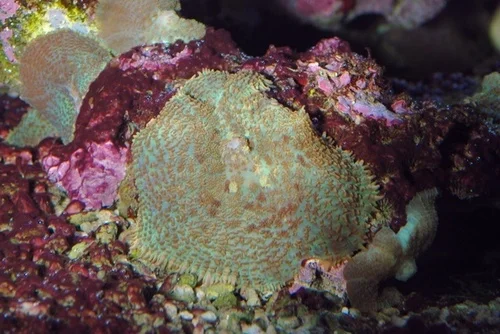

**Tipo**: Coralimorfario
**Familia**: Discosomatidae
**Origen**: Indo-Pacífico, Caribe
**Tamaño**: 5 – 15 cm de diámetro (pólipo individual)
**Temperatura**: 23 – 27°C
**pH**: 8.1 – 8.4
**Salinidad**: 1.022 – 1.026
**Ca / KH / Mg**: No son consumidores importantes; agua estándar marina suficiente
**Dificultad**: ★☆☆☆☆
**Luz**: baja – media (PAR 30-100)
**Corriente**: baja – media
**Agresividad**: baja – media (liberan toxinas que afectan a corales cercanos)
**Alimentación**: fotosíntesis (zooxantelas) principalmente; filtración de micropartículas
**Reef Safe**: ✅ sí
**Notas**: Los corales más fáciles del hobby. Toleran fluctuaciones de parámetros que matan otros corales. Se reproducen por fisión. Gran variedad de colores y texturas. Las Discosoma metálicas son muy valoradas. Con poca luz se expanden para captar más fotones.

---

### Seta Ricordea Florida (Ricordea florida)
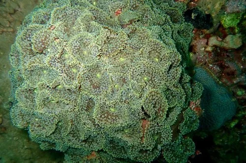

**Tipo**: Coralimorfario
**Familia**: Ricordeidae
**Origen**: Caribe, Florida
**Tamaño**: 4 – 8 cm de diámetro
**Temperatura**: 23 – 26°C
**pH**: 8.1 – 8.4
**Salinidad**: 1.023 – 1.026
**Ca / KH / Mg**: estándar marino
**Dificultad**: ★★☆☆☆
**Luz**: media (PAR 75-150)
**Corriente**: baja – media
**Agresividad**: baja
**Alimentación**: fotosíntesis; acepta mysis directamente
**Reef Safe**: ✅ sí
**Notas**: Superficie cubierta de tentáculos redondeados que dan aspecto de peluche o flor. Colores muy llamativos (verde, naranja, azul, morado). Algo más exigente que Discosoma pero muy manejable. Acepta alimentación directa con mysis para crecer más rápido. Muy cotizada por los colores únicos.

---

### Seta Ricordea Yuma (Ricordea yuma)
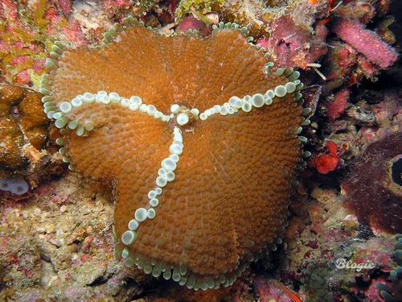

**Tipo**: Coralimorfario
**Familia**: Ricordeidae
**Origen**: Indo-Pacífico
**Tamaño**: 5 – 10 cm de diámetro
**Temperatura**: 24 – 26°C
**pH**: 8.1 – 8.4
**Salinidad**: 1.023 – 1.026
**Ca / KH / Mg**: estándar marino
**Dificultad**: ★★★☆☆
**Luz**: media – alta (PAR 100-200)
**Corriente**: baja – media
**Agresividad**: baja
**Alimentación**: fotosíntesis; acepta alimentación directa
**Reef Safe**: ✅ sí
**Notas**: Versión Indo-Pacífico de R. florida. Tentáculos más alargados. Colores muy llamativos con fluorescencia bajo luz azul. Algo más sensible a parámetros que R. florida. Las yumas de alta calidad son muy cotizadas.

---

## Corales Blandos (Soft Corals)

### Zoanthus (Zoanthus spp.)
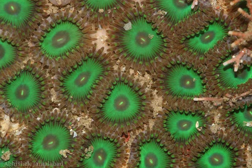

**Tipo**: Soft Coral (Zoantharia)
**Familia**: Zoanthidae
**Origen**: Indo-Pacífico, Caribe
**Tamaño**: colonia de 5 – 30+ cm; pólipos de 0.5 – 2 cm
**Temperatura**: 23 – 27°C
**pH**: 8.1 – 8.4
**Salinidad**: 1.023 – 1.026
**Ca / KH / Mg**: estándar marino
**Dificultad**: ★☆☆☆☆
**Luz**: baja – alta (PAR 50-250; muy adaptables)
**Corriente**: baja – media
**Agresividad**: media (pueden superar a otros corales lentamente)
**Alimentación**: fotosíntesis principalmente; aceptan zooplancton pequeño
**Reef Safe**: ✅ sí
**Notas**: Colonias de pólipos con enorme variedad de colores. Los Zoanthus "de diseño" (PPE, Utter Chaos, Rastas, Eagle Eye) pueden costar cientos de euros por pólipo. **ADVERTENCIA**: Los Palythoa sp. contienen palytoxina — extremadamente tóxica para humanos. Zoanthus también puede contenerla en pequeñas cantidades: usar guantes siempre.

---

### Palythoa (Palythoa spp.)
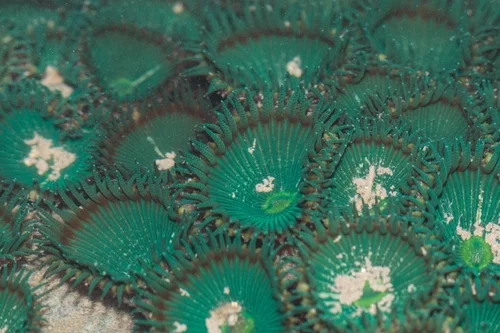

**Tipo**: Soft Coral (Zoantharia)
**Familia**: Sphenopidae
**Origen**: Indo-Pacífico, Caribe, Atlántico tropical
**Tamaño**: pólipos de 1 – 3 cm; colonias de 10 – 50 cm
**Temperatura**: 22 – 27°C
**pH**: 8.1 – 8.4
**Salinidad**: 1.022 – 1.026
**Ca / KH / Mg**: estándar marino
**Dificultad**: ★★☆☆☆
**Luz**: baja – alta (PAR 50-200)
**Corriente**: baja – media
**Agresividad**: media
**Alimentación**: fotosíntesis; zooplancton
**Reef Safe**: ✅ sí
**Notas**: ⚠️ **PALYTOXINA**: Contienen palytoxina, una de las toxinas naturales más potentes. Se libera al cortar, aplastar o calentar el coral. Síntomas: náuseas, dificultad respiratoria, convulsiones. SIEMPRE usar guantes de nitrilo y gafas al manipular. NUNCA verter agua con Palythoa sobre una herida.

---

### Cuero de Champiñón (Sarcophyton spp.)
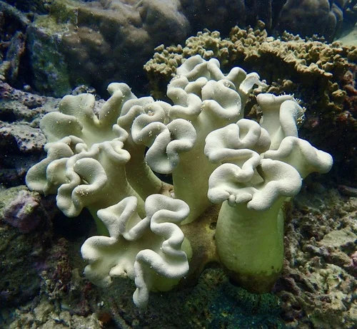

**Tipo**: Soft Coral (Alcyonacea)
**Familia**: Alcyoniidae
**Origen**: Indo-Pacífico
**Tamaño**: 5 – 30 cm de diámetro
**Temperatura**: 23 – 27°C
**pH**: 8.1 – 8.4
**Salinidad**: 1.023 – 1.026
**Ca / KH / Mg**: estándar marino
**Dificultad**: ★★☆☆☆
**Luz**: media – alta (PAR 100-200)
**Corriente**: media
**Agresividad**: media – alta (alelopatía: libera terpenoides que inhiben otros corales)
**Alimentación**: fotosíntesis principalmente
**Reef Safe**: ✅ sí (con espacio suficiente)
**Notas**: Forma de seta gigante. Libera terpenoides que pueden inhibir el crecimiento de corales cercanos. Usar carbón activo para contrarrestar. Periódicamente el coral se "cierra" y se cubre de mucosa que luego elimina: comportamiento normal.

---

### Dedo de Cuero (Lobophytum spp.)
**Tipo**: Soft Coral (Alcyonacea)
**Familia**: Alcyoniidae
**Origen**: Indo-Pacífico
**Tamaño**: 10 – 40 cm
**Temperatura**: 23 – 27°C
**pH**: 8.1 – 8.4
**Salinidad**: 1.023 – 1.026
**Ca / KH / Mg**: estándar marino
**Dificultad**: ★★☆☆☆
**Luz**: media – alta (PAR 100-250)
**Corriente**: media
**Agresividad**: media (alelopatía)
**Alimentación**: fotosíntesis; filtración
**Reef Safe**: ✅ sí
**Notas**: Similar a Sarcophyton pero lobulado o en forma de dedos. También libera terpenoides. Pólipos muy finos y plumosos cuando están expandidos.

---

### Pulsing Xenia (Xenia spp.)
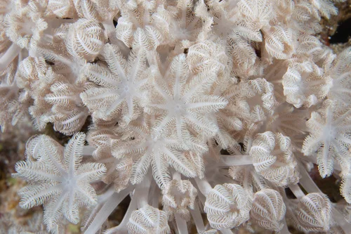

**Tipo**: Soft Coral (Alcyonacea)
**Familia**: Xeniidae
**Origen**: Indo-Pacífico (Mar Rojo, Maldivas)
**Tamaño**: 3 – 15 cm
**Temperatura**: 24 – 27°C
**pH**: 8.1 – 8.4
**Salinidad**: 1.023 – 1.026
**Ca / KH / Mg**: KH mínimo 8 dKH
**Dificultad**: ★★☆☆☆
**Luz**: media – alta (PAR 100-200)
**Corriente**: media
**Agresividad**: baja – media (se expande rápidamente)
**Alimentación**: fotosíntesis; absorción directa de nutrientes del agua
**Reef Safe**: ✅ sí
**Notas**: Los tentáculos se contraen y expanden rítmicamente (pulsing): comportamiento hipnótico. Se reproduce rápidamente y puede invadir el acuario: requiere control. Muy sensible a la calidad del agua. Absorbe fosfato.

---

### Clavularia / Clavo de Órgano (Clavularia spp.)
**Tipo**: Soft Coral (Alcyonacea)
**Familia**: Clavulariidae
**Origen**: Indo-Pacífico
**Tamaño**: tapiz variable; pólipos de 1 – 3 cm
**Temperatura**: 23 – 27°C
**pH**: 8.1 – 8.4
**Salinidad**: 1.022 – 1.026
**Ca / KH / Mg**: estándar marino
**Dificultad**: ★☆☆☆☆
**Luz**: baja – media (PAR 30-100)
**Corriente**: baja – media
**Agresividad**: baja
**Alimentación**: fotosíntesis; zooplancton fino
**Reef Safe**: ✅ sí
**Notas**: Octocoral colonial que tapiza rocas y paredes. Muy resistente. Buen indicador de calidad del agua: si los pólipos no abren en horas, algo está mal. Algunos tienen tinte verde o azul fluorescente bajo UV.

---

## Corales LPS (Large Polyp Stony)

### Coral Martillo (Euphyllia ancora)
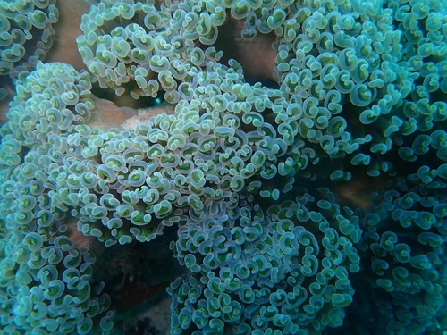

**Tipo**: LPS
**Familia**: Euphylliidae
**Origen**: Indo-Pacífico
**Tamaño**: colonia de 10 – 40 cm; tentáculos de 3 – 10 cm
**Temperatura**: 23 – 27°C
**pH**: 8.1 – 8.4
**Salinidad**: 1.023 – 1.026
**Ca / KH / Mg**: Ca 380+, KH 8+, Mg 1200+
**Dificultad**: ★★☆☆☆
**Luz**: media (PAR 75-150)
**Corriente**: media (moderada, no directa sobre tentáculos)
**Agresividad**: alta (tentáculos urticantes con gran alcance)
**Alimentación**: fotosíntesis principalmente; acepta mysis y pellets de pólipo
**Reef Safe**: ✅ sí
**Notas**: Tentáculos con puntas en forma de martillo o maza. Los peces payaso a veces lo usan como anémona sustituta. Los tentáculos tienen nematocistos con largo alcance: dejar 10 cm mínimo alrededor. Se reproducen por brotación lateral.

---

### Coral Antorcha (Euphyllia glabrescens)
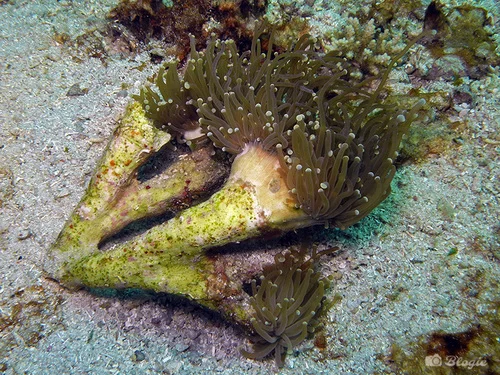

**Tipo**: LPS
**Familia**: Euphylliidae
**Origen**: Indo-Pacífico
**Tamaño**: colonia de 10 – 30 cm; tentáculos de 5 – 15 cm
**Temperatura**: 23 – 27°C
**pH**: 8.1 – 8.4
**Salinidad**: 1.023 – 1.026
**Ca / KH / Mg**: Ca 380+, KH 8+, Mg 1200+
**Dificultad**: ★★☆☆☆
**Luz**: media (PAR 75-150)
**Corriente**: media baja
**Agresividad**: alta (tentáculos muy urticantes y largos)
**Alimentación**: fotosíntesis; acepta mysis directamente
**Reef Safe**: ✅ sí
**Notas**: Tentáculos alargados con punta translúcida como antorcha. Algunos payasos (A. clarkii) los usan como anémona. La punta puede urticar a humanos. Buena fluorescencia bajo luz azul. No poner junto a Hammer: se "lucharán" con tentáculos.

---

### Coral de Burbujas (Plerogyra sinuosa)
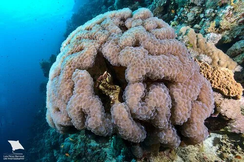

**Tipo**: LPS
**Familia**: Caryophylliidae
**Origen**: Indo-Pacífico
**Tamaño**: 15 – 40 cm de diámetro
**Temperatura**: 23 – 27°C
**pH**: 8.1 – 8.4
**Salinidad**: 1.023 – 1.026
**Ca / KH / Mg**: Ca 380+, KH 8+, Mg 1200+
**Dificultad**: ★★☆☆☆
**Luz**: media (PAR 75-150)
**Corriente**: baja (la corriente alta daña las burbujas)
**Agresividad**: media – alta (tentáculos urticantes nocturnos)
**Alimentación**: fotosíntesis; acepta mysis directamente
**Reef Safe**: ✅ sí
**Notas**: De día los tentáculos se expanden como burbujas translúcidas. De noche retrae las burbujas y extiende tentáculos urticantes para cazar zooplancton. No mezclar con corales de corriente alta. Dejar 15 cm de espacio libre alrededor.

---

### Blastomussa (Blastomussa wellsi / merleti)
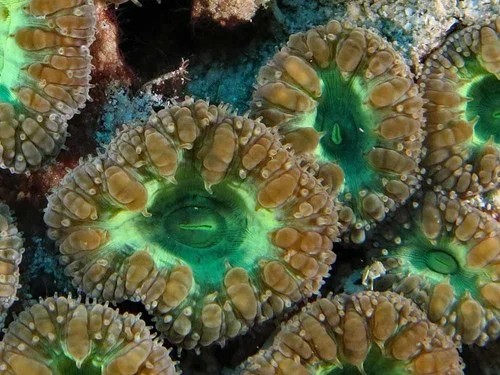

**Tipo**: LPS
**Familia**: Mussidae
**Origen**: Indo-Pacífico
**Tamaño**: pólipos de 1 – 3 cm; colonia de 5 – 30 cm
**Temperatura**: 22 – 27°C
**pH**: 8.1 – 8.4
**Salinidad**: 1.022 – 1.026
**Ca / KH / Mg**: Ca 350+, KH 7+, Mg 1200+
**Dificultad**: ★☆☆☆☆
**Luz**: baja – media (PAR 30-100)
**Corriente**: baja – media
**Agresividad**: baja
**Alimentación**: fotosíntesis; acepta mysis con gusto
**Reef Safe**: ✅ sí
**Notas**: Uno de los LPS más resistentes. Tolera peores parámetros que la mayoría de LPS. Pólipos grandes de muchos colores (verde, rojo, morado, bicolor). Se reproducen por brotación. Responden muy bien a la alimentación directa.

---

### Lobophyllia (Lobophyllia hemprichii)
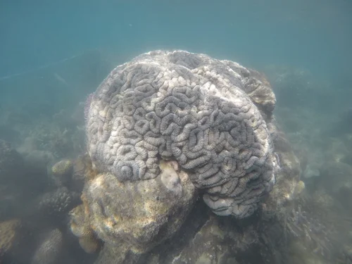

**Tipo**: LPS
**Familia**: Lobophylliidae
**Origen**: Indo-Pacífico, Mar Rojo
**Tamaño**: 15 – 40 cm
**Temperatura**: 23 – 27°C
**pH**: 8.1 – 8.4
**Salinidad**: 1.023 – 1.026
**Ca / KH / Mg**: Ca 380-420, KH 8-10, Mg 1250-1350
**Dificultad**: ★★☆☆☆
**Luz**: media-baja (PAR 50-150)
**Corriente**: baja – media
**Agresividad**: media (tentáculos de barrido nocturnos)
**Alimentación**: fotosíntesis; alimentación nocturna recomendada
**Reef Safe**: ✅ sí
**Notas**: Coral masivo con grandes pólipos carnosos: verde, rojo, marrón, azul. Muy resistente. Puede colocarse en el fondo con poca luz. Excelente respuesta a alimentación nocturna con mysis. Muy apto para principiantes en arrecife.

---

### Cabeza de Cerebro Abierta (Trachyphyllia geoffroyi)
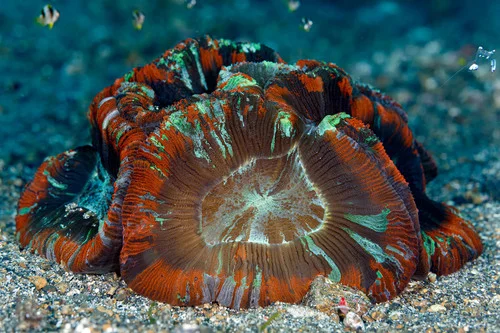

**Tipo**: LPS
**Familia**: Lobophylliidae
**Origen**: Indo-Pacífico
**Tamaño**: 5 – 20 cm
**Temperatura**: 23 – 27°C
**pH**: 8.1 – 8.4
**Salinidad**: 1.023 – 1.026
**Ca / KH / Mg**: Ca 380+, KH 8+, Mg 1250+
**Dificultad**: ★★☆☆☆
**Luz**: media (PAR 75-150); NO alta (bleachea)
**Corriente**: baja – media
**Agresividad**: media
**Alimentación**: fotosíntesis; acepta mysis, krill, pellets directamente
**Reef Safe**: ✅ sí
**Notas**: Superficies cerebriformes muy características. De vida libre (no se adhiere a rocas): colocar sobre arena. Acepta bien la alimentación directa. Los especímenes con colores verde, rojo, naranja y morado son los más valorados.

---

### Favia / Favites (Favia spp. / Favites spp.)
**Tipo**: LPS
**Familia**: Merulinidae
**Origen**: Indo-Pacífico, Caribe
**Tamaño**: colonia de 10 – 50 cm (crecimiento lento)
**Temperatura**: 23 – 27°C
**pH**: 8.1 – 8.4
**Salinidad**: 1.023 – 1.026
**Ca / KH / Mg**: Ca 380+, KH 8+, Mg 1250+
**Dificultad**: ★★★☆☆
**Luz**: media – alta (PAR 100-250)
**Corriente**: media
**Agresividad**: alta (mesenterios urticantes largos de noche)
**Alimentación**: fotosíntesis; acepta zooplancton
**Reef Safe**: ✅ sí
**Notas**: Colonias masivas con patrón de celdas hexagonales. Los mesenterios pueden dañar corales cercanos hasta 5-10 cm. Necesitan espacio libre. Crecimiento muy lento.

---

### Elegance Coral (Catalaphyllia jardinei)
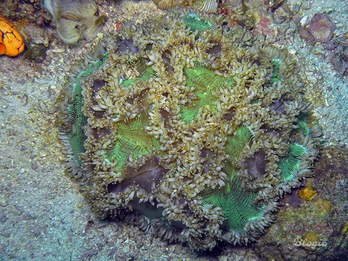

**Tipo**: LPS
**Familia**: Euphylliidae
**Origen**: Indo-Pacífico, Australia
**Tamaño**: 20 – 40 cm (extendido)
**Temperatura**: 23 – 27°C
**pH**: 8.1 – 8.4
**Salinidad**: 1.023 – 1.026
**Ca / KH / Mg**: Ca 400-430, KH 8-10, Mg 1280+
**Dificultad**: ★★★★☆
**Luz**: media (PAR 75-200)
**Corriente**: baja – media (muy sensible a corriente directa)
**Agresividad**: alta (tentáculos urticantes muy largos)
**Alimentación**: fotosíntesis + alimentación semanal obligatoria (gambas, mysis, pescado)
**Reef Safe**: ⚠️ precaución (tentáculos largos)
**Notas**: Uno de los corales más espectaculares: grandes tentáculos blancos o verdes con puntas moradas. Los tentáculos pueden extenderse 20-30 cm. Posicionar en el fondo con mucho espacio libre. Vive en arena, no en la cima de rocas.

---

### Goniopora / Coral de Flores (Goniopora columna)
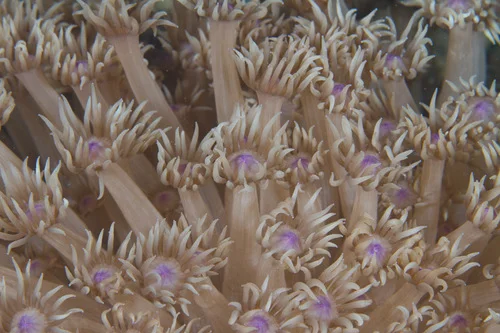

**Tipo**: LPS
**Familia**: Poritidae
**Origen**: Indo-Pacífico, Mar Rojo
**Tamaño**: 10 – 30 cm
**Temperatura**: 23 – 27°C
**pH**: 8.1 – 8.4
**Salinidad**: 1.023 – 1.026
**Ca / KH / Mg**: Ca 380-430, KH 8-10, Mg 1250+
**Dificultad**: ★★★★☆
**Luz**: media – alta (PAR 100-250)
**Corriente**: baja – media
**Agresividad**: media
**Alimentación**: fotosíntesis; fitoplancton/zooplancton fino muy recomendado
**Reef Safe**: ✅ sí
**Notas**: Los pólipos extendidos parecen flores de 12 pétalos. Históricamente difícil de mantener ("coral de 6 meses"). La clave es la alimentación activa con fitoplancton y rotíferos. Los frags de cautividad son mucho más resistentes que los salvajes.

---

## Corales SPS (Small Polyp Stony)

### Montipora (Montipora spp.)
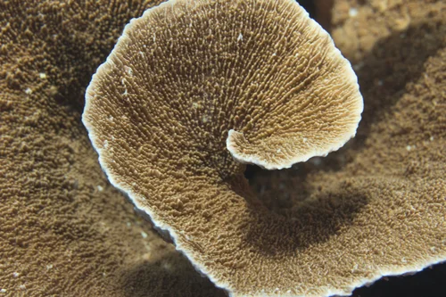

**Tipo**: SPS
**Familia**: Acroporidae
**Origen**: Indo-Pacífico
**Tamaño**: 10 – 50 cm según especie
**Temperatura**: 24 – 27°C
**pH**: 8.1 – 8.4
**Salinidad**: 1.023 – 1.026
**Ca / KH / Mg**: Ca 400+, KH 8+, Mg 1250+
**Dificultad**: ★★★☆☆
**Luz**: alta (PAR 150-300)
**Corriente**: media – alta
**Agresividad**: baja
**Alimentación**: fotosíntesis; nanoplancton
**Reef Safe**: ✅ sí
**Notas**: El SPS más tolerante y recomendado para iniciarse. Formas muy variadas: encrusting (M. capricornis), ramificado (M. digitata), foliar. Colores impresionantes bajo luz azul (verde, naranja, morado, rojo). Mucho más tolerante a fluctuaciones de KH que Acropora. M. digitata es el punto de entrada más recomendado en SPS.

---

### Montipora Digitata (Montipora digitata)
**Tipo**: SPS
**Familia**: Acroporidae
**Origen**: Indo-Pacífico, Mar Rojo
**Tamaño**: 15 – 40 cm
**Temperatura**: 24 – 27°C
**pH**: 8.2 – 8.4
**Salinidad**: 1.023 – 1.026
**Ca / KH / Mg**: Ca 400-430, KH 8-10, Mg 1280-1380
**Dificultad**: ★★★☆☆
**Luz**: alta (PAR 200-400)
**Corriente**: alta
**Agresividad**: baja
**Alimentación**: fotosíntesis; zooplancton fino
**Reef Safe**: ✅ sí
**Notas**: Forma ramificada (digitada). Crece más rápido que la mayoría de SPS. Muy sensible a la temperatura: bleaching por encima de 28°C. El SPS "de iniciación" más recomendado: si creces bien M. digitata, estás listo para Acropora.

---

### Pocillopora (Pocillopora damicornis / verrucosa)
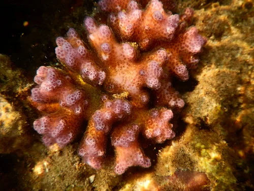

**Tipo**: SPS
**Familia**: Pocilloporidae
**Origen**: Indo-Pacífico
**Tamaño**: 10 – 30 cm
**Temperatura**: 24 – 27°C
**pH**: 8.1 – 8.4
**Salinidad**: 1.023 – 1.026
**Ca / KH / Mg**: Ca 400+, KH 8+, Mg 1250+
**Dificultad**: ★★★☆☆
**Luz**: alta (PAR 150-300)
**Corriente**: alta
**Agresividad**: baja
**Alimentación**: fotosíntesis; zooplancton fino
**Reef Safe**: ✅ sí
**Notas**: Ramificaciones densas y bulbosas. P. damicornis puede reproducirse asexualmente liberando "planulas" que se asientan en el acuario. Buen SPS para iniciarse después de Montipora. Responde rápido a cambios de parámetros (indicador útil).

---

### Stylophora pistillata
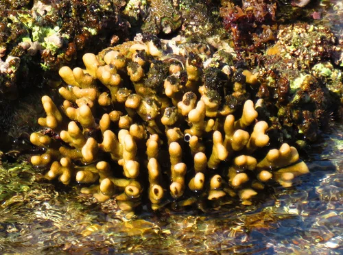

**Tipo**: SPS
**Familia**: Pocilloporidae
**Origen**: Indo-Pacífico, Mar Rojo
**Tamaño**: 10 – 25 cm
**Temperatura**: 24 – 27°C
**pH**: 8.2 – 8.4
**Salinidad**: 1.023 – 1.026
**Ca / KH / Mg**: Ca 400-430, KH 8-10, Mg 1280+
**Dificultad**: ★★★☆☆
**Luz**: alta (PAR 200-350)
**Corriente**: alta
**Agresividad**: baja
**Alimentación**: fotosíntesis; zooplancton fino
**Reef Safe**: ✅ sí
**Notas**: Ramificaciones en forma de porra con puntas redondeadas. Muy común en el Mar Rojo. Colores: rosa, morado, verde, marrón. Las puntas claras indican crecimiento activo; las oscuras o marrones indican estrés.

---

### Seriatopora / Nido de Pájaro (Seriatopora hystrix)
**Tipo**: SPS
**Familia**: Pocilloporidae
**Origen**: Indo-Pacífico
**Tamaño**: 10 – 30 cm
**Temperatura**: 25 – 26°C
**pH**: 8.2 – 8.4
**Salinidad**: 1.024 – 1.026
**Ca / KH / Mg**: Ca 420+, KH 8-9, Mg 1300+
**Dificultad**: ★★★★☆
**Luz**: muy alta (PAR 200-400)
**Corriente**: alta – muy alta
**Agresividad**: baja
**Alimentación**: fotosíntesis
**Reef Safe**: ✅ sí
**Notas**: Ramificaciones extremadamente finas y densas como un nido de pájaro. Muy frágil mecánicamente. Colores llamativos (rosa, verde, amarillo). Para acuaristas con experiencia en SPS.

---

### Acropora (Acropora spp.)
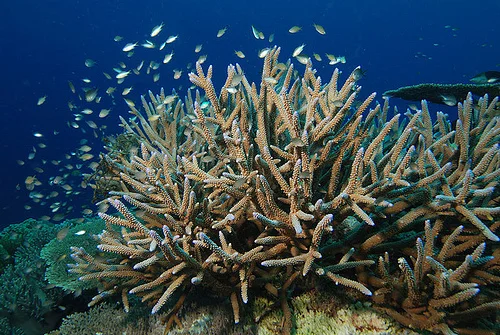

**Tipo**: SPS
**Familia**: Acroporidae
**Origen**: Indo-Pacífico
**Tamaño**: ramificaciones de 5 – 60+ cm
**Temperatura**: 25 – 26°C (estabilidad crítica ±0.5°C)
**pH**: 8.2 – 8.4
**Salinidad**: 1.024 – 1.026
**Ca / KH / Mg**: Ca 420-450, KH 8-9, Mg 1300-1400
**Dificultad**: ★★★★★
**Luz**: muy alta (PAR 250-500+)
**Corriente**: muy alta y turbulenta (20-30x volumen/hora, alternante)
**Agresividad**: baja – media
**Alimentación**: fotosíntesis (95%+); zooplancton fino
**Reef Safe**: ✅ sí
**Notas**: El género más diverso y exigente del hobby. Morfologías muy distintas: ramificada (staghorn), tabular, digitada, encrusting. Requiere parámetros NSW ultra-estables. Los cambios de KH de ±0.5 dKH en 24h pueden causar STN o RTN. Solo para acuaristas con 2+ años de experiencia en marino.

---

### Acropora millepora
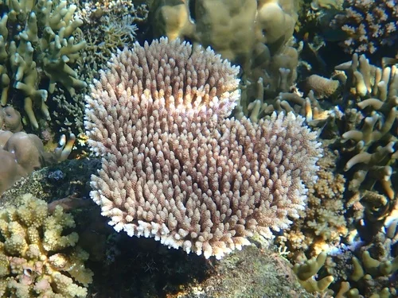

**Tipo**: SPS
**Familia**: Acroporidae
**Origen**: Indo-Pacífico, Gran Barrera de Coral
**Tamaño**: 20 – 50 cm
**Temperatura**: 25 – 26°C
**pH**: 8.2 – 8.4
**Salinidad**: 1.024 – 1.026
**Ca / KH / Mg**: Ca 420-450, KH 8-9, Mg 1300-1400
**Dificultad**: ★★★★★
**Luz**: muy alta (PAR 300-600)
**Corriente**: muy alta
**Agresividad**: baja
**Alimentación**: fotosíntesis; zooplancton ultrafino
**Reef Safe**: ✅ sí
**Notas**: Colores extraordinarios: azul, rosa, verde, naranja, multicolor. Indicador más sensible de la calidad del agua — si una A. millepora está bien, el arrecife está bien. Requiere parámetros de NSW casi perfectos. Muy sensible a variaciones de KH. El "santo grial" para muchos acuaristas de arrecife.

---

### Leptoseris / Plato de Sopa (Leptoseris sp.)
**Tipo**: SPS
**Familia**: Agariciidae
**Origen**: Indo-Pacífico
**Tamaño**: 10 – 25 cm
**Temperatura**: 23 – 27°C
**pH**: 8.1 – 8.4
**Salinidad**: 1.023 – 1.026
**Ca / KH / Mg**: Ca 380-420, KH 8-10, Mg 1250+
**Dificultad**: ★★★☆☆
**Luz**: baja – media (PAR 30-100)
**Corriente**: baja – media
**Agresividad**: baja
**Alimentación**: fotosíntesis
**Reef Safe**: ✅ sí
**Notas**: SPS de baja luz — inusual en esta categoría. Forma placas finas laminares o en copa. Vive en zonas profundas del arrecife. No necesita la intensa iluminación de las Acroporas. Más tolerante a variaciones de parámetros. Ideal para zonas bajas del arrecife doméstico.
