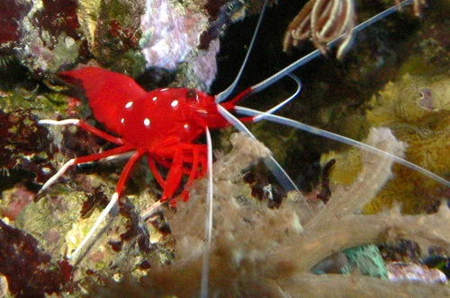
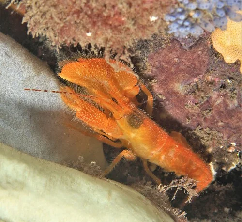
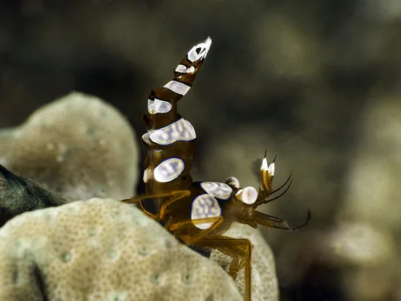
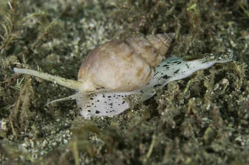
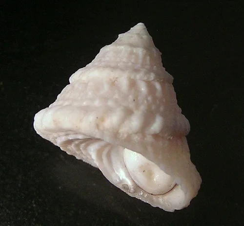
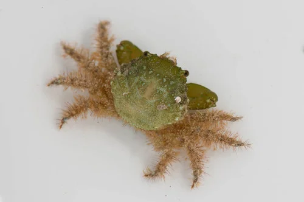

## ESTRUCTURA DE FICHA DE INVERTEBRADO

```
### Nombre Común (Nombre científico)
**Familia**:
**Origen**:
**Tamaño**: adulto
**Temperatura**: °C
**pH**:
**GH / KH / TDS**: (agua dulce) o Salinidad (marino)
**Dificultad**: ★ a ★★★★★
**Tipo de agua**: dulce / marino / salobre
**Comportamiento**: pacífico / semiagrresivo / agresivo
**Compatible con peces**: sí / no / depende (indicar cuáles)
**Dieta**: detritívoro / algívoro / carnívoro / omnívoro / filtrador
**Reproducción**: breve descripción
**Notas**:
```

---

## Invertebrados — Acuario Marino Arrecife de Coral (REEF)

> Los invertebrados del acuario REEF forman el **cleanup crew** (equipo de limpieza) esencial para mantener la calidad del agua y las rocas limpias de algas y detritos. Se complementan con gambas ornamentales que también pueden actuar como limpiadoras de parásitos.

---

## Gambas Marinas

### Gamba Limpiadora de Skunk (Lysmata amboinensis)


**Familia**: Lysmatidae
**Origen**: Indo-Pacífico (arrecifes de coral)
**Tamaño**: 6 cm
**Temperatura**: 24 – 26°C
**pH**: 8.1 – 8.4
**GH / KH / TDS**: Salinidad 1.023-1.025
**Dificultad**: ★★☆☆☆
**Tipo de agua**: marino
**Comportamiento**: pacífico
**Compatible con peces**: casi todos; los peces hacen cola para ser limpiados
**Dieta**: carroñera y limpiadora (parásitos, tejido muerto de otros peces)
**Reproducción**: hermafrodita simultánea; se reproduce en pareja; larvas planctónicas difíciles de criar
**Notas**: La mejor limpiadora parasitaria del acuario marino. Los peces se colocan en "posturas de sumisión" (aletas extendidas, branquias abiertas) para ser limpiados. La franja blanca dorsal con puntos rojos es característica. Imprescindible en cualquier REEF.

---

### Gamba Fuego (Lysmata debelius)


**Familia**: Lysmatidae
**Origen**: Indo-Pacífico, Mar Rojo
**Tamaño**: 5 cm
**Temperatura**: 23 – 26°C
**pH**: 8.1 – 8.4
**GH / KH / TDS**: Salinidad 1.023-1.025
**Dificultad**: ★★★☆☆
**Tipo de agua**: marino
**Comportamiento**: pacífico (muy tímida; raramente se ve de día)
**Compatible con peces**: todos los pacíficos; no con predadores de invertebrados
**Dieta**: carroñera; parásitos
**Reproducción**: hermafrodita; en pareja se reproduce bien
**Notas**: Color rojo intenso con puntos blancos. Estrictamente nocturna: rara vez se ve durante el día. Necesita cuevas y escondites profundos. En pareja se vuelve algo menos tímida.

---

### Gamba Pistolera (Alpheus spp.)


**Familia**: Alpheidae
**Origen**: Indo-Pacífico, Atlántico tropical
**Tamaño**: 3 – 5 cm
**Temperatura**: 24 – 26°C
**pH**: 8.1 – 8.4
**GH / KH / TDS**: Salinidad 1.023-1.025
**Dificultad**: ★★★☆☆
**Tipo de agua**: marino
**Comportamiento**: semiagrresivo (peligroso solo para invertebrados pequeños)
**Compatible con peces**: sí; especialmente con gobios pistolero (Cryptocentrus, Amblyeleotris) — simbiosis mutualista
**Dieta**: carnívora oportunista
**Reproducción**: ovípara
**Notas**: Al cerrar su pinza gigante rápidamente crea una burbuja de cavitación con un chasquido audible. La simbiosis con el gobio pistolero es fascinante: el camarón (casi ciego) excava la madriguera; el gobio actúa de centinela. Se comunican por contacto físico.

---

### Gamba Sexy (Thor amboinensis)


**Familia**: Thoridae
**Origen**: Indo-Pacífico, Atlántico Occidental
**Tamaño**: 1.5 – 2 cm
**Temperatura**: 24 – 26°C
**pH**: 8.1 – 8.4
**GH / KH / TDS**: Salinidad 1.023-1.025
**Dificultad**: ★★★☆☆
**Tipo de agua**: marino
**Comportamiento**: pacífico
**Compatible con peces**: peces pacíficos; se asocia con anémonas o Zoanthus
**Dieta**: omnívora; come moco de anémonas y restos
**Reproducción**: ovípara
**Notas**: La gamba más pequeña del hobby. Se llama "sexy shrimp" porque mueve el abdomen rítmicamente de forma continua. Se refugia en anémonas o corales blandos. En grupo es muy llamativa.

---

## Caracoles Marinos (Cleanup Crew)

### Caracol Nassarius (Nassarius spp.)


**Familia**: Nassariidae
**Origen**: Indo-Pacífico, Atlántico
**Tamaño**: 1.5 – 3 cm
**Temperatura**: 23 – 27°C
**pH**: 8.1 – 8.4
**GH / KH / TDS**: Salinidad 1.023-1.025
**Dificultad**: ★★☆☆☆
**Tipo de agua**: marino
**Comportamiento**: pacífico
**Compatible con peces**: todos
**Dieta**: carroñero (detecta comida a metros de distancia; emerge del sustrato para comer)
**Reproducción**: ovíparo
**Notas**: Vive enterrado en la arena la mayor parte del tiempo. Emerge a gran velocidad cuando detecta comida. Parte esencial del cleanup crew: eliminan restos de comida antes de que se descompongan. Remueven la arena evitando zonas anóxicas. Casi imprescindibles en cualquier marino con arena.

---

### Caracol Trochus (Trochus spp.)


**Familia**: Trochidae
**Origen**: Indo-Pacífico
**Tamaño**: 2 – 5 cm
**Temperatura**: 23 – 27°C
**pH**: 8.1 – 8.4
**GH / KH / TDS**: Salinidad 1.023-1.025
**Dificultad**: ★☆☆☆☆
**Tipo de agua**: marino
**Comportamiento**: pacífico
**Compatible con peces**: todos
**Dieta**: algívoro (algas en rocas, cristal y sustrato)
**Reproducción**: ovíparo; puede reproducirse en cautividad
**Notas**: Concha cónica. Excelente comedora de algas coralinas y filamentosas en rocas. Puede darse la vuelta solo si cae de espaldas (ventaja sobre Astraea). Se puede reproducir en el acuario. Trabaja tanto de día como de noche.

---

### Caracol Astraea (Astraea tecta)


**Familia**: Turbinidae
**Origen**: Caribe
**Tamaño**: 2 – 4 cm
**Temperatura**: 23 – 27°C
**pH**: 8.1 – 8.4
**GH / KH / TDS**: Salinidad 1.023-1.025
**Dificultad**: ★☆☆☆☆
**Tipo de agua**: marino
**Comportamiento**: pacífico
**Compatible con peces**: todos
**Dieta**: algívoro (algas filamentosas y película en rocas y cristal)
**Reproducción**: ovíparo
**Notas**: Concha estrellada con puntas. Muy eficiente para algas en cristal y rocas. Punto débil: NO puede darse la vuelta solo si cae de espaldas → puede morir. Revisar periódicamente. Mejor usar Trochus como alternativa más autosuficiente.

---

## Cangrejos Marinos

### Cangrejo Ermitaño de Piernas Rojas (Clibanarius digueti)


**Familia**: Diogenidae
**Origen**: Pacífico Este (California, México)
**Tamaño**: 2 – 3 cm
**Temperatura**: 23 – 27°C
**pH**: 8.1 – 8.4
**GH / KH / TDS**: Salinidad 1.023-1.025
**Dificultad**: ★★☆☆☆
**Tipo de agua**: marino
**Comportamiento**: pacífico (necesita conchas de repuesto; sin ellas puede atacar a otros ermitaños)
**Compatible con peces**: todos los pacíficos
**Dieta**: omnívoro (algas, detritos, pellets, animales muertos)
**Reproducción**: sexual; larvas planctónicas
**Notas**: Parte esencial del cleanup crew marino. Come algas en rocas y limpia el fondo. IMPRESCINDIBLE: proporcionar siempre conchas vacías de varios tamaños o matarán a otros ermitaños para robarles la concha. 1-2 conchas extra por cada cangrejo.

---

### Cangrejo Esmeralda (Mithraculus sculptus)


**Familia**: Majidae
**Origen**: Caribe y Atlántico Occidental
**Tamaño**: 5 cm
**Temperatura**: 23 – 27°C
**pH**: 8.1 – 8.4
**GH / KH / TDS**: Salinidad 1.023-1.025
**Dificultad**: ★★☆☆☆
**Tipo de agua**: marino
**Comportamiento**: semiagrresivo (puede atacar a invertebrados pequeños)
**Compatible con peces**: todos los pacíficos; precaución con gambas pequeñas
**Dieta**: algívoro especializado en Bubble Algae (Valonia) y algas macro
**Reproducción**: sexual; larvas planctónicas
**Notas**: El único invertebrado efectivo contra las Bubble Algae (Valonia ventricosa), la "plaga verde" del acuario marino. Come también algas filamentosas y Bryopsis. Puede ocasionalmente atacar a invertebrados pequeños si tiene hambre. Poner pocas unidades para que siempre tengan algas disponibles.
