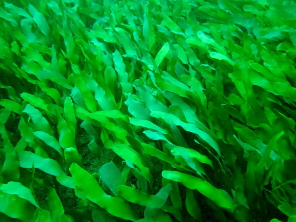
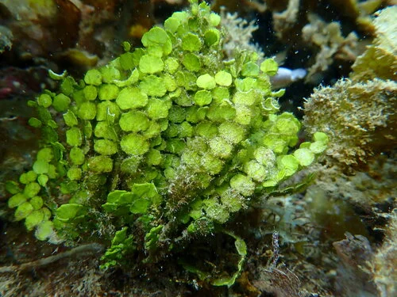

## ESTRUCTURA DE FICHA DE PLANTA

---

## Plantas / Macroalgas — Acuario Marino Arrecife de Coral (REEF)

> **No existen "plantas" marinas** en el sentido estricto del acuario de agua dulce. El equivalente en marino son las **macroalgas**, que desempeñan un papel similar (filtración de nutrientes, refugio, O2). Se cultivan habitualmente en el **refugio** (sump/refugium) para extraer nitratos y fosfatos del sistema.

---

### Caulerpa taxifolia

**Grupo**: Macroalga verde (Chlorophyta)
**Origen**: Indo-Pacífico (invasora en el Mediterráneo)
**Temperatura**: 22 – 28°C
**Salinidad**: 1.023 – 1.025
**Dificultad**: ★☆☆☆☆
**Luz**: media – alta
**Crecimiento**: muy rápido
**Notas**: La macroalga más fácil de cultivar. Excelente exportadora de nutrientes en el refugio. En el acuario principal puede crecer demasiado rápido e invadir corales. Si va a estolonizar, puede "esporular" (liberar todo el citoplasma de golpe) matando todo lo que rodea — esto ocurre si se poda en exceso o la planta llega al límite de su ciclo. Recolectar regularmente en lugar de podar. Especie invasora: nunca tirar al exterior.

---

### Caulerpa prolifera

**Grupo**: Macroalga verde (Chlorophyta)
**Origen**: Mediterráneo, Atlántico
**Temperatura**: 22 – 28°C
**Salinidad**: 1.022 – 1.026
**Dificultad**: ★☆☆☆☆
**Luz**: media
**Crecimiento**: rápido
**Notas**: Hojas planas y anchas de color verde intenso. Menos invasiva que C. taxifolia. Excelente en refugio para extracción de nutrientes. Más estable que C. taxifolia — menor riesgo de esporulación. Muy usada en refugios mediterráneos y atlánticos.

---

### Chaetomorpha (Chaetomorpha linum)

**Grupo**: Macroalga verde filamentosa (Chlorophyta)
**Origen**: Cosmopolita (mares templados y tropicales)
**Temperatura**: 20 – 28°C
**Salinidad**: 1.022 – 1.026
**Dificultad**: ★☆☆☆☆
**Luz**: alta
**Crecimiento**: muy rápido
**Notas**: El "scrubber" de nutrientes más popular del refugio de marino. La masa de filamentos gruesos captura nitratos y fosfatos muy eficientemente. Se cosecha sacando porciones de la masa. No tiene riesgo de esporulación. Los anfípodos y copépodos se reproducen entre sus filamentos: fuente de alimento vivo para el acuario principal.

---

### Halimeda (Halimeda spp.)

**Grupo**: Macroalga verde calcárea (Chlorophyta)
**Origen**: Indo-Pacífico, Caribe (arrecifes de coral)
**Temperatura**: 23 – 27°C
**Salinidad**: 1.023 – 1.025
**Dificultad**: ★★★☆☆
**Luz**: media – alta
**Crecimiento**: lento – medio
**Notas**: Segmentos calcificados en forma de monedas o apliques. Consume calcio del agua para crecer (como los corales). Muy ornamental en el arrecife principal. Los segmentos calcificados que caen forman arena aragonítica natural con el tiempo. Necesita suplemento de calcio si crece mucho.
