## ESTRUCTURA DE FICHA DE PEZ MARINO

```
### Nombre Común (Nombre científico)
**Familia**:
**Origen**:
**Tamaño**: adulto
**Temperatura**: °C
**pH**: (rango marino estándar salvo excepción)
**Salinidad**: densidad objetivo
**Dificultad**: ★ a ★★★★★
**Tipo de acuario**: FOWLR / Reef / Ambos
**Nivel de nado**: fondo / medio / superficie
**Comportamiento**: pacífico / semiagrresivo / agresivo
**Mínimo de individuos**: (si aplica)
**Tamaño de acuario mínimo**: litros
**Dieta**: omnívoro / carnívoro / herbívoro / planctívoro
**Reproducción**: ovíparo / hermafrodita secuencial
**Reef Safe**: sí / no / precaución
```

---

## Peces — Acuario Marino Arrecife de Coral (REEF)

> El acuario REEF alberga corales vivos. Solo son aptos peces **Reef Safe** (seguros para el arrecife) que no picotean, coman ni dañen corales, anémonas ni invertebrados de limpieza. Los peces NO reef safe (la mayoría de mariposas, algunos ángeles) están excluidos de este tipo de acuario.

---

## Familia Pomacentridae (Peces Payaso y Damiselas)

### Pez Payaso Ocellaris / Pez Payaso Falso (Amphiprion ocellaris)


**Familia**: Pomacentridae
**Origen**: Indo-Pacífico (Océano Índico Oriental y Pacífico Occidental)
**Tamaño**: 11 cm
**Temperatura**: 24 – 26°C
**pH**: 8.1 – 8.4
**Salinidad**: 1.023 – 1.025
**Dificultad**: ★★☆☆☆
**Tipo de acuario**: Reef (ideal) / FOWLR
**Nivel de nado**: medio
**Comportamiento**: pacífico (territorial alrededor de su anémona/zona)
**Mínimo de individuos**: 1 o pareja
**Tamaño de acuario mínimo**: 120 litros
**Dieta**: omnívoro (zooplancton, algas, escamas marinas)
**Reproducción**: ovíparo; hermafrodita protándrico (todos nacen machos; el dominante se convierte en hembra)
**Reef Safe**: ✅ sí
**Notas**: El pez marino más popular del mundo. En pareja, el individuo más grande es siempre la hembra. Si la hembra muere, el macho dominante cambia de sexo. No es imprescindible una anémona, pero convive naturalmente con Entacmaea quadricolor y Heteractis magnifica. Preferir ejemplares de cautividad.

---

### Pez Payaso Verdadero / Naranja (Amphiprion percula)
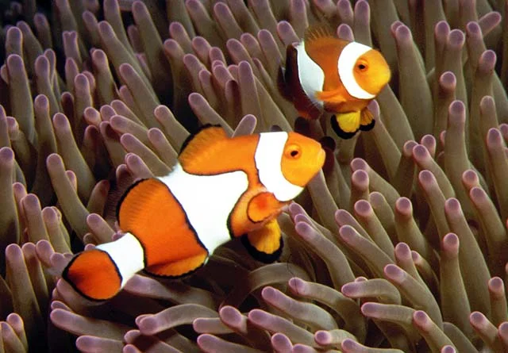

**Familia**: Pomacentridae
**Origen**: Pacífico Occidental (Australia, Papua Nueva Guinea)
**Tamaño**: 11 cm
**Temperatura**: 24 – 26°C
**pH**: 8.1 – 8.4
**Salinidad**: 1.023 – 1.025
**Dificultad**: ★★☆☆☆
**Tipo de acuario**: Reef / FOWLR
**Nivel de nado**: medio
**Comportamiento**: pacífico
**Mínimo de individuos**: 1 o pareja
**Tamaño de acuario mínimo**: 120 litros
**Dieta**: omnívoro
**Reproducción**: ovíparo; hermafrodita protándrico
**Reef Safe**: ✅ sí
**Notas**: Similar a A. ocellaris pero con anillos negros más gruesos y definidos. Mantenimiento idéntico. Muchas variedades de selección (Picasso, Platinum, Snowflake, DaVinci). Se asocia con las mismas anémonas.

---

### Pez Payaso de Clark (Amphiprion clarkii)
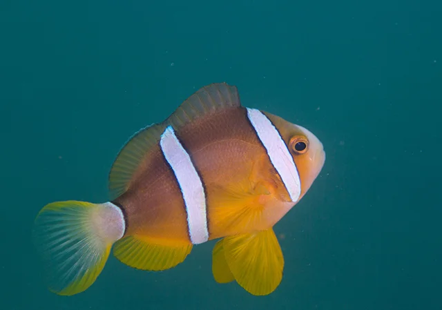

**Familia**: Pomacentridae
**Origen**: Océano Índico y Pacífico Occidental
**Tamaño**: 15 cm
**Temperatura**: 23 – 27°C
**pH**: 8.1 – 8.4
**Salinidad**: 1.022 – 1.025
**Dificultad**: ★☆☆☆☆
**Tipo de acuario**: Reef / FOWLR
**Nivel de nado**: medio
**Comportamiento**: semiagrresivo (más agresivo que A. ocellaris)
**Mínimo de individuos**: 1 o pareja
**Tamaño de acuario mínimo**: 120 litros
**Dieta**: omnívoro
**Reproducción**: ovíparo; hermafrodita protándrico
**Reef Safe**: ✅ sí
**Notas**: Uno de los payasos más resistentes y adaptables. Se asocia con hasta 10 especies de anémonas. Algo más agresivo que A. ocellaris en defensa de su anémona. Colores variables: amarillo, naranja y negro.

---

### Damisela de Cola Amarilla (Chrysiptera parasema)
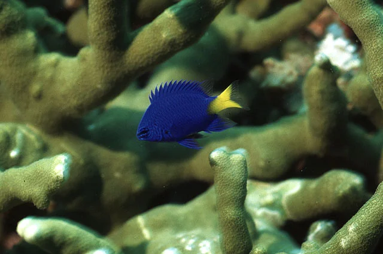

**Familia**: Pomacentridae
**Origen**: Pacífico Occidental
**Tamaño**: 7 cm
**Temperatura**: 24 – 26°C
**pH**: 8.1 – 8.4
**Salinidad**: 1.023 – 1.025
**Dificultad**: ★☆☆☆☆
**Tipo de acuario**: Reef / FOWLR
**Nivel de nado**: medio
**Comportamiento**: semiagrresivo (territorial)
**Mínimo de individuos**: 1 o grupo de 5+ con espacio suficiente
**Tamaño de acuario mínimo**: 100 litros
**Dieta**: omnívoro
**Reproducción**: ovíparo
**Reef Safe**: ✅ sí
**Notas**: Cuerpo azul brillante con aleta caudal amarilla. Una de las damiselas menos agresivas. Una vez establecida en su territorio puede dificultar la introducción de otros peces.

---

## Familia Acanthuridae (Cirujanos / Tangs)

### Cirujano Azul Real (Paracanthurus hepatus)


**Familia**: Acanthuridae
**Origen**: Indo-Pacífico
**Tamaño**: 31 cm
**Temperatura**: 24 – 26°C
**pH**: 8.1 – 8.4
**Salinidad**: 1.023 – 1.025
**Dificultad**: ★★★☆☆
**Tipo de acuario**: Reef / FOWLR
**Nivel de nado**: medio (necesita mucho espacio)
**Comportamiento**: semiagrresivo (con otros tangs azules)
**Mínimo de individuos**: 1
**Tamaño de acuario mínimo**: 400 litros
**Dieta**: herbívoro – omnívoro (algas, nori, artemia)
**Reproducción**: ovíparo
**Reef Safe**: ✅ sí
**Notas**: El "Dory" de la película. Muy susceptible al ich marino. Necesita acuarios grandes para nadar. Come principalmente algas filamentosas y nori. NO apto para acuarios pequeños.

---

### Cirujano Amarillo (Zebrasoma flavescens)


**Familia**: Acanthuridae
**Origen**: Pacífico (Hawaii, Japón)
**Tamaño**: 20 cm
**Temperatura**: 24 – 26°C
**pH**: 8.1 – 8.4
**Salinidad**: 1.023 – 1.025
**Dificultad**: ★★☆☆☆
**Tipo de acuario**: Reef / FOWLR
**Nivel de nado**: medio
**Comportamiento**: semiagrresivo (con otros tangs)
**Mínimo de individuos**: 1
**Tamaño de acuario mínimo**: 300 litros
**Dieta**: herbívoro (algas, nori, spirulina)
**Reproducción**: ovíparo
**Reef Safe**: ✅ sí
**Notas**: El tang más recomendado para comenzar en marinos. Más resistente al ich que el Cirujano Azul. Amarillo intenso muy llamativo. Complementar con alga nori varias veces a la semana.

---

## Familia Labridae (Labros / Wrasse)

### Labro de Seis Líneas (Pseudocheilinus hexataenia)
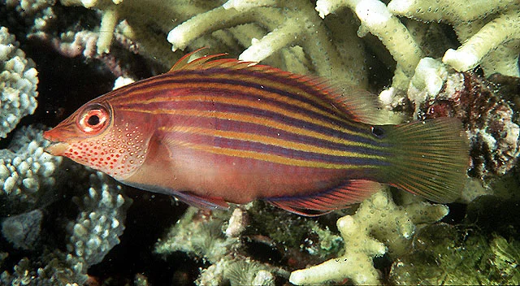

**Familia**: Labridae
**Origen**: Indo-Pacífico
**Tamaño**: 9 cm
**Temperatura**: 24 – 26°C
**pH**: 8.1 – 8.4
**Salinidad**: 1.023 – 1.025
**Dificultad**: ★★☆☆☆
**Tipo de acuario**: Reef / FOWLR
**Nivel de nado**: fondo – medio
**Comportamiento**: semiagrresivo (agresivo con otros labros pequeños)
**Mínimo de individuos**: 1
**Tamaño de acuario mínimo**: 150 litros
**Dieta**: carnívoro (flatworms, poliquetos, copépodos)
**Reproducción**: ovíparo; hermafrodita
**Reef Safe**: ✅ sí (puede comer gambas ornamentales pequeñas)
**Notas**: Seis líneas azules y naranjas muy vistosas. Come flatworms dañinos para corales. Puede ser agresivo con peces nuevos. Útil como control biológico de flatworms en reef.

---

### Labro Amarillo de Canarias (Halichoeres chrysus)
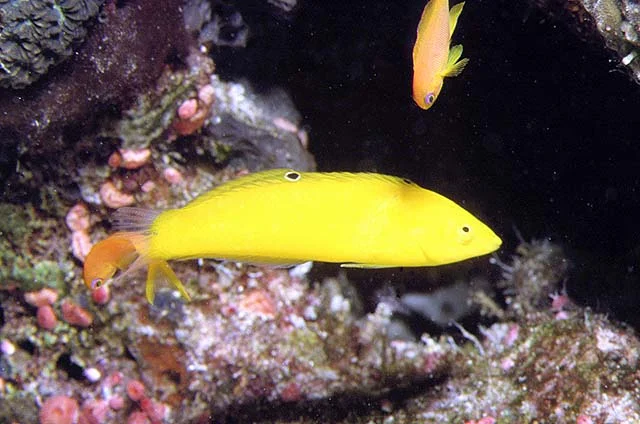

**Familia**: Labridae
**Origen**: Indo-Pacífico
**Tamaño**: 12 cm
**Temperatura**: 24 – 26°C
**pH**: 8.1 – 8.4
**Salinidad**: 1.023 – 1.025
**Dificultad**: ★★☆☆☆
**Tipo de acuario**: Reef / FOWLR
**Nivel de nado**: medio – fondo
**Comportamiento**: pacífico
**Mínimo de individuos**: 1 o harén 1M + 2-3H
**Tamaño de acuario mínimo**: 150 litros
**Dieta**: carnívoro (poliquetos, copépodos)
**Reproducción**: ovíparo; hermafrodita protógino
**Reef Safe**: ✅ sí
**Notas**: Color amarillo brillante uniforme. Duerme enterrado en la arena: necesita mínimo 5-8 cm de arena fina. Come parásitos del sustrato. Si está estresado se entierra en segundos.

---

### Labro Mandarín (Synchiropus splendidus)
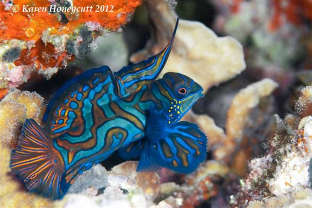

**Familia**: Callionymidae
**Origen**: Pacífico Occidental
**Tamaño**: 6 cm
**Temperatura**: 24 – 26°C
**pH**: 8.1 – 8.4
**Salinidad**: 1.023 – 1.025
**Dificultad**: ★★★★★
**Tipo de acuario**: Reef
**Nivel de nado**: fondo – medio
**Comportamiento**: pacífico
**Mínimo de individuos**: 1 o pareja
**Tamaño de acuario mínimo**: 200 litros con refugio activo de copépodos
**Dieta**: carnívoro estricto (SOLO copépodos vivos)
**Reproducción**: ovíparo; danza nupcial al atardecer
**Reef Safe**: ✅ sí
**Notas**: El pez más colorido del planeta (color estructural: azul, verde, naranja). Sin escamas: piel cubierta de mucus amargo. Come SOLO copépodos vivos: el refugio debe tener una población reproductiva activa. Solo para acuaristas experimentados que cultiven copépodos.

---

## Familia Gobiidae (Gobios Marinos)

### Gobio Pistolero Amarillo (Cryptocentrus cinctus)
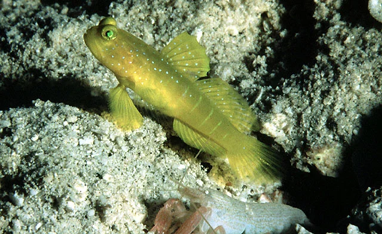

**Familia**: Gobiidae
**Origen**: Pacífico Occidental e Índico
**Tamaño**: 10 cm
**Temperatura**: 24 – 26°C
**pH**: 8.1 – 8.4
**Salinidad**: 1.023 – 1.025
**Dificultad**: ★★☆☆☆
**Tipo de acuario**: Reef / FOWLR
**Nivel de nado**: fondo
**Comportamiento**: pacífico
**Mínimo de individuos**: 1 con su camarón compañero (Alpheus)
**Tamaño de acuario mínimo**: 100 litros
**Dieta**: carnívoro (mysis, escamas, invertebrados)
**Reproducción**: ovíparo
**Reef Safe**: ✅ sí
**Notas**: Simbiosis obligatoria con camarones pistolero Alpheus: el camarón cava la madriguera, el gobio actúa de vigía. Necesita sustrato arenoso profundo para la madriguera.

---

### Gobio Neón (Elacatinus oceanops)
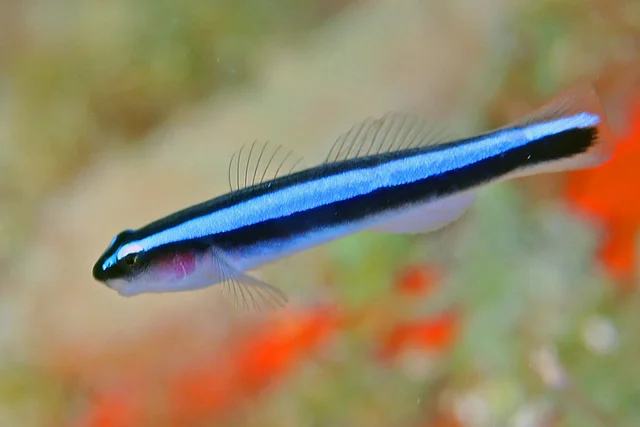

**Familia**: Gobiidae
**Origen**: Caribe
**Tamaño**: 3 cm
**Temperatura**: 23 – 26°C
**pH**: 8.1 – 8.4
**Salinidad**: 1.022 – 1.025
**Dificultad**: ★★☆☆☆
**Tipo de acuario**: Reef / FOWLR
**Nivel de nado**: fondo
**Comportamiento**: pacífico
**Mínimo de individuos**: 2 (forman pares)
**Tamaño de acuario mínimo**: 60 litros
**Dieta**: carnívoro (parásitos, copépodos)
**Reproducción**: ovíparo; se reproduce en cautividad
**Reef Safe**: ✅ sí
**Notas**: Línea azul neón de la cabeza a la cola. Actúa como limpiador de parásitos muy eficientemente. Uno de los pocos gobios que se reproduce en cautividad.

---

### Gobio de Fuego (Nemateleotris magnifica)
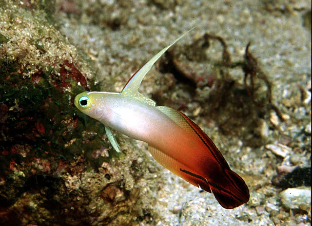

**Familia**: Gobiidae (Microdesmidae)
**Origen**: Indo-Pacífico
**Tamaño**: 9 cm
**Temperatura**: 24 – 26°C
**pH**: 8.1 – 8.4
**Salinidad**: 1.023 – 1.025
**Dificultad**: ★★★☆☆
**Tipo de acuario**: Reef / FOWLR
**Nivel de nado**: medio – agua abierta
**Comportamiento**: pacífico (tímido)
**Mínimo de individuos**: 1 o pareja
**Tamaño de acuario mínimo**: 100 litros
**Dieta**: carnívoro (copépodos, mysis)
**Reproducción**: ovíparo
**Reef Safe**: ✅ sí
**Notas**: Cola roja-naranja y cuerpo blanco con primera aleta dorsal enormemente alargada. Salta cuando se asusta: tapa imprescindible. Se intimida con peces activos o agresivos.

---

## Familia Pomacanthidae (Ángeles Enanos)

### Ángel Llama (Centropyge loricula)
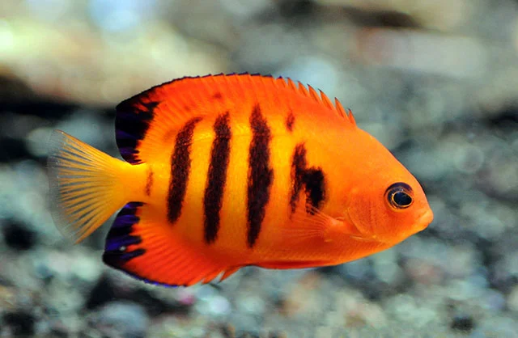

**Familia**: Pomacanthidae
**Origen**: Pacífico Central y Occidental
**Tamaño**: 10 cm
**Temperatura**: 24 – 26°C
**pH**: 8.1 – 8.4
**Salinidad**: 1.023 – 1.025
**Dificultad**: ★★★☆☆
**Tipo de acuario**: Reef (con precaución) / FOWLR
**Nivel de nado**: medio – fondo
**Comportamiento**: semiagrresivo (con otros ángeles enanos)
**Mínimo de individuos**: 1 o harén 1M + 2H
**Tamaño de acuario mínimo**: 150 litros
**Dieta**: omnívoro (algas, esponjas, mysis)
**Reproducción**: ovíparo; hermafrodita protógino
**Reef Safe**: ⚠️ precaución (puede picotear corales blandos y LPS)
**Notas**: Naranja-rojo con franjas azul-negro. Comportamiento reef-safe muy variable según el individuo: algunos nunca molestan los corales, otros los picotean constantemente. Introducir con corales ya establecidos y observar durante semanas.

---

### Ángel Coral Beauty (Centropyge bispinosa)
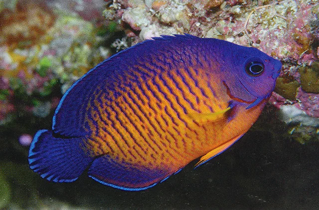

**Familia**: Pomacanthidae
**Origen**: Indo-Pacífico
**Tamaño**: 10 cm
**Temperatura**: 24 – 26°C
**pH**: 8.1 – 8.4
**Salinidad**: 1.023 – 1.025
**Dificultad**: ★★☆☆☆
**Tipo de acuario**: Reef (precaución) / FOWLR
**Nivel de nado**: medio – fondo
**Comportamiento**: semiagrresivo (con congéneres)
**Mínimo de individuos**: 1
**Tamaño de acuario mínimo**: 150 litros
**Dieta**: omnívoro (algas, esponjas)
**Reproducción**: ovíparo; hermafrodita protógino
**Reef Safe**: ⚠️ precaución
**Notas**: Azul profundo en el dorso con naranja en el vientre. Uno de los ángeles enanos más resistentes. Come algas constantemente. Comportamiento con corales impredecible individualmente.
