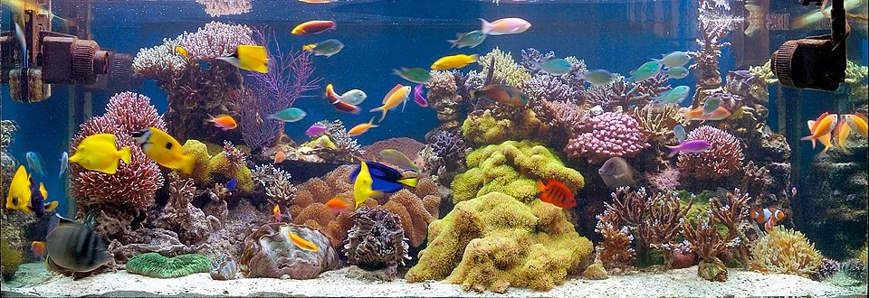

# ACUARIO MARINO — ARRECIFE DE CORAL (REEF)

**Dificultad general**: ★★★☆☆ (blandos y LPS) a ★★★★★ (SPS dominante)
**Coste de setup**: muy alto
**Tamaño mínimo recomendado**: 150 L (blandos/LPS) / 300 L (SPS)
**Para quién es**: avanzado – experto

---

## Descripción

El acuario más exigente, más costoso y más espectacular de todo el hobby. Los corales vivos son los protagonistas. Requiere un equilibrio perfecto de luz, corriente, química del agua y parámetros que imiten el océano natural. La recompensa es un ecosistema subacuático de extraordinaria belleza.

---

## Parámetros del agua (NSW — Natural Sea Water)

| Parámetro | Blandos/LPS | LPS/SPS mixto | SPS dominante |
|-----------|-------------|---------------|---------------|
| Temperatura | 23-27°C | 25-26°C | 25-26°C (±0.5°C) |
| pH | 8.1-8.4 | 8.2-8.4 | 8.2-8.4 |
| Salinidad | 1.023-1.026 | 1.024-1.026 | 1.025-1.026 |
| Ca | 350+ ppm | 400-430 ppm | 420-450 ppm |
| KH (Alk) | 7-11 dKH | 8-10 dKH | 8-9 dKH |
| Mg | 1200+ ppm | 1250-1350 ppm | 1300-1400 ppm |
| NO3 | < 20 ppm | < 5 ppm | 2-5 ppm |
| PO4 | < 0.1 ppm | < 0.05 ppm | 0.03-0.05 ppm |

---

## Equipamiento esencial para reef

| Equipo | Propósito |
|--------|-----------|
| Skimmer de calidad (Nyos, Deltec, Bubble Magus) | Extraer materia orgánica antes de que se descomponga |
| Bombas de circulación de alto caudal (Tunze, Jebao) | Corriente para corales (20-40x volumen/hora) |
| Iluminación LED/T5 de alta calidad (Radion, AI Hydra, Kessil) | Fotosíntesis de zooxantelas; PAR preciso |
| Sump + refugio con macroalgas | Filtración, estabilidad, copépodos |
| ATO (Auto Top Off) | Reponer evaporación automáticamente |
| Dosificadora + sistema Balling (GHL, Kamoer) | Reponer Ca, KH, Mg de forma precisa y automática |
| Controlador de reef (Apex, GHL) | Monitoreo y automatización total |
| Refractómetro de calidad (ATC) | Salinidad diaria |
| Tests completos (Hanna Colorímetro, Salifert) | Control semanal de Ca, KH, Mg, NO3, PO4 |

---

## Algas comunes — cuáles son, por qué aparecen, cómo eliminarlas

En el reef, las algas son uno de los mayores retos y uno de los indicadores más precisos de la salud del sistema.

### Fase de establecimiento (primeras 8-16 semanas)

Todo reef nuevo pasa por fases de algas antes de estabilizarse. Es normal y necesario.

**Semanas 1-4: Diatomas**
Película marrón en todo. Normal. Nassarius y Trochus la controlan. Desaparece sola.

**Semanas 4-8: GHA (Alga Pelo Verde)**
Mechones verdes en rocas y cristal. Señal de que NO3 y PO4 del ciclo inicial están altos.
- Mejorar el skimmer
- Cleanup crew: Trochus, Nassarius, cangrejos ermitaños, cangrejo esmeralda
- Labros comeralgas

**Semanas 6-12: Dinoflagelados (Dinos)**
El enemigo más temido del reef nuevo. Moco marrón-amarillo viscoso sobre la arena.
(Ver sección de protocolo completo más abajo)

**Semanas 12-24: Alga Coralina (CCA)**
La aparición de CCA rosa-morada en las rocas significa que el reef se está estableciendo correctamente. Bienvenida.

---

### Bryopsis (Alga Plumosa Verde)
**Aspecto**: Alga filamentosa verde con ramificaciones en pluma, de 2-8 cm. Muy difícil de eliminar.
**Por qué:** Aparece cuando otros controles fallan; es resistente a la mayoría de tratamientos.
**Solución:**
- Fluconazol (antifúngico): el único tratamiento comprobado. Dosis precisa en agua con circulación. Puede afectar a invertebrados; usarlo con precaución y preparación.
- Labros (Halichoeres, *Pseudocheilinus hexataenia*): comen algo de Bryopsis
- Remoción manual exhaustiva

---

### Cianobacterias (Cyano Marino Rojo)
**Por qué en reef:** NO3 alto, PO4 desequilibrado, poca circulación.
**Solución:**
- Mejorar circulación (las bombas Gyre son excelentes para eliminar zonas muertas)
- Reducir alimentación
- Refugio con macroalgas activo (absorbe NO3 y PO4)
- Cambios de agua más frecuentes

---

### Dinoflagelados (Dinos) — El mayor problema del reef
**Aspecto**: Moco marrón-amarillo viscoso, a veces con burbujas. Aparece de noche/madrugada, se disuelve parcialmente con la luz del día. Cubre la arena y las bases de los corales.
**Por qué:** Múltiples causas: sistema nuevo sin competencia establecida, NO3 y PO4 muy bajos (paradójico), agua "demasiado limpia" sin bacterias diversas.
**Protocolo completo de eliminación:**
1. Identificar el tipo de dino (microscópico si es posible: Ostreopsis, Amphidinium son los más tóxicos)
2. Subir NO3 a 5-10 ppm y PO4 a 0.05-0.1 ppm si están muy bajos
3. Oscuridad total 3-5 días (tapar el acuario completamente)
4. Aspirar físicamente con sifón cada mañana antes de encender la luz
5. Inocular copépodos y anfípodos (Tisbe, Tigriopus): competencia biológica
6. Aumentar la circulación del fondo (los dinos son bentónicos)
7. Paciencia: puede tardar 6-12 semanas en controlarse completamente

---

## El "New Tank Syndrome" en marino

Los primeros 6-12 meses de un reef son los más inestables. Es normal enfrentarse a brotes de algas, fluctuaciones de parámetros y dificultades de establecimiento. La paciencia es la virtud más importante en el reef.

---

## Errores más comunes

- Añadir corales antes de que el sistema esté estabilizado (mínimo 3-6 meses para LPS; 12+ meses para SPS)
- No hacer cuarentena a los peces (introduce ich que se extiende a todo el sistema)
- No dosificar Ca/KH/Mg cuando el consumo de los corales supera los cambios de agua
- Parámetros inestables (peor que parámetros ligeramente bajos pero estables)
- Skimmer insuficiente para el volumen del sistema

---

## Consejos clave

- La estabilidad de los parámetros es más importante que los valores exactos
- Empezar con corales blandos y LPS fáciles (Zoanthus, Mushrooms, Hammers) antes de probar SPS
- El refugio con Chaetomorpha o Caulerpa taxifolia es el mejor método natural para reducir NO3 y PO4
- Tener siempre agua de mar preparada lista para cambios de emergencia
- Documentar todos los parámetros semanalmente para detectar tendencias antes de que causen problemas
