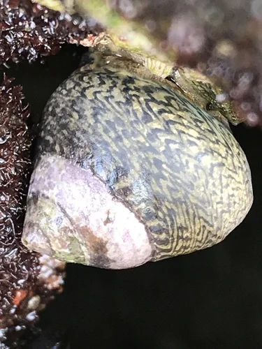
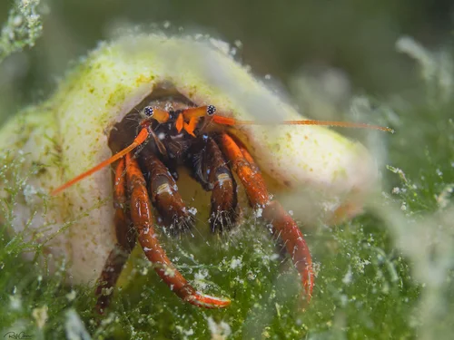
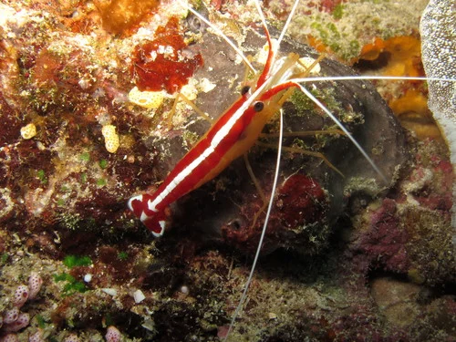

## ESTRUCTURA DE FICHA DE INVERTEBRADO

```
### Nombre Común (Nombre científico)
**Familia**:
**Origen**:
**Tamaño**: adulto
**Temperatura**: °C
**pH**:
**GH / KH / TDS**: (agua dulce) o Salinidad (marino)
**Dificultad**: ★ a ★★★★★
**Tipo de agua**: dulce / marino / salobre
**Comportamiento**: pacífico / semiagrresivo / agresivo
**Compatible con peces**: sí / no / depende (indicar cuáles)
**Dieta**: detritívoro / algívoro / carnívoro / omnívoro / filtrador
**Reproducción**: breve descripción
**Notas**:
```

---

## Invertebrados — Acuario Marino FOWLR

> Los invertebrados en un FOWLR son más limitados que en un REEF por la presencia frecuente de peces agresivos o predadores de invertebrados (ballestas, globos, leones). La **regla de oro** es: si el pez puede comer al invertebrado, no los poner juntos. En un FOWLR estándar con peces pacíficos como payazos y tangs, el cleanup crew completo es viable.

---

### Caracol Nassarius (Nassarius spp.)


**Familia**: Nassariidae
**Origen**: Indo-Pacífico, Atlántico
**Tamaño**: 1.5 – 3 cm
**Temperatura**: 23 – 27°C
**pH**: 8.1 – 8.4
**GH / KH / TDS**: Salinidad 1.023-1.025
**Dificultad**: ★★☆☆☆
**Tipo de agua**: marino
**Comportamiento**: pacífico
**Compatible con peces**: todos excepto peces ballesta, globo o cualquier especie que coma moluscos
**Dieta**: carroñero (restos de comida, animales muertos)
**Reproducción**: ovíparo
**Notas**: Vive enterrado en la arena la mayor parte del tiempo. Emerge a velocidad sorprendente cuando detecta comida. Elimina restos antes de que se descompongan y generan amoniaco. Remueve la arena previniendo zonas anóxicas. No compatible con peces globo ni ballesta.

---

### Caracol Trochus (Trochus spp.)


**Familia**: Trochidae
**Origen**: Indo-Pacífico
**Tamaño**: 2 – 5 cm
**Temperatura**: 23 – 27°C
**pH**: 8.1 – 8.4
**GH / KH / TDS**: Salinidad 1.023-1.025
**Dificultad**: ★☆☆☆☆
**Tipo de agua**: marino
**Comportamiento**: pacífico
**Compatible con peces**: todos excepto peces que comen moluscos
**Dieta**: algívoro (algas en rocas, cristal y sustrato)
**Reproducción**: ovíparo
**Notas**: El mejor comedora de algas del FOWLR. Come algas coralinas y filamentosas en rocas vivas. Puede darse la vuelta solo. Se puede reproducir en el acuario. No poner con peces ballesta o globo.

---

### Cangrejo Ermitaño de Piernas Rojas (Clibanarius digueti)


**Familia**: Diogenidae
**Origen**: Pacífico Este
**Tamaño**: 2 – 3 cm
**Temperatura**: 23 – 27°C
**pH**: 8.1 – 8.4
**GH / KH / TDS**: Salinidad 1.023-1.025
**Dificultad**: ★★☆☆☆
**Tipo de agua**: marino
**Comportamiento**: pacífico (necesita conchas de repuesto)
**Compatible con peces**: con peces pacíficos; NO con ballestas, globos o leones (los comen)
**Dieta**: omnívoro (algas, detritos, pellets)
**Reproducción**: sexual; larvas planctónicas
**Notas**: Parte del cleanup crew en FOWLR con peces pacíficos. Proporcionar siempre conchas vacías extra o atacarán a otros ermitaños para robarles la concha. Incompatibles con peces predadores de crustáceos.

---

### Cangrejo Esmeralda (Mithraculus sculptus)


**Familia**: Majidae
**Origen**: Caribe y Atlántico Occidental
**Tamaño**: 5 cm
**Temperatura**: 23 – 27°C
**pH**: 8.1 – 8.4
**GH / KH / TDS**: Salinidad 1.023-1.025
**Dificultad**: ★★☆☆☆
**Tipo de agua**: marino
**Comportamiento**: semiagrresivo
**Compatible con peces**: con peces pacíficos; no con ballestas ni globos
**Dieta**: algívoro especializado en Bubble Algae (Valonia)
**Reproducción**: sexual; larvas planctónicas
**Notas**: El único control biológico efectivo contra las Bubble Algae. En FOWLR con peces pacíficos puede mantenerse bien. Los peces ballesta y globo lo comerán inmediatamente.

---

### Gamba Limpiadora de Skunk (Lysmata amboinensis)


**Familia**: Lysmatidae
**Origen**: Indo-Pacífico
**Tamaño**: 6 cm
**Temperatura**: 24 – 26°C
**pH**: 8.1 – 8.4
**GH / KH / TDS**: Salinidad 1.023-1.025
**Dificultad**: ★★☆☆☆
**Tipo de agua**: marino
**Comportamiento**: pacífico
**Compatible con peces**: con peces pacíficos y semi-agresivos que no coman gambas; NO con peces globo, ballesta ni labros grandes
**Dieta**: limpiadora (parásitos de otros peces) y carroñera
**Reproducción**: hermafrodita simultánea
**Notas**: Muy útil en FOWLR para el control de ich y parásitos en los peces. Los peces reconocen la "estación de limpieza" y se dejan limpiar. Incompatible con peces predadores de crustáceos (ballestas, globos, labros carnívoros grandes).
