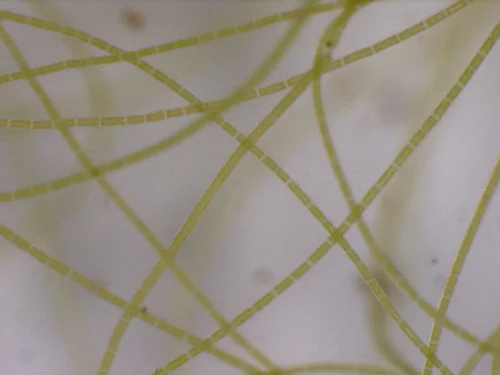
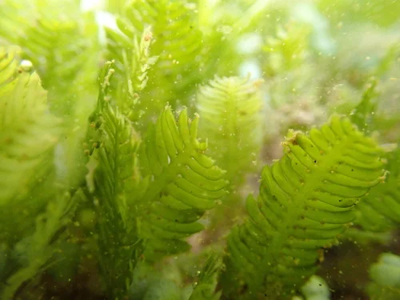

## ESTRUCTURA DE FICHA DE PLANTA

---

## Plantas / Macroalgas — Acuario Marino FOWLR

> No existen "plantas" marinas en el sentido del acuario dulce. En el FOWLR, las macroalgas se cultivan en el **refugio** (sump/refugium) para exportar nitratos y fosfatos. En el acuario principal, la roca viva y el sustrato albergan microalgas coralinas (encostradas rosas/moradas) que son beneficiosas.

---

### Chaetomorpha (Chaetomorpha linum)

**Grupo**: Macroalga verde filamentosa
**Origen**: Cosmopolita
**Temperatura**: 20 – 28°C
**Salinidad**: 1.022 – 1.026
**Dificultad**: ★☆☆☆☆
**Luz**: alta (en el refugio)
**Crecimiento**: muy rápido
**Notas**: La macroalga más eficiente para la exportación de nutrientes en el refugio del FOWLR. Los FOWLR suelen tener cargas de peces más altas (más nitratos) que los REEF, lo que hace este papel aún más importante. Se cosecha regularmente sacando porciones de la masa. Alberga copépodos y anfípodos que enriquecen el refugio.

---

### Caulerpa (Caulerpa taxifolia / C. prolifera)

**Grupo**: Macroalga verde
**Origen**: Indo-Pacífico / Mediterráneo
**Temperatura**: 22 – 28°C
**Salinidad**: 1.022 – 1.026
**Dificultad**: ★☆☆☆☆
**Luz**: media – alta
**Crecimiento**: muy rápido
**Notas**: Alternativa a Chaetomorpha en el refugio. C. taxifolia puede esporulizar si se poda en exceso o llega a su ciclo límite: recolectar en lugar de podar. Especie invasora en el Mediterráneo: nunca tirar al exterior.
