## ESTRUCTURA DE FICHA DE PEZ MARINO

```
### Nombre Común (Nombre científico)
**Familia**:
**Origen**:
**Tamaño**: adulto
**Temperatura**: °C
**pH**: (rango marino estándar salvo excepción)
**Salinidad**: densidad objetivo
**Dificultad**: ★ a ★★★★★
**Tipo de acuario**: FOWLR / Reef / Ambos
**Nivel de nado**: fondo / medio / superficie
**Comportamiento**: pacífico / semiagrresivo / agresivo
**Mínimo de individuos**: (si aplica)
**Tamaño de acuario mínimo**: litros
**Dieta**: omnívoro / carnívoro / herbívoro / planctívoro
**Reproducción**: ovíparo / hermafrodita secuencial
**Reef Safe**: sí / no / precaución
```

---

## Peces — Acuario Marino FOWLR

> El acuario **FOWLR** (Fish Only With Live Rock) es más permisivo que el REEF: no hay corales vivos que proteger, por lo que pueden mantenerse peces **NO reef safe** como mariposas, ángeles grandes, ballestas, leones y globos. La roca viva proporciona filtración biológica y escondites sin ser el objetivo decorativo principal. Se incluyen tanto peces reef-safe como peces exclusivos de FOWLR.

---

## Peces Reef-Safe (aptos también en REEF)

### Pez Payaso Ocellaris (Amphiprion ocellaris)
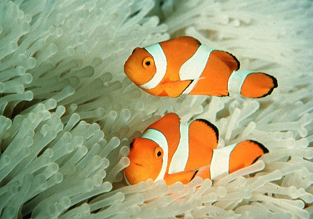

**Familia**: Pomacentridae
**Origen**: Indo-Pacífico
**Tamaño**: 11 cm
**Temperatura**: 24 – 26°C
**pH**: 8.1 – 8.4
**Salinidad**: 1.023 – 1.025
**Dificultad**: ★★☆☆☆
**Tipo de acuario**: Reef / FOWLR
**Nivel de nado**: medio
**Comportamiento**: pacífico (territorial en zona)
**Mínimo de individuos**: 1 o pareja
**Tamaño de acuario mínimo**: 120 litros
**Dieta**: omnívoro
**Reproducción**: ovíparo; hermafrodita protándrico
**Reef Safe**: ✅ sí
**Notas**: El pez marino más popular. En pareja, el más grande se convierte en hembra. No necesita anémona pero puede alojarse en corales blandos o zonas rocosas en FOWLR.

---

### Cirujano Amarillo (Zebrasoma flavescens)
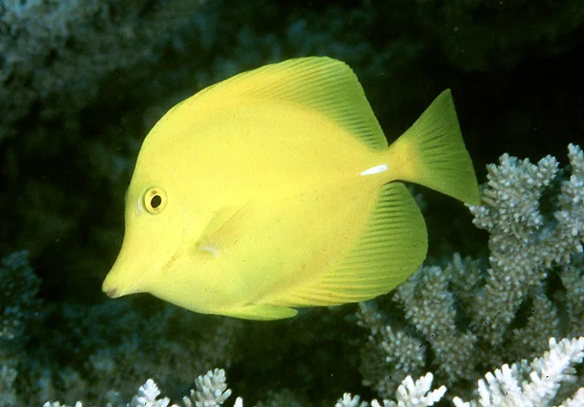

**Familia**: Acanthuridae
**Origen**: Pacífico (Hawaii, Japón)
**Tamaño**: 20 cm
**Temperatura**: 24 – 26°C
**pH**: 8.1 – 8.4
**Salinidad**: 1.023 – 1.025
**Dificultad**: ★★☆☆☆
**Tipo de acuario**: Reef / FOWLR
**Nivel de nado**: medio
**Comportamiento**: semiagrresivo (con otros tangs)
**Mínimo de individuos**: 1
**Tamaño de acuario mínimo**: 300 litros
**Dieta**: herbívoro (algas, nori, spirulina)
**Reproducción**: ovíparo
**Reef Safe**: ✅ sí
**Notas**: El tang más recomendado para comenzar en marinos. Muy visible y activo. Come algas del acuario; complementar con nori. Puede ser agresivo con tangs introducidos después.

---

### Cirujano Azul Real (Paracanthurus hepatus)
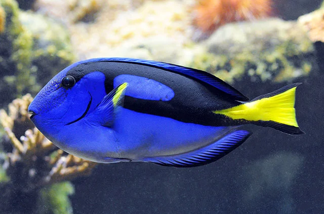

**Familia**: Acanthuridae
**Origen**: Indo-Pacífico
**Tamaño**: 31 cm
**Temperatura**: 24 – 26°C
**pH**: 8.1 – 8.4
**Salinidad**: 1.023 – 1.025
**Dificultad**: ★★★☆☆
**Tipo de acuario**: Reef / FOWLR
**Nivel de nado**: medio
**Comportamiento**: semiagrresivo
**Mínimo de individuos**: 1
**Tamaño de acuario mínimo**: 400 litros
**Dieta**: herbívoro – omnívoro
**Reproducción**: ovíparo
**Reef Safe**: ✅ sí
**Notas**: Muy susceptible al ich marino. Necesita acuarios grandes para nadar. Come principalmente algas y nori.

---

### Gobio de Fuego (Nemateleotris magnifica)
**Familia**: Gobiidae (Microdesmidae)
**Origen**: Indo-Pacífico
**Tamaño**: 9 cm
**Temperatura**: 24 – 26°C
**pH**: 8.1 – 8.4
**Salinidad**: 1.023 – 1.025
**Dificultad**: ★★★☆☆
**Tipo de acuario**: Reef / FOWLR
**Nivel de nado**: medio
**Comportamiento**: pacífico (tímido)
**Mínimo de individuos**: 1 o pareja
**Tamaño de acuario mínimo**: 100 litros
**Dieta**: carnívoro (copépodos, mysis)
**Reproducción**: ovíparo
**Reef Safe**: ✅ sí
**Notas**: Cola roja-naranja llamativa con primera aleta dorsal muy alargada. Salta con facilidad: tapa imprescindible. Puede intimidarse con peces activos.

---

## Peces Exclusivos FOWLR (NO Reef Safe)

### Mariposa de Hocico Largo (Forcipiger flavissimus)
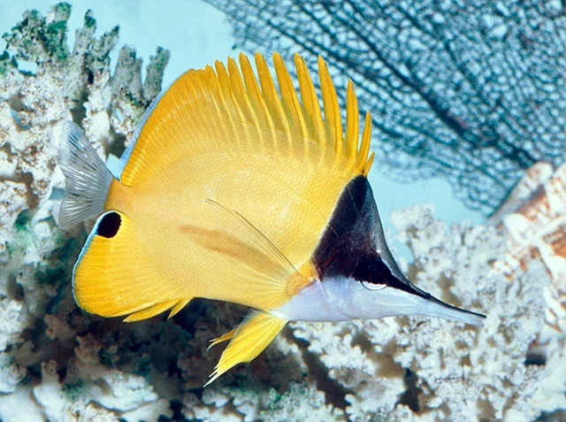

**Familia**: Chaetodontidae
**Origen**: Indo-Pacífico y Pacífico Este
**Tamaño**: 22 cm
**Temperatura**: 24 – 26°C
**pH**: 8.1 – 8.4
**Salinidad**: 1.023 – 1.025
**Dificultad**: ★★★☆☆
**Tipo de acuario**: FOWLR
**Nivel de nado**: medio
**Comportamiento**: pacífico
**Mínimo de individuos**: 1 o pareja
**Tamaño de acuario mínimo**: 200 litros
**Dieta**: carnívoro (invertebrados, pólipos de coral)
**Reproducción**: ovíparo
**Reef Safe**: ❌ no (come pólipos de LPS)
**Notas**: El hocico alargado le permite extraer poliquetos y crustáceos de grietas. Come pólipos de corales LPS y tubeworms. Muy llamativo por el amarillo brillante y la máscara negra.

---

### Mariposa de Raccoon (Chaetodon lunula)
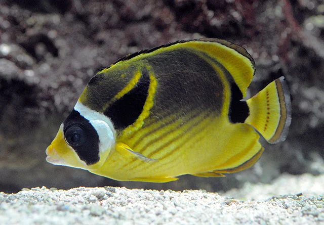

**Familia**: Chaetodontidae
**Origen**: Indo-Pacífico
**Tamaño**: 20 cm
**Temperatura**: 24 – 26°C
**pH**: 8.1 – 8.4
**Salinidad**: 1.023 – 1.025
**Dificultad**: ★★★☆☆
**Tipo de acuario**: FOWLR exclusivamente
**Nivel de nado**: medio
**Comportamiento**: pacífico
**Mínimo de individuos**: 1 o pareja
**Tamaño de acuario mínimo**: 200 litros
**Dieta**: omnívoro (algas, corales, tunicados, invertebrados)
**Reproducción**: ovíparo
**Reef Safe**: ❌ no
**Notas**: Patrón con máscara negra en el ojo y banda posterior negra, similar a un mapache. Resistente y fácil de mantener en FOWLR. Come corales, anémonas y otros invertebrados: nunca en reef.

---

### Ángel Imperial (Pomacanthus imperator)
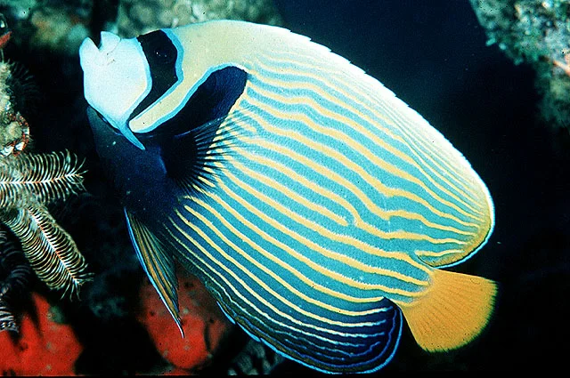

**Familia**: Pomacanthidae
**Origen**: Indo-Pacífico
**Tamaño**: 38 cm
**Temperatura**: 23 – 26°C
**pH**: 8.1 – 8.4
**Salinidad**: 1.023 – 1.025
**Dificultad**: ★★★★☆
**Tipo de acuario**: FOWLR
**Nivel de nado**: medio
**Comportamiento**: semiagrresivo – agresivo
**Mínimo de individuos**: 1
**Tamaño de acuario mínimo**: 500 litros
**Dieta**: omnívoro (esponjas, tunicados, algas, escamas de calidad)
**Reproducción**: ovíparo; hermafrodita protógino
**Reef Safe**: ❌ no (come esponjas y corales)
**Notas**: El cambio de coloración de juvenil (anillos blancos y azules sobre negro) a adulto (franjas amarillas y azules horizontales) es uno de los fenómenos más espectaculares del hobby marino. Solo para acuarios muy grandes. Difícil de adaptar a escamas sin experiencia.

---

### Pez Ballesta Picasso (Rhinecanthus aculeatus)
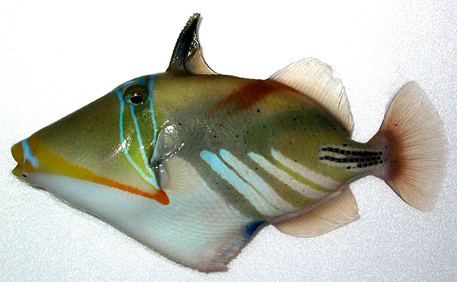

**Familia**: Balistidae
**Origen**: Indo-Pacífico
**Tamaño**: 30 cm
**Temperatura**: 23 – 26°C
**pH**: 8.1 – 8.4
**Salinidad**: 1.022 – 1.025
**Dificultad**: ★★☆☆☆
**Tipo de acuario**: FOWLR
**Nivel de nado**: medio
**Comportamiento**: agresivo (muerde equipo, cables y manos)
**Mínimo de individuos**: 1
**Tamaño de acuario mínimo**: 300 litros
**Dieta**: carnívoro (erizos, crustáceos, moluscos, corales)
**Reproducción**: ovíparo
**Reef Safe**: ❌ no
**Notas**: Patrón de colores como un cuadro de Picasso. Muy inteligente y curioso, interactúa con el dueño. Puede morder termómetros, mangueras, cables y dedos. La aleta dorsal tiene un "gatillo" para bloquearse en grietas. Nunca en reef.

---

### Pez Ballesta Payaso (Balistoides conspicillum)
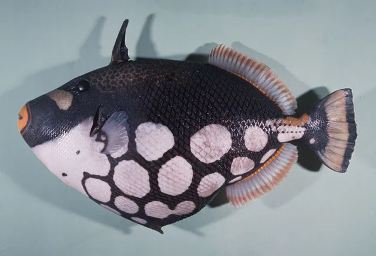

**Familia**: Balistidae
**Origen**: Indo-Pacífico
**Tamaño**: 50 cm
**Temperatura**: 23 – 26°C
**pH**: 8.1 – 8.4
**Salinidad**: 1.022 – 1.025
**Dificultad**: ★★★☆☆
**Tipo de acuario**: FOWLR
**Nivel de nado**: medio
**Comportamiento**: agresivo
**Mínimo de individuos**: 1
**Tamaño de acuario mínimo**: 600 litros
**Dieta**: carnívoro (erizos, crustáceos, moluscos)
**Reproducción**: ovíparo
**Reef Safe**: ❌ no
**Notas**: Considerado uno de los peces más bellos del océano: cuerpo negro con grandes puntos blancos y hocico naranja. Muy agresivo con cualquier pez de tamaño similar. Solo para acuarios grandes con peces grandes.

---

### Pez León Común (Pterois volitans)
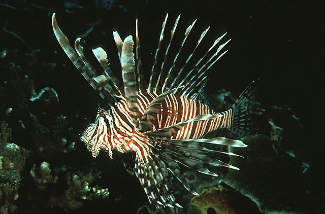

**Familia**: Scorpaenidae
**Origen**: Indo-Pacífico (invasor en Atlántico y Mediterráneo)
**Tamaño**: 35 cm
**Temperatura**: 23 – 26°C
**pH**: 8.1 – 8.4
**Salinidad**: 1.022 – 1.025
**Dificultad**: ★★☆☆☆
**Tipo de acuario**: FOWLR
**Nivel de nado**: fondo – medio
**Comportamiento**: pacífico con peces de su tamaño; devora peces pequeños
**Mínimo de individuos**: 1
**Tamaño de acuario mínimo**: 250 litros
**Dieta**: carnívoro (peces, crustáceos; puede adaptarse a alimento congelado)
**Reproducción**: ovíparo
**Reef Safe**: ❌ no (come peces e invertebrados)
**Notas**: ⚠️ Las espinas dorsales, pélvicas y anales son VENENOSAS: dolor intenso, náuseas. Manejar con redes largas y guantes. Puede adaptarse a comer peces congelados agitados con un palo. Muy tranquilo y lento: acecha y espera. Especie invasora devastadora si se libera al exterior.

---

### Pez Globo Máscarón (Arothron meleagris)
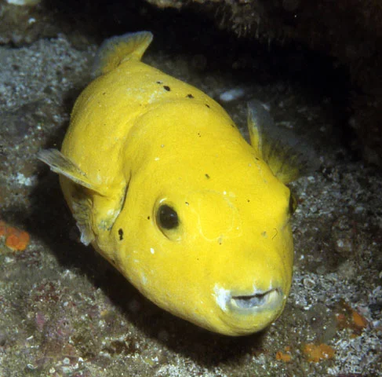

**Familia**: Tetraodontidae
**Origen**: Indo-Pacífico
**Tamaño**: 50 cm
**Temperatura**: 23 – 26°C
**pH**: 8.1 – 8.4
**Salinidad**: 1.022 – 1.025
**Dificultad**: ★★☆☆☆
**Tipo de acuario**: FOWLR
**Nivel de nado**: medio
**Comportamiento**: semiagrresivo – agresivo (con invertebrados)
**Mínimo de individuos**: 1
**Tamaño de acuario mínimo**: 400 litros
**Dieta**: carnívoro (erizos, corales, crustáceos, moluscos)
**Reproducción**: ovíparo
**Reef Safe**: ❌ no
**Notas**: Cuerpo con puntos blancos. Muy inteligente: reconoce al dueño. Come cualquier invertebrado y coral. Los peces globo no tienen escamas. Inflar artificialmente al pez puede ser fatal. Solo con peces grandes que no quepan en su boca.

---

### Labro Lunare (Thalassoma lunare)
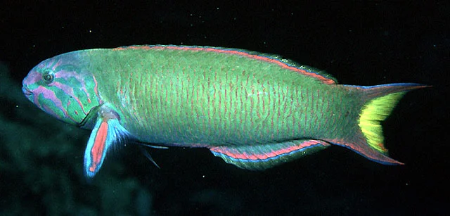

**Familia**: Labridae
**Origen**: Indo-Pacífico, Mar Rojo
**Tamaño**: 25 cm
**Temperatura**: 23 – 27°C
**pH**: 8.1 – 8.4
**Salinidad**: 1.022 – 1.025
**Dificultad**: ★★☆☆☆
**Tipo de acuario**: FOWLR
**Nivel de nado**: medio
**Comportamiento**: agresivo (con peces de tamaño similar)
**Mínimo de individuos**: 1
**Tamaño de acuario mínimo**: 250 litros
**Dieta**: carnívoro (crustáceos, gusanos, moluscos)
**Reproducción**: hermafrodita protogínico
**Reef Safe**: ❌ no
**Notas**: Adulto con colores hipnóticos: verde con líneas rosadas en la cabeza y caudal amarilla con lunula. Uno de los labros más activos y visibles. Ataca a otros peces de forma impredecible, especialmente los recién introducidos. Come todos los invertebrados. Se entierra en la arena para dormir.
