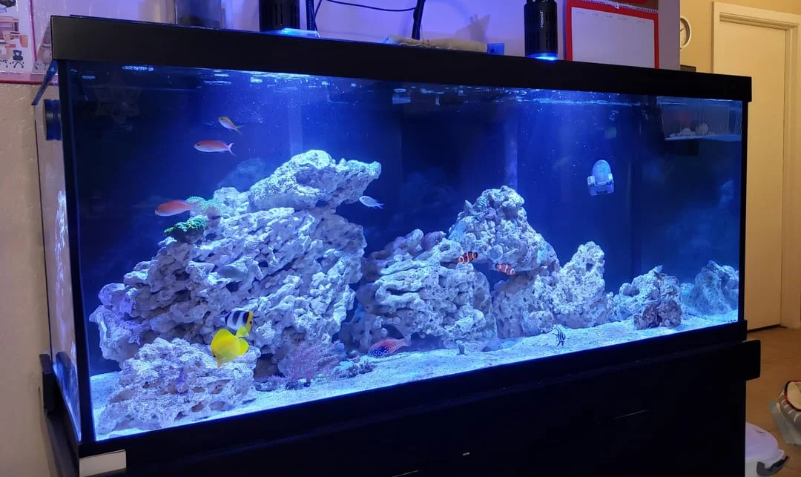

# ACUARIO MARINO — FOWLR (Fish Only With Live Rock)

**Dificultad general**: ★★★☆☆
**Coste de setup**: alto
**Tamaño mínimo recomendado**: 200 L
**Para quién es**: intermedio – avanzado

---

## Descripción

**Fish Only With Live Rock**: peces marinos con roca viva pero sin corales ni invertebrados delicados. Es el punto de entrada al acuario marino. Más permisivo en parámetros que el arrecife, permite peces más grandes y coloridos.

---

## Parámetros del agua

| Parámetro | Rango |
|-----------|-------|
| Temperatura | 24 – 27°C |
| Densidad / Salinidad | 1.020 – 1.025 / 27-35 ppt |
| pH | 8.0 – 8.4 |
| NH3 | 0 ppm |
| NO2 | 0 ppm |
| NO3 | < 30 ppm (más permisivo que reef) |
| PO4 | < 0.5 ppm |

---

## Equipamiento necesario

| Equipo | Especificación |
|--------|---------------|
| Filtro | Skimmer de proteínas + filtración mecánica |
| Roca viva (live rock) | 15-20 kg por 100L (filtro biológico principal) |
| Circulación | 10-20x el volumen/hora |
| Iluminación | Solo estética (LED básico marino o T8) |
| Calefactor | Titanio, anti-corrosión |
| Refractómetro | Para controlar salinidad diariamente |

---

## Fauna habitual en FOWLR

Peces payaso, tangs, peces ballesta, peces mariposa, peces globo, peces ángel grandes, meros, peces León. Muchas especies que no son reef safe se mantienen perfectamente en FOWLR.

---

## Algas comunes — cuáles son, por qué aparecen, cómo eliminarlas

Las algas son uno de los mayores retos del marino. El proceso de establecimiento de un FOWLR tiene fases de algas muy definidas.

### Fase 1 — Diatomas (Semanas 1-4)
**Aspecto**: Película marrón sobre arena, rocas y cristal.
**Por qué:** Silicatos del agua nueva y salinidad. Totalmente normal.
**Solución:** Esperar. Los caracoles Nassarius y Trochus la comen. Desaparece sola.

---

### Fase 2 — Alga Verde Filamentosa (GHA) (Semanas 4-12)
**Aspecto**: Mechones verdes en rocas y sustrato.
**Por qué:** Exceso de nitratos y fosfatos del ciclo inicial. Muy normal en la fase de establecimiento.
**Solución:**
- Skimmer funcionando correctamente (reduce materia orgánica que alimenta las algas)
- Cleanup crew: caracoles Trochus + Nassarius + cangrejos ermitaños
- Cambios de agua periódicos

---

### Alga Pelo Verde Persistente (GHA crónico)
**Por qué persiste:** Nitratos o fosfatos crónicamente altos (sobrealimentación, pocos cambios de agua, skimmer insuficiente).
**Solución:**
- Aumentar el skimmer (o comprar uno más potente)
- Labros comeralgas (Halichoeres chrysus, Cirujano amarillo)
- Cambios de agua más frecuentes
- Revisar la alimentación (reducir)
- Reactor de GFO (fosfatos)

---

### Alga Coralina (CCA — Crustose Coralline Algae)
**Aspecto**: Incrustaciones rosadas, moradas o rojas sobre las rocas y el cristal.
**¿Es mala?** NO. Es completamente beneficiosa: indica agua de calidad, compite con otras algas, embellece las rocas. Es el objetivo de todo acuario marino bien establecido.
**Cómo fomentarla:**
- Mantener Ca > 380 ppm y KH > 8 dKH
- Agua con buena salinidad y calidad
- Luz adecuada sobre las rocas

---

### Dinoflagelados (Dinos)
**Aspecto**: Moco marrón-amarillento viscoso con burbujas de O₂ atrapadas. Cubre la arena y las rocas formando una película pegajosa. Aparece sobre todo por las mañanas.
**Por qué:** Desequilibrio de nutrientes (NO3 y PO4 muy bajos) + fase de establecimiento. Los dinos pueden tomar ventaja cuando no hay suficiente competencia de bacterias y otros microorganismos.
**¿Es peligrosa?** Algunas especies de dinos son tóxicas para los peces e invertebrados.
**Solución (proceso largo, 4-8 semanas):**
1. Oscuridad total 3 días: reduce masivamente la población
2. Aspirar físicamente con sifón todos los días
3. Subir los nitratos si están muy bajos (paradójico: < 1 ppm favorece dinos)
4. Aumentar la circulación del agua
5. Añadir copépodos (competencia natural)
6. Pasteurizar la arena (en casos extremos)
7. Anfípodos y copépodos: inocular el acuario con fauna viva

---

### Cianobacterias (Cyano Marino)
**Aspecto**: Manta de color rojo intenso, marrón-rojiza o naranja sobre la arena y las rocas.
**Por qué:** Agua estancada en zonas del fondo, NO3 alto, exceso de materia orgánica.
**Solución:** Mejorar circulación. Aspirar físicamente. Cambios de agua. Oscuridad 3 días. En casos graves, eritromicina en cuarentena (daña el filtro biológico del sump/live rock).

---

## Cuarentena en FOWLR — IMPRESCINDIBLE

Todos los peces nuevos deben pasar 4-6 semanas en cuarentena antes de entrar al acuario principal:
- Detectar ich marino (*Cryptocaryon irritans*) antes de que contamine el sistema
- El ich puede sobrevivir en el acuario principal sin peces durante 8-10 semanas
- El acuario sin peces ("fallout period") es el único método de eliminar el ich del sistema principal

---

## Errores más comunes

- No hacer cuarentena: introduce ich que luego es imposible tratar sin vaciar el acuario
- Skimmer insuficiente para el tamaño del acuario
- Poca roca viva (el filtro biológico falla)
- Sobrealimentar peces grandes (producen mucho desecho)

---

## Consejos clave

- La cuarentena no es opcional: es la diferencia entre un sistema sano y un desastre con ich
- El skimmer es el corazón del sistema: invertir en uno de calidad desde el principio
- Los cambios de agua del 10-15% semanales mantienen los parámetros estables
- FOWLR es mucho más tolerante a parámetros que un reef, pero eso no significa descuido
- Comenzar el ciclo con la roca viva solamente; no añadir peces hasta que NH3 y NO2 = 0
