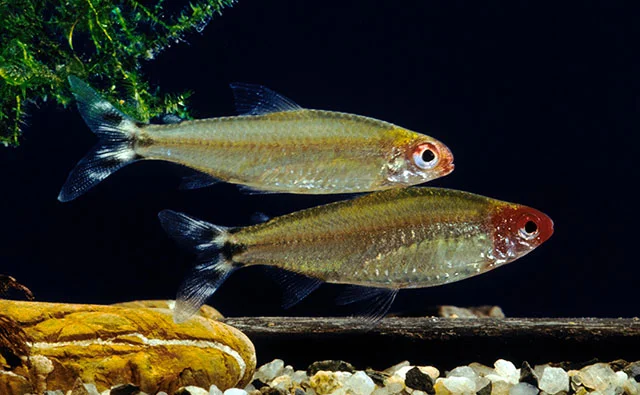
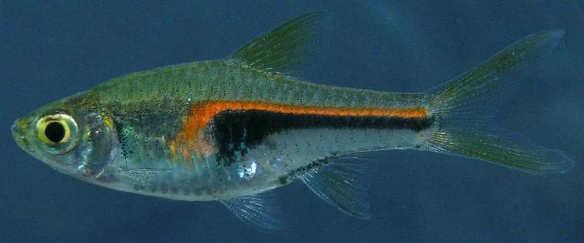
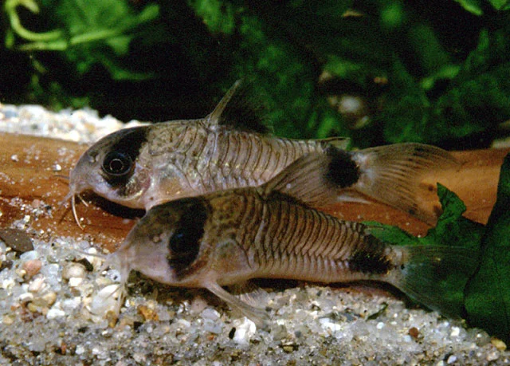
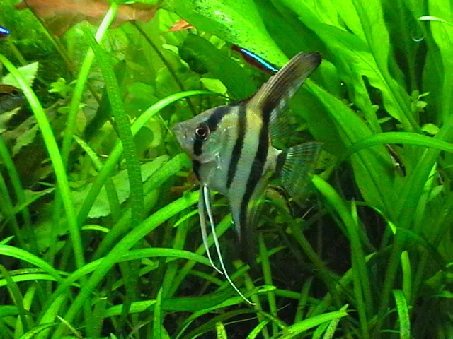

## ESTRUCTURA DE FICHA DE PEZ DULCE

---

## Peces habituales — Acuario Plantado

Peces pacíficos que no dañen plantas, con preferencia por los que ayudan en el control de algas.

---

### Neón Cardinal (Paracheirodon axelrodi)

**Familia**: Characidae
**Origen**: Río Negro y Orinoco (Venezuela, Brasil)
**Tamaño**: 5 cm
**Temperatura**: 23 – 28°C
**pH**: 4.5 – 7.0
**GH**: 0 – 6 °dGH
**Dureza**: muy blanda
**Dificultad**: ★★☆☆☆
**Tipo de agua**: dulce tropical
**Nivel de nado**: medio
**Comportamiento**: pacífico
**Mínimo de individuos**: 6 – 10
**Tamaño de acuario mínimo**: 80 L
**Dieta**: omnívoro
**Reproducción**: ovíparo
**Notas**: Banco espectacular en acuarios plantados de estilo Nature. La franja roja llega hasta la nariz. Requiere agua blanda y ligeramente ácida.

---

### Tetra Rummy Nose (Hemigrammus bleheri)

**Familia**: Characidae
**Origen**: Río Negro y Orinoco
**Tamaño**: 5 cm
**Temperatura**: 24 – 28°C
**pH**: 5.5 – 7.0
**GH**: 2 – 8 °dGH
**Dureza**: blanda
**Dificultad**: ★★☆☆☆
**Tipo de agua**: dulce tropical
**Nivel de nado**: medio
**Comportamiento**: pacífico
**Mínimo de individuos**: 10
**Tamaño de acuario mínimo**: 80 L
**Dieta**: omnívoro
**Reproducción**: ovíparo
**Notas**: Banco muy compacto y sincronizado. La nariz roja es indicador de calidad del agua. Uno de los peces más buscados para plantados estilo iwagumi.

---

### Rasbora Arlequín (Trigonostigma heteromorpha)

**Familia**: Cyprinidae
**Origen**: Tailandia, Malasia, Singapur, Sumatra
**Tamaño**: 4.5 cm
**Temperatura**: 23 – 28°C
**pH**: 6.0 – 7.5
**GH**: 1 – 12 °dGH
**Dureza**: blanda – media
**Dificultad**: ★☆☆☆☆
**Tipo de agua**: dulce tropical
**Nivel de nado**: medio
**Comportamiento**: pacífico
**Mínimo de individuos**: 6 – 8
**Tamaño de acuario mínimo**: 60 L
**Dieta**: omnívoro
**Reproducción**: ovíparo
**Notas**: La mancha triangular negra es característica. Muy popular en plantados asiáticos. No daña las plantas.

---

### Rasbora Hengeli (Trigonostigma hengeli)

**Familia**: Cyprinidae
**Origen**: Sumatra, Borneo
**Tamaño**: 3 cm
**Temperatura**: 23 – 28°C
**pH**: 5.5 – 7.0
**GH**: 1 – 8 °dGH
**Dureza**: muy blanda – blanda
**Dificultad**: ★★☆☆☆
**Tipo de agua**: dulce tropical
**Nivel de nado**: medio
**Comportamiento**: pacífico
**Mínimo de individuos**: 8
**Tamaño de acuario mínimo**: 60 L
**Dieta**: omnívoro
**Reproducción**: ovíparo
**Notas**: Versión mini de la Rasbora Arlequín. Perfecta para nano plantados y acuarios estilo biotopo asiático.

---

### Otocinclus (Otocinclus affinis / vittatus)

**Familia**: Loricariidae
**Origen**: Sudamérica
**Tamaño**: 4 – 5 cm
**Temperatura**: 20 – 26°C
**pH**: 6.0 – 7.5
**GH**: 3 – 15 °dGH
**Dureza**: blanda – media
**Dificultad**: ★★★☆☆
**Tipo de agua**: dulce tropical
**Nivel de nado**: fondo (se pega a cristal y plantas)
**Comportamiento**: pacífico
**Mínimo de individuos**: 3 – 6
**Tamaño de acuario mínimo**: 40 L
**Dieta**: herbívoro (algas verdes, biofilm)
**Reproducción**: ovíparo
**Notas**: **Imprescindible en acuarios plantados.** Controla diatomas y alga verde en cristal. Requiere acuario maduro con biofilm establecido. Muy frágil en los primeros días.

---

### Corydoras Panda (Corydoras panda)

**Familia**: Callichthyidae
**Origen**: Río Ucayali (Perú)
**Tamaño**: 4.5 cm
**Temperatura**: 22 – 26°C
**pH**: 6.0 – 7.0
**GH**: 2 – 10 °dGH
**Dureza**: blanda – media
**Dificultad**: ★★☆☆☆
**Tipo de agua**: dulce tropical
**Nivel de nado**: fondo
**Comportamiento**: pacífico
**Mínimo de individuos**: 6
**Tamaño de acuario mínimo**: 60 L
**Dieta**: omnívoro (detritívoro de fondo)
**Reproducción**: ovíparo
**Notas**: Ideal para limpiar el fondo del plantado sin dañar plantas. Manchas negras en ojo, aleta dorsal y caudal.

---

### Escalara / Pez Ángel (Pterophyllum scalare)

**Familia**: Cichlidae
**Origen**: Cuenca Amazónica
**Tamaño**: 15 cm de alto, 12 cm de largo
**Temperatura**: 26 – 30°C
**pH**: 6.0 – 7.5
**GH**: 3 – 10 °dGH
**Dureza**: blanda – media
**Dificultad**: ★★★☆☆
**Tipo de agua**: dulce tropical
**Nivel de nado**: medio
**Comportamiento**: semiagrresivo (territorial en cría)
**Mínimo de individuos**: 1 pareja o grupo de 4-6
**Tamaño de acuario mínimo**: 150 L (alto, mínimo 50 cm de altura)
**Dieta**: omnívoro
**Reproducción**: ovíparo (guardianes del sustrato)
**Notas**: Come peces pequeños que quepan en la boca (los Neones no son compatibles). Acuario alto imprescindible por su aleta dorsal. Forma parejas monógamas estables.

---

### Betta / Pez Luchador Siamés (Betta splendens)

**Familia**: Osphronemidae
**Origen**: Tailandia, Camboya, Vietnam
**Tamaño**: 7 cm
**Temperatura**: 24 – 30°C
**pH**: 6.0 – 8.0
**GH**: 5 – 20 °dGH
**Dureza**: blanda – media
**Dificultad**: ★★☆☆☆
**Tipo de agua**: dulce tropical
**Nivel de nado**: medio – superficie
**Comportamiento**: agresivo (machos entre sí)
**Mínimo de individuos**: 1 macho solo
**Tamaño de acuario mínimo**: 40 L (preferible 60 L)
**Dieta**: carnívoro
**Reproducción**: ovíparo (nido de burbujas)
**Notas**: Un SOLO macho por acuario. Compatible con plantas y gambas adultas. Los plantados con plantas flotantes y zonas de descanso son el hábitat ideal para el Betta.
