## ESTRUCTURA DE FICHA DE PLANTA

---

## Plantas habituales — Acuario Plantado

Catálogo completo de plantas acuáticas organizadas por dificultad y requisitos.

---

## PLANTAS PARA PRINCIPIANTES (sin CO2, luz baja-media)

### Anubias Nana (Anubias barteri var. nana)

**Familia**: Araceae
**Origen**: Camerún, Nigeria
**Tamaño**: 5 – 15 cm
**Temperatura**: 20 – 30°C
**pH**: 5.5 – 9.0
**GH**: 0 – 20 °dGH
**Dificultad**: ★☆☆☆☆
**Luz**: muy baja – media
**CO2**: no necesario
**Fertilización**: baja
**Crecimiento**: muy lento
**Posición**: primer plano – plano medio, fijada en roca o madera
**Sustrato**: NO enterrar
**Propagación**: división del rizoma
**Notas**: La planta más resistente. Rizoma NUNCA enterrado. Sujetar con hilo o cianoacrilato. Acumula algas GSA con exceso de luz.

---

### Musgo de Java (Taxiphyllum barbieri)

**Familia**: Hypnaceae
**Origen**: Asia del Sur y Sudeste Asiático
**Tamaño**: tapiz de 2 – 5 cm
**Temperatura**: 15 – 30°C
**pH**: 5.0 – 9.0
**GH**: 0 – 20 °dGH
**Dificultad**: ★☆☆☆☆
**Luz**: muy baja – alta
**CO2**: no necesario
**Fertilización**: baja
**Crecimiento**: lento – medio
**Posición**: fijado en roca, madera o tapiz
**Sustrato**: no aplica
**Propagación**: división de la mata
**Notas**: Esencial para crías y gambas. Biofilm entre los filamentos es su mayor valor.

---

### Helecho de Java (Microsorum pteropus)

**Familia**: Polypodiaceae
**Origen**: Sudeste Asiático
**Tamaño**: 20 – 50 cm
**Temperatura**: 18 – 30°C
**pH**: 5.0 – 8.0
**GH**: 0 – 20 °dGH
**Dificultad**: ★☆☆☆☆
**Luz**: muy baja – media
**CO2**: no necesario
**Fertilización**: baja
**Crecimiento**: lento
**Posición**: plano medio – trasera, fijado
**Sustrato**: NO enterrar
**Propagación**: división del rizoma; plántulas en hojas
**Notas**: Variedades: "Windelov", "Trident", "Narrow". Las manchas marrones del envés son esporangios.

---

### Cryptocoryne Wendtii (Cryptocoryne wendtii)
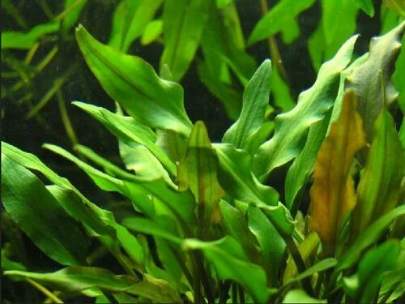

**Familia**: Araceae
**Origen**: Sri Lanka
**Tamaño**: 10 – 25 cm
**Temperatura**: 22 – 28°C
**pH**: 6.0 – 8.0
**GH**: 2 – 18 °dGH
**Dificultad**: ★★☆☆☆
**Luz**: baja – media
**CO2**: no necesario
**Fertilización**: media
**Crecimiento**: muy lento
**Posición**: primer plano – plano medio
**Sustrato**: nutritivo recomendado
**Propagación**: estolones
**Notas**: Puede sufrir "Cryptocoryne melt" al llegar: adaptación normal, rebrota en 2-3 semanas.

---

### Cryptocoryne Parva (Cryptocoryne parva)
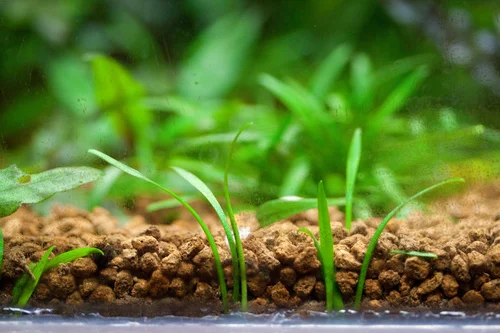

**Familia**: Araceae
**Origen**: Sri Lanka
**Tamaño**: 3 – 8 cm
**Temperatura**: 22 – 28°C
**pH**: 6.0 – 7.5
**GH**: 2 – 15 °dGH
**Dificultad**: ★★★☆☆
**Luz**: media
**CO2**: recomendable
**Fertilización**: media
**Crecimiento**: muy lento
**Posición**: primer plano
**Sustrato**: nutritivo recomendado
**Propagación**: estolones (muy lentos)
**Notas**: La Cryptocoryne más pequeña. Ideal para primer plano sin tapizantes exigentes.

---

### Vallisneria Espiral (Vallisneria spiralis)
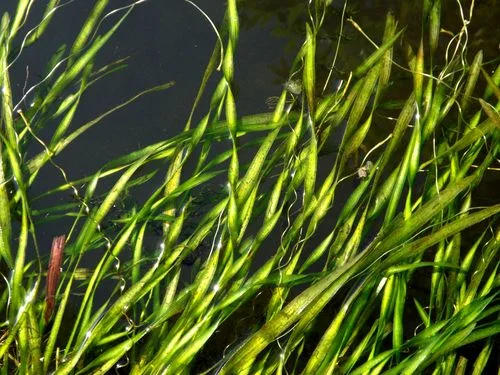

**Familia**: Hydrocharitaceae
**Origen**: Subtropical y tropical (cosmopolita)
**Tamaño**: 30 – 60 cm
**Temperatura**: 15 – 30°C
**pH**: 6.0 – 9.0
**GH**: 5 – 25 °dGH
**Dificultad**: ★☆☆☆☆
**Luz**: media
**CO2**: no necesario
**Fertilización**: baja – media
**Crecimiento**: muy rápido
**Posición**: trasera
**Sustrato**: inerte
**Propagación**: estolones laterales
**Notas**: INCOMPATIBLE con CO2 líquido (Easy Carbo/Excel). La planta de trasera más fácil.

---

### Elodea / Hierba de Agua (Egeria densa)

**Familia**: Hydrocharitaceae
**Origen**: Brasil, Argentina
**Tamaño**: tallo hasta 3 metros (se recorta)
**Temperatura**: 10 – 26°C
**pH**: 6.0 – 8.5
**GH**: 5 – 25 °dGH
**Dificultad**: ★☆☆☆☆
**Luz**: media
**CO2**: no necesario
**Fertilización**: baja
**Crecimiento**: muy rápido
**Posición**: plano medio – trasera
**Sustrato**: inerte o flotando
**Propagación**: esquejes de tallo
**Notas**: Excelente absorbente de nitratos. Tolera temperaturas bajas. Especie invasora: nunca tirar al exterior.

---

## PLANTAS DE DIFICULTAD MEDIA (CO2 recomendable, luz media-alta)

### Hygrophila Polysperma

**Familia**: Acanthaceae
**Origen**: India, Sudeste Asiático
**Tamaño**: 20 – 50 cm
**Temperatura**: 20 – 30°C
**pH**: 5.5 – 8.0
**GH**: 0 – 20 °dGH
**Dificultad**: ★☆☆☆☆
**Luz**: media
**CO2**: no necesario
**Fertilización**: baja
**Crecimiento**: muy rápido
**Posición**: plano medio – trasera
**Sustrato**: inerte
**Propagación**: esquejes
**Notas**: Una de las más resistentes y de crecimiento más rápido.

---

### Hygrophila Difformis (Water Wisteria)

**Familia**: Acanthaceae
**Origen**: India, Bangladés, Tailandia
**Tamaño**: 30 – 50 cm
**Temperatura**: 22 – 30°C
**pH**: 6.0 – 8.0
**GH**: 2 – 15 °dGH
**Dificultad**: ★☆☆☆☆
**Luz**: media – alta
**CO2**: no necesario
**Fertilización**: media
**Crecimiento**: rápido
**Posición**: plano medio – trasera
**Sustrato**: inerte
**Propagación**: esquejes
**Notas**: Hojas muy recortadas como un helecho cuando sumergida. Muy decorativa en grupo.

---

### Rotala Rotundifolia
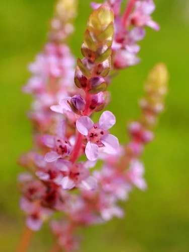

**Familia**: Lythraceae
**Origen**: Sudeste Asiático
**Tamaño**: 20 – 50 cm
**Temperatura**: 22 – 28°C
**pH**: 6.0 – 7.5
**GH**: 2 – 15 °dGH
**Dificultad**: ★★☆☆☆
**Luz**: media – alta
**CO2**: recomendable
**Fertilización**: media
**Crecimiento**: rápido
**Posición**: plano medio – trasera
**Sustrato**: nutritivo recomendado
**Propagación**: esquejes
**Notas**: Con CO2 y luz alta las hojas se vuelven coral/naranja-rojizo. La planta de tallo rosada más popular.

---

### Ludwigia Repens
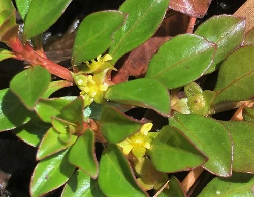

**Familia**: Onagraceae
**Origen**: América del Norte y Central
**Tamaño**: 20 – 50 cm
**Temperatura**: 20 – 28°C
**pH**: 6.0 – 8.0
**GH**: 3 – 18 °dGH
**Dificultad**: ★★☆☆☆
**Luz**: media – alta
**CO2**: recomendable
**Fertilización**: media
**Crecimiento**: rápido
**Posición**: plano medio – trasera
**Sustrato**: inerte – nutritivo
**Propagación**: esquejes
**Notas**: Hojas verdes arriba y rojizas abajo. Con luz intensa las hojas superiores se vuelven rojo-naranja.

---

### Echinodorus Bleheri (Espada Amazónica)
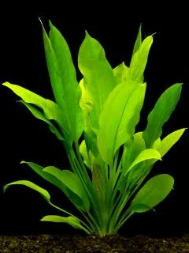

**Familia**: Alismataceae
**Origen**: Sudamérica (Brasil, Bolivia)
**Tamaño**: 30 – 60 cm
**Temperatura**: 22 – 28°C
**pH**: 6.0 – 8.0
**GH**: 3 – 15 °dGH
**Dificultad**: ★★☆☆☆
**Luz**: media – alta
**CO2**: recomendable
**Fertilización**: media – alta
**Crecimiento**: medio
**Posición**: centro – trasera
**Sustrato**: nutritivo recomendado
**Propagación**: estolones con plántulas
**Notas**: Raíces muy potentes: sustrato profundo (5-8 cm). Produce runners con plántulas.

---

### Echinodorus Tenellus (Hierba Pigmea)
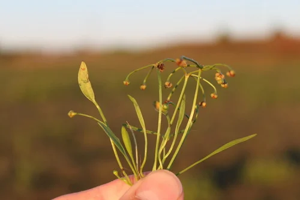

**Familia**: Alismataceae
**Origen**: Norteamérica, Brasil
**Tamaño**: 3 – 10 cm
**Temperatura**: 18 – 28°C
**pH**: 5.5 – 8.0
**GH**: 2 – 15 °dGH
**Dificultad**: ★★☆☆☆
**Luz**: media – alta
**CO2**: recomendable
**Fertilización**: media
**Crecimiento**: medio
**Posición**: primer plano (tapiz natural)
**Sustrato**: nutritivo recomendado
**Propagación**: estolones
**Notas**: Una de las pocas tapizantes que crece sin CO2 a presión. Alternativa a HC Cuba para principiantes.

---

### Sagittaria Subulata
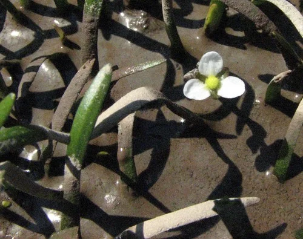

**Familia**: Alismataceae
**Origen**: Norteamérica (naturalizada en Europa)
**Tamaño**: 10 – 40 cm
**Temperatura**: 15 – 28°C
**pH**: 6.0 – 8.5
**GH**: 5 – 25 °dGH
**Dificultad**: ★☆☆☆☆
**Luz**: media
**CO2**: no necesario
**Fertilización**: baja – media
**Crecimiento**: medio
**Posición**: primer plano – plano medio
**Sustrato**: inerte
**Propagación**: estolones
**Notas**: Muy similar a Vallisneria pero más compacta. Tolera agua dura y alcalina.

---

## PLANTAS TAPIZANTES (CO2 y luz alta necesarios)

### HC Cuba / Hierba de Cuba (Hemianthus callitrichoides)
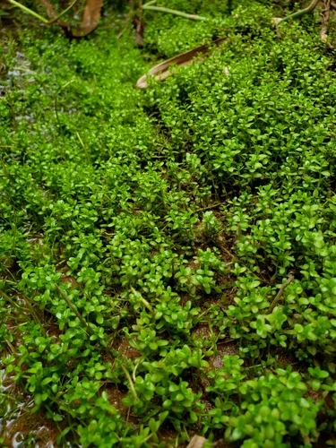

**Familia**: Linderniaceae
**Origen**: Cuba
**Tamaño**: 1 – 3 cm de alto
**Temperatura**: 20 – 28°C
**pH**: 5.0 – 7.5
**GH**: 0 – 12 °dGH
**Dificultad**: ★★★★☆
**Luz**: muy alta (PAR >150)
**CO2**: imprescindible
**Fertilización**: alta
**Crecimiento**: lento
**Posición**: primer plano (tapiz)
**Sustrato**: nutritivo imprescindible
**Propagación**: esquejes
**Notas**: La tapizante más pequeña y más deseada. Sin CO2 a presión y luz muy intensa los tallos crecen en vertical. El DSM (Dry Start Method) facilita mucho establecer el tapiz.

---

### Hairgrass (Eleocharis acicularis)
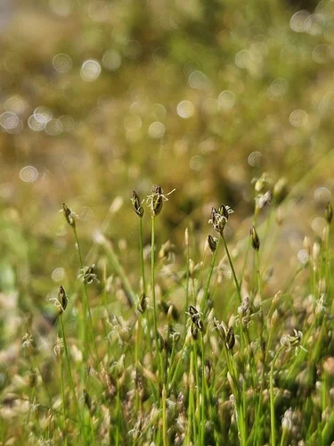

**Familia**: Cyperaceae
**Origen**: Cosmopolita
**Tamaño**: 5 – 15 cm
**Temperatura**: 15 – 28°C
**pH**: 5.5 – 7.5
**GH**: 2 – 15 °dGH
**Dificultad**: ★★★☆☆
**Luz**: alta (PAR >100)
**CO2**: recomendable
**Fertilización**: media – alta
**Crecimiento**: lento – medio
**Posición**: primer plano (tapiz de tallos finos)
**Sustrato**: nutritivo recomendado
**Propagación**: estolones
**Notas**: Más fácil de establecer que HC Cuba. Con CO2 crece lateral formando tapiz.

---

### Monte Carlo (Micranthemum tweediei)
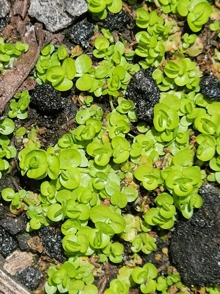

**Familia**: Linderniaceae
**Origen**: Argentina, Uruguay
**Tamaño**: 2 – 5 cm
**Temperatura**: 20 – 28°C
**pH**: 6.0 – 7.5
**GH**: 2 – 15 °dGH
**Dificultad**: ★★★☆☆
**Luz**: alta (PAR >100)
**CO2**: recomendable
**Fertilización**: media
**Crecimiento**: medio
**Posición**: primer plano (tapiz)
**Sustrato**: nutritivo recomendado
**Propagación**: esquejes
**Notas**: Alternativa más tolerante a HC Cuba. Con CO2 forma tapiz denso y bajo. Sin CO2 crece algo más alta.

---

### Glossostigma Elatinoides
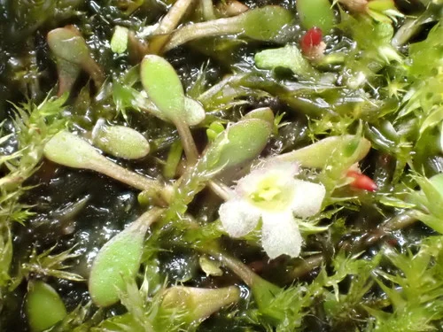

**Familia**: Phrymaceae
**Origen**: Australia, Nueva Zelanda
**Tamaño**: 1 – 3 cm
**Temperatura**: 20 – 26°C
**pH**: 5.5 – 7.5
**GH**: 1 – 10 °dGH
**Dificultad**: ★★★★☆
**Luz**: muy alta (PAR >200, cenital)
**CO2**: imprescindible
**Fertilización**: alta
**Crecimiento**: medio
**Posición**: primer plano (tapiz)
**Sustrato**: nutritivo imprescindible
**Propagación**: esquejes (runners)
**Notas**: NECESITA luz estrictamente cenital: si viene de los lados crece en vertical en lugar de tapizar.

---

### Rotala Macrandra
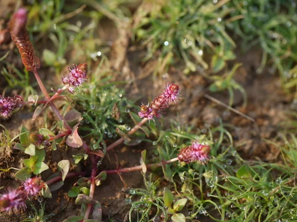

**Familia**: Lythraceae
**Origen**: India
**Tamaño**: 20 – 50 cm
**Temperatura**: 22 – 28°C
**pH**: 5.5 – 7.0
**GH**: 0 – 8 °dGH
**Dificultad**: ★★★★☆
**Luz**: muy alta
**CO2**: imprescindible
**Fertilización**: alta (especialmente hierro)
**Crecimiento**: medio
**Posición**: trasera
**Sustrato**: nutritivo
**Propagación**: esquejes
**Notas**: La planta de tallo roja más espectacular. Sin CO2 estable y luz muy potente las hojas se vuelven verdes. Solo para acuaristas avanzados.

---

## PLANTAS FLOTANTES

### Salvinia Auriculata
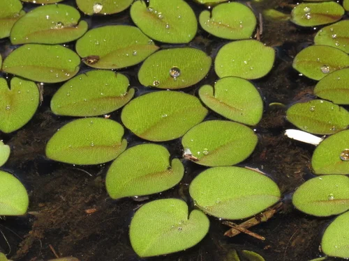

**Familia**: Salviniaceae
**Origen**: América tropical y subtropical
**Tamaño**: hojas de 1 – 2 cm
**Temperatura**: 18 – 30°C
**pH**: 5.0 – 8.0
**GH**: 0 – 18 °dGH
**Dificultad**: ★☆☆☆☆
**Luz**: media – alta
**CO2**: no necesario
**Fertilización**: baja
**Crecimiento**: muy rápido
**Posición**: flotante
**Sustrato**: no aplica
**Propagación**: vegetativa
**Notas**: Reduce la luz en el acuario. Refugio para crías y gambas. Controlar para que no cubra toda la superficie.

---

### Pistia Stratiotes (Lechuga de Agua)
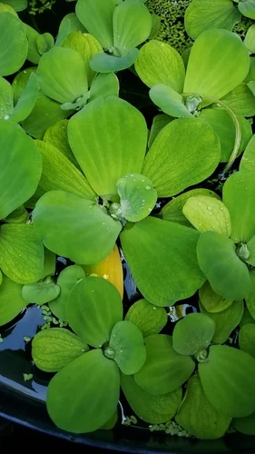

**Familia**: Araceae
**Origen**: Trópicos de todo el mundo
**Tamaño**: roseta de 5 – 15 cm
**Temperatura**: 22 – 30°C
**pH**: 6.0 – 8.0
**GH**: 3 – 15 °dGH
**Dificultad**: ★★☆☆☆
**Luz**: alta
**CO2**: no necesario
**Fertilización**: media
**Crecimiento**: rápido
**Posición**: flotante
**Sustrato**: no aplica
**Propagación**: estolones laterales
**Notas**: Raíces muy largas y densas, excelente refugio. Necesita espacio aéreo húmedo sobre el agua.

---

## MUSGOS Y BRIÓFITOS ADICIONALES

### Flame Moss (Taxiphyllum sp. "Flame")
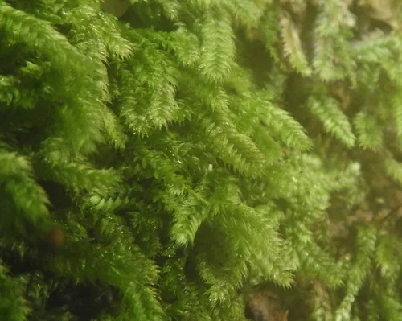

**Familia**: Hypnaceae
**Origen**: Asia
**Tamaño**: crece en espiral hacia arriba, 5-10 cm
**Temperatura**: 18 – 28°C
**pH**: 5.5 – 8.0
**GH**: 0 – 20 °dGH
**Dificultad**: ★★☆☆☆
**Luz**: baja – media
**CO2**: recomendable
**Fertilización**: baja
**Crecimiento**: lento
**Posición**: fijado en roca o madera, sobre el sustrato
**Sustrato**: no aplica
**Propagación**: división
**Notas**: Los tallos crecen en espiral vertical imitando llamas. Muy decorativo. Crece más lento que el musgo de Java.
