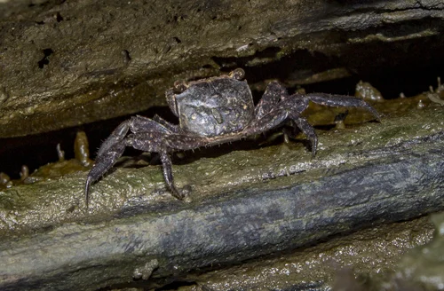
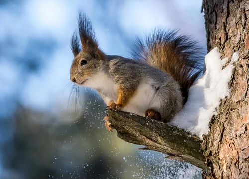
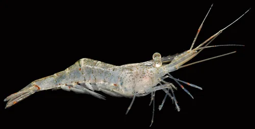

## ESTRUCTURA DE FICHA DE INVERTEBRADO

```
### Nombre Común (Nombre científico)
**Familia**:
**Origen**:
**Tamaño**: adulto
**Temperatura**: °C
**pH**:
**GH / KH / TDS**: (agua dulce) o Salinidad (marino)
**Dificultad**: ★ a ★★★★★
**Tipo de agua**: dulce / marino / salobre
**Comportamiento**: pacífico / semiagrresivo / agresivo
**Compatible con peces**: sí / no / depende (indicar cuáles)
**Dieta**: detritívoro / algívoro / carnívoro / omnívoro / filtrador
**Reproducción**: breve descripción
**Notas**:
```

---

## Invertebrados — Acuario Salobre

> Los invertebrados del salobre son principalmente crustáceos y moluscos de estuarios y manglares. Muchos cangrejos y gambas de manglar son buenos limpiadores. El Puffer de río los comería si se mantienen juntos; planificar la convivencia.

---

### Cangrejo de Manglar (Perisesarma bidens / Sesarma spp.)


**Familia**: Sesarmidae
**Origen**: Indo-Pacífico (manglares y estuarios costeros)
**Tamaño**: caparazón de 3 – 5 cm
**Temperatura**: 22 – 28°C
**pH**: 7.5 – 8.3
**GH / KH / TDS**: Salinidad 1.005 – 1.015
**Dificultad**: ★★☆☆☆
**Tipo de agua**: salobre
**Comportamiento**: semiagrresivo (territorial entre machos; puede morder pequeños peces)
**Compatible con peces**: con peces medianos-grandes que no los atrapen (Mollies adultos, Arquero)
**Dieta**: omnívoro (algas, detritos, vegetales, invertebrados pequeños)
**Reproducción**: ovíparo; larvas planctónicas que requieren agua marina — muy difícil en cautividad
**Notas**: Cangrejo semiterrestre: necesita zonas fuera del agua (ramas, rocas emergidas, cornisa). Puede escapar del acuario: tapa imprescindible. Destruye plantas blandas. Compatible con decoración de manglar (madera emergida, rocas). Cada individuo necesita su territorio.

---

### Fiddler Crab / Cangrejo Violinista (Uca spp.)


**Familia**: Ocypodidae
**Origen**: Costas tropicales y subtropicales (mundo entero)
**Tamaño**: caparazón de 2 – 3 cm; pinza mayor del macho hasta 4-5 cm
**Temperatura**: 22 – 30°C
**pH**: 7.5 – 8.5
**GH / KH / TDS**: Salinidad 1.005 – 1.015
**Dificultad**: ★★★☆☆
**Tipo de agua**: salobre
**Comportamiento**: semiagrresivo (los machos se enfrentan con la pinza mayor)
**Compatible con peces**: solo con peces grandes y rápidos; puede atacar a los lentos
**Dieta**: detritívoro (sedimento, algas, microorganismos del fango)
**Reproducción**: ovíparo; larvas planctónicas en agua marina
**Notas**: El macho tiene una pinza enormemente desarrollada (violín) usada en exhibiciones para atraer hembras y en combates con otros machos. Semiterrestre: necesita zonas de tierra o arena expuesta fuera del agua (biotopo de orilla de manglar). Muy sensible al cobre. No compatibles con peces que los puedan destrozar.

---

### Caracol Nerite de Manglar (Neritina virginea / N. turrita)


**Familia**: Neritidae
**Origen**: Caribe, Atlántico tropical
**Tamaño**: 1 – 2 cm
**Temperatura**: 22 – 28°C
**pH**: 7.5 – 8.5
**GH / KH / TDS**: Salinidad 1.005 – 1.020
**Dificultad**: ★☆☆☆☆
**Tipo de agua**: salobre – marino
**Comportamiento**: pacífico
**Compatible con peces**: con casi todos excepto puffers que lo destrozarán
**Dieta**: algívoro (algas en cristal y sustrato)
**Reproducción**: pone huevos en superficies (no eclosionan en agua dulce ni salobre)
**Notas**: El mejor limpiador de cristales del acuario salobre. Las variedades de Nerite tolerantes a la salinidad incluyen N. virginea y N. turrita. Ideales para el control de algas en salobre. No resistirán a los Puffers; no combinarlos.

---

### Gamba Fantasma (Palaemonetes paludosus)


**Familia**: Palaemonidae
**Origen**: Norteamérica del Este
**Tamaño**: 3 – 5 cm
**Temperatura**: 18 – 28°C
**pH**: 7.0 – 8.0
**GH / KH / TDS**: Salinidad hasta 1.005
**Dificultad**: ★☆☆☆☆
**Tipo de agua**: dulce – salobre baja
**Comportamiento**: pacífico – semiagrresivo
**Compatible con peces**: con peces medianos que no la coman
**Dieta**: omnívora oportunista
**Reproducción**: ovípara; fase larval planctónica difícil de criar
**Notas**: Solo tolera salinidades muy bajas (hasta densidad 1.005). En salobres más densos declina y muere. Útil como limpiadora y como complemento de dieta para peces grandes. Completamente transparente. Barata y fácil de conseguir.
