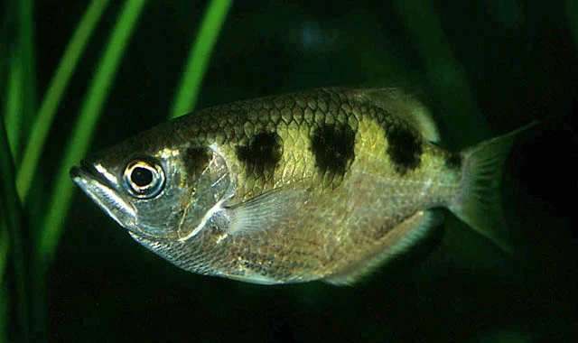
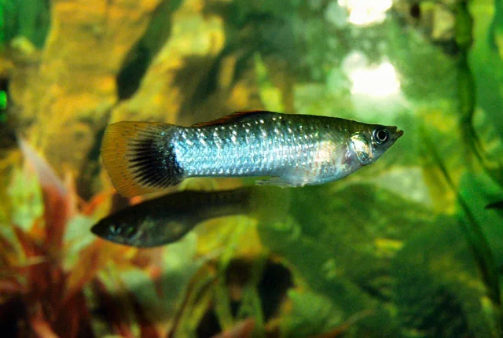
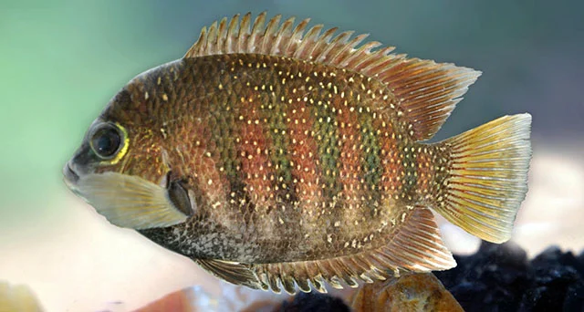
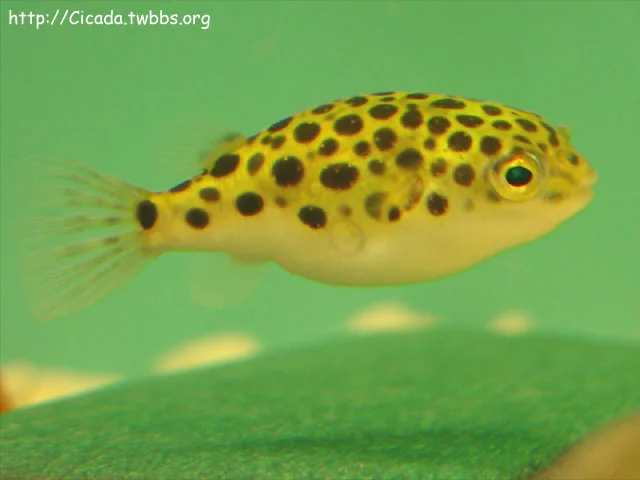

## ESTRUCTURA DE FICHA DE PEZ MARINO

```
### Nombre Común (Nombre científico)
**Familia**:
**Origen**:
**Tamaño**: adulto
**Temperatura**: °C
**pH**: (rango marino estándar salvo excepción)
**Salinidad**: densidad objetivo
**Dificultad**: ★ a ★★★★★
**Tipo de acuario**: FOWLR / Reef / Ambos
**Nivel de nado**: fondo / medio / superficie
**Comportamiento**: pacífico / semiagrresivo / agresivo
**Mínimo de individuos**: (si aplica)
**Tamaño de acuario mínimo**: litros
**Dieta**: omnívoro / carnívoro / herbívoro / planctívoro
**Reproducción**: ovíparo / hermafrodita secuencial
**Reef Safe**: sí / no / precaución
```

## ESTRUCTURA DE FICHA DE PEZ DULCE

```
### Nombre Común (Nombre científico)
**Familia**:
**Origen**:
**Tamaño**: adulto
**Temperatura**: °C
**pH**:
**GH**: °dGH
**Dureza**:
**Dificultad**: ★ a ★★★★★
**Tipo de agua**:
**Nivel de nado**: fondo / medio / superficie
**Comportamiento**: pacífico / semiagrresivo / agresivo
**Mínimo de individuos**: (si aplica)
**Tamaño de acuario mínimo**: litros
**Dieta**: omnívoro / carnívoro / herbívoro
**Reproducción**: ovíparo / vivíparo
**Notas**:
```

---

## Peces — Acuario Salobre

> El acuario salobre replica estuarios, marismas y manglares (salinidad 1.003–1.015). Los peces salobres toleran o prefieren esta mezcla de agua dulce y marina. No son aptos peces de agua dulce estricta ni peces marinos que requieren salinidad completa.

---

### Pez Arquero (Toxotes jaculatrix)


**Familia**: Toxotidae
**Origen**: Indo-Pacífico (estuarios de India, Sudeste Asiático, Australia)
**Tamaño**: 20 – 30 cm
**Temperatura**: 25 – 30°C
**pH**: 7.0 – 8.0
**GH**: 10 – 25 °dGH
**Dureza**: dura
**Dificultad**: ★★★☆☆
**Tipo de agua**: salobre (salinidad 1.005-1.015)
**Nivel de nado**: superficie
**Comportamiento**: semiagrresivo (agresivo con su propia especie; pacífico con otros)
**Mínimo de individuos**: 3 – 5 (para reducir agresividad intraespecie)
**Tamaño de acuario mínimo**: 200 litros
**Dieta**: carnívoro (insectos, pequeños peces, langostinos)
**Reproducción**: ovíparo; muy difícil en cautividad
**Notas**: Famoso por escupir chorros de agua para derribar insectos de ramas sobre el agua. En cautividad aprende a escupir al cuidador durante la alimentación. Necesita espacio sobre el nivel del agua (plantas emergidas, ramas) para practicar su comportamiento natural. Requiere tapa sólida: puede saltar y escupir fuera del acuario.

---

### Molly Vela / Molly Negro (Poecilia latipinna / P. sphenops)


**Familia**: Poeciliidae
**Origen**: Sur de EEUU, México, América Central (estuarios)
**Tamaño**: 6 – 12 cm (macho < hembra)
**Temperatura**: 24 – 30°C
**pH**: 7.5 – 8.5
**GH**: 15 – 30 °dGH
**Dureza**: muy dura y alcalina
**Dificultad**: ★☆☆☆☆
**Tipo de agua**: dulce dura / salobre (salinidad hasta 1.010)
**Nivel de nado**: medio – superficie
**Comportamiento**: pacífico
**Mínimo de individuos**: 1 macho / 3 hembras (mínimo)
**Tamaño de acuario mínimo**: 80 litros
**Dieta**: omnívoro (herbívoro tendencia: algas, vegetales)
**Reproducción**: vivíparo; paren cada 4-6 semanas; 20-60 crías por camada
**Notas**: El pez vivíparo más tolerante a la sal. En agua salobre de baja densidad (1.003-1.010) prosperan y tienen mejor salud que en agua dulce. Altamente resistentes a enfermedades en salobre. Los machos de Molly Vela tienen la aleta dorsal enorme y vistosa. La variedad "Balloon Molly" (cuerpo redondeado) es más delicada.

---

### Guppy (Poecilia reticulata)


**Familia**: Poeciliidae
**Origen**: Venezuela, Trinidad (naturalizado en todo el mundo)
**Tamaño**: machos 3 – 4 cm / hembras 5 – 6 cm
**Temperatura**: 22 – 28°C
**pH**: 6.8 – 8.0
**GH**: 8 – 25 °dGH
**Dureza**: media – dura
**Dificultad**: ★☆☆☆☆
**Tipo de agua**: dulce / salobre baja (hasta 1.005)
**Nivel de nado**: medio – superficie
**Comportamiento**: pacífico
**Mínimo de individuos**: 1 macho / 2-3 hembras
**Tamaño de acuario mínimo**: 40 litros
**Dieta**: omnívoro
**Reproducción**: vivíparo; paren cada 3-4 semanas
**Notas**: Tolera salinidad baja (hasta densidad 1.005), lo cual reduce enfermedades y parásitos. No apto para salobres de densidad alta. Los machos de selección tienen colas y colores exuberantes. Se reproducen constantemente: controlar la población.

---

### Chromide Naranja (Etroplus maculatus)


**Familia**: Cichlidae
**Origen**: India y Sri Lanka (estuarios y ríos costeros)
**Tamaño**: 8 – 10 cm
**Temperatura**: 22 – 30°C
**pH**: 7.5 – 8.5
**GH**: 12 – 25 °dGH
**Dureza**: dura
**Dificultad**: ★★☆☆☆
**Tipo de agua**: salobre baja – media (salinidad 1.003-1.012)
**Nivel de nado**: medio
**Comportamiento**: semiagrresivo (territorial en cría)
**Mínimo de individuos**: pareja
**Tamaño de acuario mínimo**: 100 litros
**Dieta**: omnívoro (algas, invertebrados, pellets)
**Reproducción**: ovíparo con cuidado biparental; ponen huevos en superficies
**Notas**: El único cíclido nativo de Asia. En salobre su salud y coloración son óptimas. Color naranja brillante con manchas negras. Forman pareja estable y cuidan sus puestas activamente. Más pequeño y manejable que el Chromide Verde (E. suratensis).

---

### Pufferfish Enano de Manglar / Puffer de Río (Dichotomyctere nigroviridis)


**Familia**: Tetraodontidae
**Origen**: Asia del Sur y Sudeste Asiático (estuarios y manglares)
**Tamaño**: 10 – 14 cm
**Temperatura**: 24 – 28°C
**pH**: 7.5 – 8.3
**GH**: 15 – 25 °dGH
**Dureza**: dura
**Dificultad**: ★★★☆☆
**Tipo de agua**: salobre (salinidad 1.005-1.015)
**Nivel de nado**: medio
**Comportamiento**: agresivo (muerde aletas; incompatible con la mayoría de peces)
**Mínimo de individuos**: 1 por acuario o grupo grande con mucho espacio
**Tamaño de acuario mínimo**: 100 litros (solo)
**Dieta**: carnívoro (caracoles, crustáceos, gusanos, mejillones)
**Reproducción**: ovíparo
**Notas**: El pez más interesante del salobre pero también el más difícil de convivencia. Sus dientes (que se fusionan en un pico) crecen continuamente: deben desgastarse comiendo caracoles, mejillones o calmares. Acuario species-only o con peces demasiado rápidos para ser mordidos (Mollies en grupos grandes). Personalidad muy marcada y reconoce a su cuidador.
