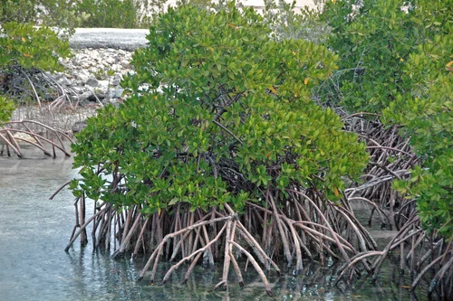

## ESTRUCTURA DE FICHA DE PLANTA

```
### Nombre Común (Nombre científico)
**Familia**:
**Origen**:
**Tamaño**: altura máxima en acuario
**Temperatura**: °C
**pH**:
**GH**: °dGH
**Dificultad**: ★ a ★★★★★
**Luz**: muy baja / baja / media / alta / muy alta
**CO2**: no necesario / recomendable / imprescindible
**Fertilización**: baja / media / alta
**Crecimiento**: muy lento / lento / medio / rápido / muy rápido
**Posición**: primer plano / plano medio / trasera / flotante / fijada en roca o madera
**Sustrato**: inerte / nutritivo recomendado / nutritivo imprescindible
**Propagación**: esquejes / estolones / rizoma / esporas
```

---

## Plantas — Acuario Salobre

> La mayoría de plantas de agua dulce no toleran la salinidad del acuario salobre. Las opciones se reducen a plantas halófilas (tolerantes a la sal) y macrófitas estuarinas. El manglar (Rhizophora) es emblemático pero de crecimiento muy lento. Las plantas emergidas son más tolerantes que las sumergidas.

---

### Manglares (Rhizophora mangle / Avicennia marina)


**Familia**: Rhizophoraceae / Acanthaceae
**Origen**: Pantropical (costas y estuarios del mundo)
**Tamaño**: plantas de 30 cm – 1 m en acuario (en la naturaleza son árboles)
**Temperatura**: 22 – 30°C
**pH**: 7.5 – 8.5
**GH**: 15 – 30 °dGH
**Dificultad**: ★★★★☆
**Luz**: muy alta (requieren luz solar o focos potentes)
**CO2**: no aplica (planta emergida)
**Fertilización**: baja
**Crecimiento**: muy lento
**Posición**: emergida (raíces en agua salobre, tallo y hojas fuera del agua)
**Sustrato**: arena o grava
**Propagación**: propágulos (semillas ya germinadas)
**Notas**: Los manglares son el símbolo del biotopo salobre. Se plantan con las raíces sumergidas en agua salobre y el tallo emergido. Crecen muy lentamente (años para alcanzar 30 cm). Requieren mucha luz para no etiolarse. Los propágulos se compran en tiendas especializadas: son plántulas con raíz ya formada. Con el tiempo crean un acuario-terrario espectacular de manglar.

---

### Vallisneria (Vallisneria spiralis / V. americana)


**Familia**: Hydrocharitaceae
**Origen**: Subtropical y tropical (cosmopolita)
**Tamaño**: 30 – 60 cm
**Temperatura**: 15 – 30°C
**pH**: 6.5 – 9.0
**GH**: 5 – 25 °dGH
**Dificultad**: ★★☆☆☆
**Luz**: media
**CO2**: no necesario
**Fertilización**: baja
**Crecimiento**: rápido
**Posición**: trasera
**Sustrato**: inerte
**Propagación**: estolones
**Notas**: Una de las pocas plantas sumergidas que tolera salinidad baja (hasta densidad 1.005 aproximadamente). A mayor salinidad su supervivencia se reduce. En salobres muy suaves es una buena opción para cubrir la trasera. No usar con Excel/Easy Carbo.

---

### Elodea (Egeria densa)


**Familia**: Hydrocharitaceae
**Origen**: Brasil, Argentina
**Tamaño**: tallo hasta 3 metros (se recorta)
**Temperatura**: 10 – 26°C
**pH**: 6.0 – 8.5
**GH**: 5 – 25 °dGH
**Dificultad**: ★★☆☆☆
**Luz**: media
**CO2**: no necesario
**Fertilización**: baja
**Crecimiento**: muy rápido
**Posición**: plano medio – trasera
**Sustrato**: inerte
**Propagación**: esquejes
**Notas**: Tolera salinidad muy baja (hasta 1.003). A mayor salinidad se deteriora. Útil para salobres de densidad muy baja. Excelente absorbente de nitratos. Especie invasora: nunca tirar al exterior.

---

### Anubias (Anubias barteri var. nana)


**Familia**: Araceae
**Origen**: África Occidental
**Tamaño**: 5 – 15 cm
**Temperatura**: 20 – 30°C
**pH**: 5.5 – 9.0
**GH**: 0 – 20 °dGH
**Dificultad**: ★★☆☆☆
**Luz**: muy baja – media
**CO2**: no necesario
**Fertilización**: baja
**Crecimiento**: muy lento
**Posición**: fijada en roca o madera
**Sustrato**: NO enterrar
**Propagación**: división del rizoma
**Notas**: Tolera salinidades bajas (hasta densidad 1.005) mejor que la mayoría de plantas dulceacuícolas. A salinidades más altas sus hojas se deterioran progresivamente. En salobres muy suaves puede mantenerse.
