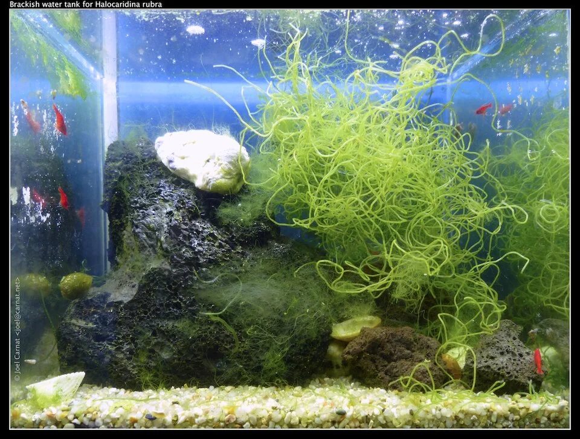

# ACUARIO SALOBRE

**Dificultad general**: ★★★☆☆
**Coste de setup**: medio
**Tamaño mínimo recomendado**: 100 L
**Para quién es**: intermedio – avanzado

---

## Descripción

Agua con salinidad intermedia entre dulce y marina. Reproduce los ecosistemas de estuarios, manglares y ríos costeros. Interesante desde el punto de vista biogeográfico: estos ecosistemas son de los más productivos y complejos del planeta. Pocas tiendas tienen conocimiento profundo del salobre, lo que lo hace un nicho especial del hobby.

---

## Parámetros del agua

| Parámetro | Salobre leve | Salobre moderado |
|-----------|-------------|-----------------|
| Temperatura | 24 – 28°C | 24 – 28°C |
| pH | 7.5 – 8.5 | 7.8 – 8.5 |
| Densidad | 1.003 – 1.008 | 1.008 – 1.015 |
| Salinidad | 4 – 12 ppt | 12 – 22 ppt |
| GH | 12 – 25 °dGH | 15 – 30 °dGH |

---

## Equipamiento necesario

| Equipo | Especificaciones |
|--------|-----------------|
| Filtro | Externo o interior potente; 6-10x el volumen/hora |
| Calefactor | 2-3W/L con termostato |
| Refractómetro | Para controlar salinidad con precisión |
| Iluminación | LED básico; 8-10h/día |
| Sustrato | Arena fina o grava |
| Sal | Exclusivamente sal marina de acuario (Red Sea, Instant Ocean) — NUNCA sal de mesa |

---

## Fauna típica salobre

**Peces:**
- Pez Arquero (*Toxotes jaculatrix*): dispara chorros de agua a insectos; 200L+
- Pez Globo de manglar (*Tetraodon biocellatus*): come caracoles; 60L
- Mudskipper / Gobio saltarín (*Periophthalmus*): puede caminar fuera del agua; paludario salobre
- Mono / Scat (*Scatophagus argus*): omnívoro activo; 200L+
- Platy y Molly (toleran agua ligeramente salobre)

**Invertebrados:**
- Cangrejos de manglar (*Cardisoma*, *Ucides*): paludario
- Gambas de río (*Macrobrachium*): precaución (omnívoras)

---

## Plantas en acuario salobre

Pocas plantas toleran el salobre:
- Manglares (*Rhizophora*): ideales; sus raíces también filtran el agua
- Bacopa (tolera algo de salinidad)
- Java Fern en salinidad baja
- Halimione (planta costera; en paludario)

---

## Algas comunes — cuáles son, por qué aparecen, cómo eliminarlas

El agua salobre crea un entorno donde compiten algas de agua dulce y marinas, con resultados impredecibles.

### Alga Parda / Diatomas
La más frecuente al inicio. Comportamiento idéntico a otros acuarios. Desaparece sola.

---

### Cianobacterias
Muy frecuentes en salobre, especialmente con peces sucios como Scat. La materia orgánica alta y la temperatura favorecen su crecimiento.
**Solución:** Mejor filtración. Circulación del fondo. Cambios de agua.

---

### GHA (Alga Pelo Verde)
Puede aparecer con exceso de nutrientes. Los peces salobre (Scat, Otocinclus de agua dulce en salinidad baja) la controlan parcialmente.

---

## Errores más comunes

- Usar sal de mesa (NO): solo sal marina de acuario (Red Sea, Instant Ocean)
- No aclimatizar los peces gradualmente al salobre (el cambio brusco de salinidad es mortal)
- Asumir que "cualquier pez aguanta algo de sal" (falso: la mayoría de tropicales NO)
- Mezclar peces de dulce con peces de mar pensando que "el salobre es el término medio"

---

## Consejos clave

- Investigar específicamente la salinidad óptima de cada especie antes de comprarla
- La aclimatización al salobre debe ser muy gradual (subir la salinidad en semanas, no de golpe)
- El manglar es la mejor "planta" para el salobre: también filtra nutrientes del agua
- El pez arquero necesita espacio emergido con plantas para demostrar su comportamiento más interesante
- El salobre es un ecosistema único: documentar los parámetros con regularidad
