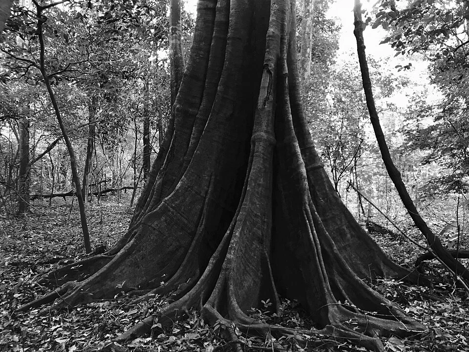

# Afluentes Várzea — Bosque Inundado

> Durante la época de lluvias, el Amazonas inunda miles de km² de bosque. Los peces nadan entre raíces y hojas caídas de árboles que normalmente están en tierra.

## Descripción

La "várzea" o igapó es el bosque inundado estacionalmente. Los peces penetran entre las raíces sumergidas en busca de frutos caídos, insectos, semillas. El agua es muy orgánica — llena de hojas, detritos y microorganismos.

---

## Parámetros

| Parámetro | Valor |
|---|---|
| pH | 5.5 – 7.0 (variable) |
| GH | 1 – 8 °dGH |
| Temperatura | 26 – 30°C |

---

## Decoración
- Raíces entrelazadas imitando los buttress roots de árboles tropicales
- Hojas en abundancia cubriendo el sustrato
- Frutas/vainas secas de árboles tropicales (Alder cones, terminalia)
- Plantas flotantes densas que filtran la luz

---

## Especies
- *Metynnis hypsauchen* (pez moneda — herbívoro)
- *Mylossoma duriventre* (pirañas herbívoras — frugivoras)
- *Colossoma macropomum* (tambaquí — muy grande, para acuarios grandes o estanques)
- *Hoplias malabaricus* (tararira — carnívoro depredador)
- *Eigenmannia virescens* (cuchillo verde)
