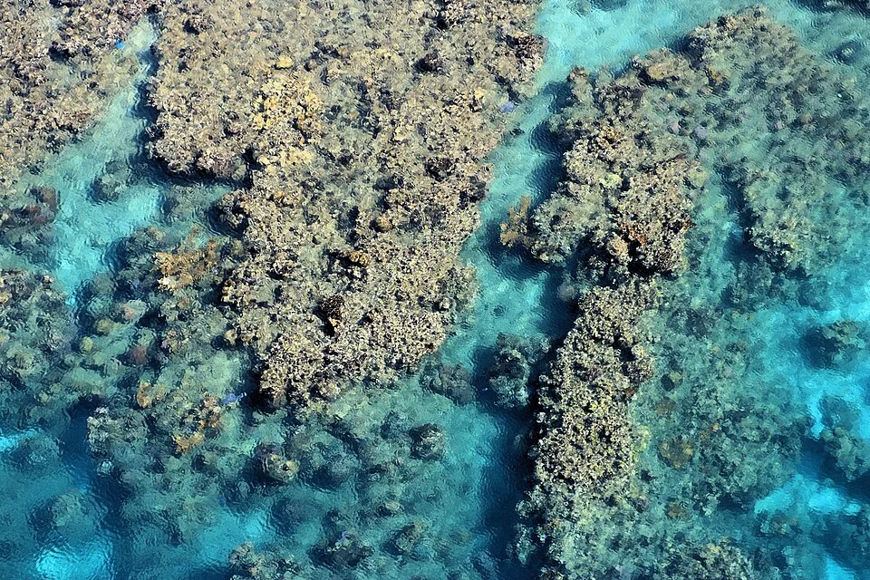

# Arrecife del Caribe

> El arrecife del Atlántico occidental. Diferente fauna del Indo-Pacífico — complementario, no idéntico.

## Diferencias con el Indo-Pacífico

- Menor diversidad de especies
- Colores diferentes (muchos peces caribeños son más apagados que los del Pacífico)
- Corales distintos: Porites, Diploria, Gorgonia ventalina
- Temperatura algo más baja: 22-26°C
- Sin peces payaso en estado natural (son Indo-Pacífico)

---

## Especies del Caribe

**Peces:**

| Especie | Características |
|---|---|
| *Gramma loreto* — Royal Gramma | Bicolor violeta-amarillo |
| *Holacanthus tricolor* — ángel rock beauty | NG: no reef safe |
| *Acanthurus bahianus* — cirujano marrón caribeño | Herbívoro |
| *Acanthurus coeruleus* — cirujano azul caribeño | Diferente del Indo-Pacífico |
| *Thalassoma bifasciatum* — labro arco iris | Muy activo |
| *Elacatinus oceanops* — gobio neón | Limpiador; azul eléctrico con línea amarilla |
| *Diadema antillarum* — erizo de espinas largas | El mejor herbívoro del Caribe |

---

**Corales:**
- *Orbicella faveolata* — coral estrella masivo
- *Acropora palmata* — coral alce (protegido)
- *Diploria labyrinthiformis* — coral cerebro
- *Gorgonia ventalina* — abanico de mar caribeño (azooxantelado)
