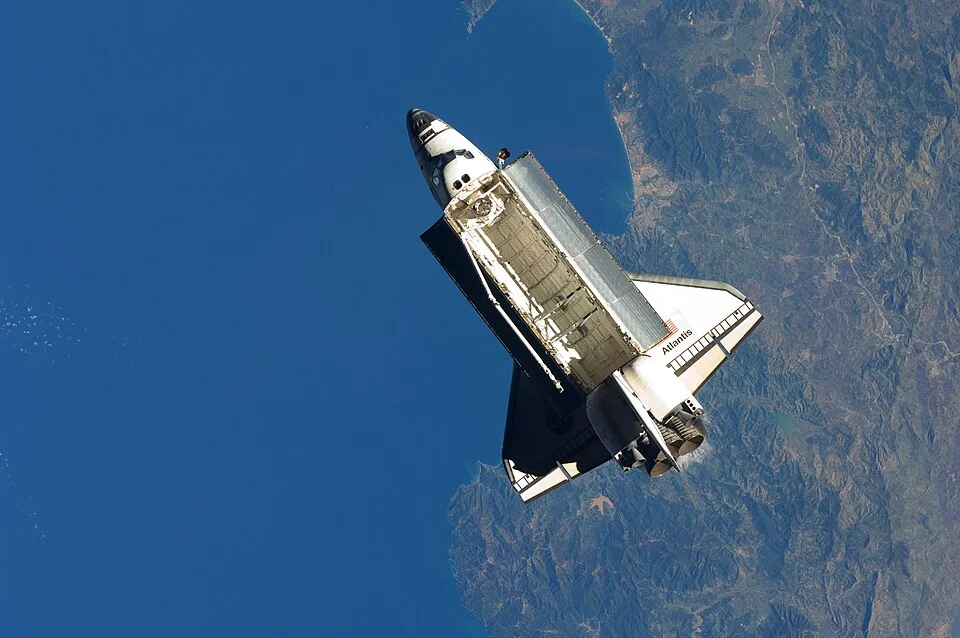

# Biotopo Mediterráneo

> La fauna acuática autóctona del mar y costa mediterránea. Para amantes de lo local y lo autóctono.

## Parámetros

| Parámetro | Agua dulce | Marino mediterráneo |
|---|---|---|
| pH | 7.0 – 8.5 | 8.0 – 8.3 |
| GH | 10 – 25 °dGH | — |
| Salinidad | — | 1.022 – 1.026 |
| Temperatura | 10 – 22°C | 14 – 26°C (estacional) |

---

## Dulce mediterráneo (ríos autóctonos ibéricos)

**Especies ibéricas:**
- *Barbus bocagei* — barbo común ibérico
- *Chondrostoma polylepis* — boga del Tajo
- *Squalius pyrenaicus* — cacho
- *Luciobarbus comizo* — barbo comizo (grande, > 60 cm)
- *Cobitis paludica* — lamprehuela (loach ibérico)
- *Valencia hispanica* — samaruc (killifish mediterráneo en peligro crítico)
- *Aphanius iberus* — fartet (especie protegida)

> ⚠️ Muchas especies ibéricas están protegidas — verificar legalidad antes de capturar o mantener.

---

## Marino mediterráneo

**Peces:**
- *Diplodus sargus* — sargo
- *Sparus aurata* — dorada (grande)
- *Gobius niger* — gobio negro
- *Gobius cobitis* — gobio de roca
- *Symphodus tinca* — tordo verde (labro mediterráneo)
- *Chromis chromis* — castañuela (damisela mediterránea)
- *Scorpaena scrofa* — rascacio (venenoso)

**Invertebrados:**
- *Paracentrotus lividus* — erizo de mar mediterráneo
- *Octopus vulgaris* — pulpo (solo para expertos con acuario grande)
- *Anemonia viridis* — anémona de roca
- *Posidonia oceanica* — planta marina mediterránea (protegida)
