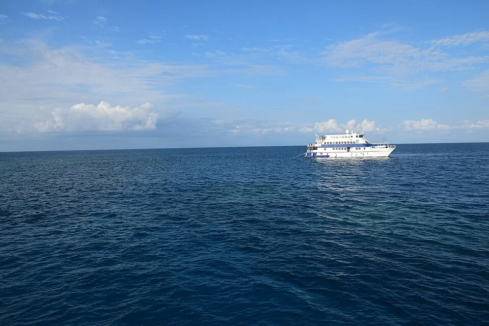

# Gran Barrera de Coral — Pacífico

> El mayor ecosistema de coral del mundo. Acuarios de arrecife inspirados en el Indo-Pacífico.

## Descripción

La Gran Barrera de Coral (Queensland, Australia) y los arrecifes del Indo-Pacífico en general son el modelo de referencia para los acuarios de arrecife. Agua cristalina, muy oxigenada, rica en calcio, con diversidad enorme.

---

## Parámetros de referencia (NSW — Natural Sea Water)

| Parámetro | Valor NSW |
|---|---|
| Salinidad | 1.025 – 1.026 |
| pH | 8.1 – 8.3 |
| KH | 7 – 9 dKH |
| Ca | 415 – 435 ppm |
| Mg | 1.280 – 1.320 ppm |
| NO3 | < 1 ppm |
| PO4 | < 0.01 ppm |
| Temperatura | 25 – 27°C |

---

## Zonas del arrecife y sus habitantes

### Zona de acantilado exterior (alta energía)
- Corales SPS: *Acropora*, *Seriatopora*, *Stylophora*
- Peces: Tang (*Acanthurus*, *Zebrasoma*), Labros grandes
- Alta corriente, luz intensa

### Zona de arrecife de laguna (media energía)
- Corales LPS: *Euphyllia*, *Trachyphyllia*, *Goniopora*
- Corales blandos: *Sinularia*, Xenia
- Peces: Payazo + anémona, Gobios, Cardenales
- Corriente moderada, luz media-alta

### Zona de sustrato arenoso
- Gobios de arena (*Valencienna*)
- Estrella de arena (*Archaster*)
- Pepino de mar

---

## Lista de peces del Indo-Pacífico (para biotopo reef)
- *Amphiprion ocellaris* — payazo falso
- *Zebrasoma flavescens* — cirujano amarillo (Pacífico)
- *Paracanthurus hepatus* — cirujano azul
- *Nemateleotris magnifica* — dartfish de fuego
- *Pterapogon kauderni* — cardenal Banggai
- *Synchiropus splendidus* — pez mandarín
- *Halichoeres chrysus* — labro dorado
- *Siganus vulpinus* — foxface
