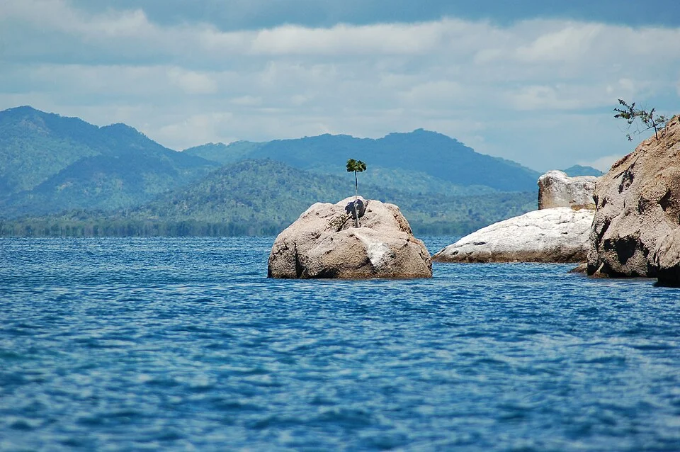

# Lago Malawi (África Oriental)

> El "Mar Mediterráneo" de los cíclidos. Agua muy dura y alcalina, con rocas y cíclidos de colores de arrecife.

## Descripción del hábitat

El lago Malawi es uno de los lagos más antiguos y profundos del mundo. Sus aguas son cristalinas, alcalinas y muy duras — pH cercano a 8.5. La costa está dominada por afloramientos rocosos (habitat de los Mbunas) y zonas arenosas (hábitat de los Haplochromis y Aulonocara). No hay corales, pero los cíclidos de colores rivalizan con los peces marinos en espectacularidad.

---

## Parámetros

| Parámetro | Valor natural |
|---|---|
| pH | 7.8 – 8.5 |
| GH | 12 – 20 °dGH |
| KH | 8 – 15 °dKH |
| Temperatura | 24 – 28°C |
| TDS | 200 – 250 ppm |
| Dureza | muy dura |

---

## Zonas del lago y sus habitantes

### Zona Mbuna (costas rocosas)
| Especie | Características |
|---|---|
| *Maylandia zebra* (cebra) | Múltiples morfos de color; herbívoro estricto |
| *Pseudotropheus demasoni* | Muy agresivo; azul con rayas negras |
| *Labidochromis caeruleus* (yellow) | Amarillo brillante; más tolerante |
| *Melanochromis auratus* | Invertido sexual: hembra amarilla, macho negro |
| *Pseudotropheus acei* | Azul con dorsal y caudal amarillas; más pacífico |
| *Cynotilapia afra* | Azul con rayas negras; cola punteada |

### Zona arenosa (Aulonocara / Peacock)
| Especie | Características |
|---|---|
| *Aulonocara stuartgranti* | "Peacock" — macho con colores iridiscentes |
| *Aulonocara nyassae* | Azul cobalto |
| *Aulonocara jacobfreibergi* | Naranja/rojo en aletas |
| *Nimbochromis livingstonii* | Depredador que finge estar muerto |

### Zona pelágica (Haplochromis)
| Especie | Características |
|---|---|
| *Copadichromis borleyi* | Rojo-azul; cardumen en zona media |
| *Protomelas taeniolatus* | Varios morfos por lago |
| *Fossochromis rostratus* | Hocico alargado; tamiza arena |

---

## Decoración auténtica
- **Sustrato**: Arena fina blanca-beige (arena de cuarzo sin carbonato)
- **Rocas**: Abundantes apiladas formando arrecifes de roca — losas de pizarra, granito, o rocas de lago (Malawi rock). Sin madera.
- **Sin plantas**: La mayoría del lago es sin vegetación (excepto *Vallisneria* en zonas someras)
- **Estructura**: Muchas cuevas, grietas y pasadizos para que las hembras se escondan

---

## Estrategia de poblamiento
- **Superpoblar deliberadamente**: 1 cíclido/10L para distribuir agresividad
- **Proporción harén**: 1 macho : 3-5 hembras por especie
- **Introducir todos a la vez o por tandas pequeñas**: Nunca un macho solo en sistema establecido

---

## Errores comunes
- Mezclar Mbunas con peces de agua blanda (son incompatibles)
- Pocas rocas — el macho territorial persigue a todos al no haber suficientes zonas
- Dar dieta rica en proteínas a Mbunas herbívoros (provoca "bloat" — hinchazón fatal)
- Filtración insuficiente — estos peces producen mucho residuo
