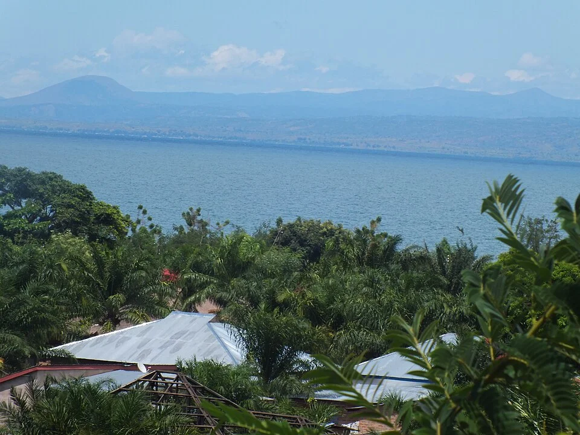

# Lago Tanganica (África Oriental)

> El lago más profundo de África. Agua dura y cristalina. Cíclidos con comportamientos únicos: shell dwellers, cíclidos de limpieza, Frontosas.

## Descripción

El Lago Tanganica es el segundo lago más profundo del mundo. Sus aguas son excepcionalmente claras y mineralizadas. A diferencia del Lago Malawi, el Tanganica tiene mucha mayor biodiversidad de nichos ecológicos: cíclidos rupícolas (en roca), lakobedoers (en arena), shell dwellers (en conchas), y peces pelágicos grandes.

---

## Parámetros

| Parámetro | Valor natural |
|---|---|
| pH | 7.8 – 9.0 |
| GH | 12 – 22 °dGH |
| KH | 10 – 18 °dKH |
| Temperatura | 24 – 27°C |
| TDS | 250 – 400 ppm |

---

## Zonas y especies

### Zona rocosa (Tropheinae)
| Especie | Características |
|---|---|
| *Tropheus moorii* | Múltiples morfos por lago; muy territorial |
| *Tropheus duboisi* | Juvenil con puntos blancos; adulto negro-amarillo |
| *Julidochromis ornatus* | Amarillo con líneas negras; nada invertido |
| *Julidochromis marlieri* | Cuadros negros y blancos |
| *Altolamprologus calvus* | Cabeza comprimida para entrar en grietas |
| *Neolamprologus leleupi* | Naranja brillante; territorial |

### Zona Shell (conchas de Neothauma)
| Especie | Características |
|---|---|
| *Neolamprologus multifasciatus* | El cíclido más pequeño (4-5 cm) |
| *Neolamprologus brevis* | Más pequeño que *N. meleagris* |
| *Lamprologus ocellatus* | Solitario; territorial extremo con su concha |
| *Neolamprologus similis* | Colonias en conchas amontonadas |

### Zona arenosa / abierta
| Especie | Características |
|---|---|
| *Cyphotilapia frontosa* | Hasta 35 cm; joroba frontal; come peces |
| *Cyprichromis leptosoma* | Pelágico; cardumen colorido en zona media |
| *Xenotilapia flavipinnis* | Tamizador de arena, incuba bucalmente |

---

## Decoración auténtica
- **Sustrato**: Arena fina blanca + conchas de *Neothauma* (o conchas de caracol terrestre similares) para los shell dwellers
- **Rocas**: Pilas de roca de lago planas formando laberintos horizontales y verticales
- **Sin madera, sin plantas** (zona rocosa pura)
- **Para zona shell**: Fondo plano de arena con conchas distribuidas, poca roca

---

## Particularidades del Tanganica
- Las espinas de los cíclidos Tanganica son más importantes que los colores para determinar su bienestar
- Los Shell Dwellers necesitan MÁS conchas que peces (ratio 3:1 mínimo)
- Tropheus es extremadamente territorial — necesitan grupos de mínimo 12-15 para distribuir agresividad
- Frontosa: muy lento, necesita peces demasiado grandes para ser comidos, mucha profundidad del acuario
