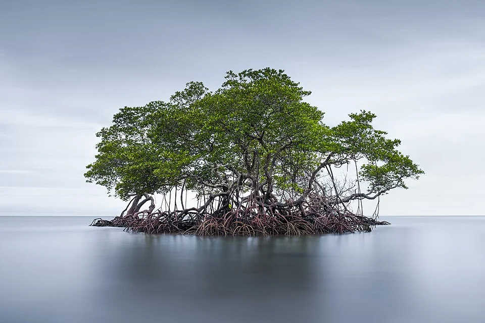

# Manglar / Zona Intermareal

> Entre el mar y el río. Agua salobre, temperatura variable, raíces de mangle.

## Descripción

Los manglares son ecosistemas de transición donde el agua dulce de los ríos se mezcla con el agua salada del mar. La salinidad varía con las mareas. La fauna está adaptada a esta variabilidad.

---

## Parámetros (variables)

| Parámetro | Rango |
|---|---|
| Salinidad | 1.003 – 1.018 (variable con mareas) |
| pH | 7.0 – 8.5 |
| Temperatura | 24 – 30°C |

---

## Decoración
- Raíces de mangle (propágulos de *Rhizophora* se pueden cultivar)
- Arena fina de estuario
- Agua marrón-verdosa (algo turbia — normal)
- Zona emergida con los troncos del mangle

---

## Especies del manglar

| Especie | Salinidad tolerada |
|---|---|
| *Toxotes chatareus* — pez arquero | Salobre hasta marino |
| *Monodactylus argenteus* — moonfish | Salobre hasta marino |
| *Scatophagus argus* — scat | Salobre hasta marino |
| *Tetraodon biocellatus* — pez globo de agua dulce | Dulce hasta salobre |
| *Dormitator maculatus* — eleotris | Salobre |
| Múltiples especies de gobios estuarinos | Variable |
| *Periopthalmus* spp. — mudskipper | Semiterrestres |
