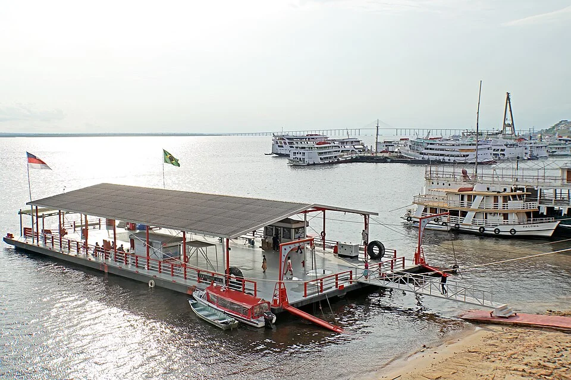

# Río Negro — Amazonas (Brasil)

> El río de aguas más oscuras del mundo. Bajo pH, casi sin minerales, temperatura alta. El paraíso de los tetras y los angelotes.

## Descripción del hábitat natural

El Río Negro (afluente del Amazonas) debe su color oscuro a los taninos y ácidos húmicos lixiviados de la vegetación en descomposición. Sus aguas son extremadamente suaves y ácidas — casi destiladas con ácidos orgánicos. La visibilidad es baja. El fondo está cubierto de hojas en descomposición, raíces y madera sumergida. La vegetación acuática es escasa — apenas plantas flotantes.

---

## Parámetros del agua natural

| Parámetro | Valor natural |
|---|---|
| pH | 3.5 – 5.5 |
| GH | 0 – 1 °dGH |
| KH | 0 – 1 °dKH |
| Temperatura | 26 – 30°C |
| Color | Marrón oscuro ("té") |
| TDS | < 20 ppm |
| Conductividad | < 10 µS/cm |

## Parámetros recomendados en acuario

| Parámetro | Objetivo en acuario |
|---|---|
| pH | 4.5 – 6.0 |
| GH | 0 – 3 °dGH |
| KH | 0 – 2 °dKH |
| Temperatura | 26 – 29°C |
| TDS | 50 – 100 ppm |

---

## Cómo lograr estos parámetros
- **Agua de base**: Osmosis inversa (RO) + mineralización mínima
- **Acidificación y color**: Hojas de Catappa (*Terminalia catappa*) — 1 hoja/20L renovar cada 2-3 semanas
- **Turba**: Filtrar a través de turba ácida (peat) — oscurece y acidifica el agua
- **Madera**: Raíces de mopani, spider wood — liberan taninos naturalmente
- **Extracto de turba/blackwater**: Productos como Sera Blackwater Aquatan, JBL Decarbo, Aquavitro Activate

---

## Decoración auténtica
- **Sustrato**: Arena de cuarzo muy fina, oscura a ser posible
- **Madera**: Múltiples trozos entrelazados de raíces finas (spider root, Malaysian driftwood)
- **Hojas**: Capa de hojas de catappa, hojas de roble, hojas de almendra — cubrir el 60-70% del fondo
- **Semillas y vainas**: Vainas de Terminalia, piñas de aliso
- **Sin rocas**: El Río Negro es pobre en minerales, las rocas subirían el pH
- **Poca o ninguna planta sumergida**: Solo plantas flotantes (*Salvinia*, *Pistia*, *Limnobium*)

---

## Iluminación
Luz tenue, filtrada por el techo de vegetación. PAR bajo (< 50 en el fondo). Bombillas de espectro cálido o neutro — no LEDs de espectro frío.

---

## Especies autócticas del Río Negro

**Peces:**

| Especie | Nombre científico | Capa | Notas |
|---|---|---|---|
| Neón Cardinal | *Paracheirodon axelrodi* | Media | Icónico del Río Negro |
| Tetra Limón | *Hyphessobrycon pulchripinnis* | Media | |
| Tetra Fantasma Negro | *Hyphessobrycon megalopterus* | Media | Aleta dorsal larga |
| Pez Lápiz Naranja | *Nannostomus mortenthaleri* | Media | Nanostomus spp. |
| Apistogramma agassizii | *Apistogramma agassizii* | Fondo | Enano, colores vivos |
| Apistogramma cacatuoides | *Apistogramma cacatuoides* | Fondo | Aletas como cresta |
| Altum (Scalar) | *Pterophyllum altum* | Media | Requiere acuario muy alto |
| Discus salvaje | *Symphysodon discus* | Media | Solo en sistemas maduros |
| Corydoras adolfoi | *Corydoras adolfoi* | Fondo | Banda negra y naranja |
| Corydoras duplicareus | *Corydoras duplicareus* | Fondo | Similar a C. adolfoi |
| Pez Lápiz (Pencilfish) | *Nannostomus trifasciatus* | Media | Horizontal en reposo |

**Plantas flotantes:**
- *Salvinia natans* / *S. minima*
- *Pistia stratiotes* (lechuga de agua)
- *Limnobium laevigatum* (rana de agua)
- *Ceratopteris thalictroides* (helecho acuático flotante)

---

## Errores comunes
- Añadir rocas calcáreas (suben el pH y dureza)
- No usar agua RO — el agua de grifo tiene demasiados minerales
- Hojas de catappa insuficientes — el agua queda demasiado clara
- Sobreiluminar — el Río Negro es oscuro
- Mezclar peces que no son del Río Negro (ej. Danios, Guppies de agua dura)
