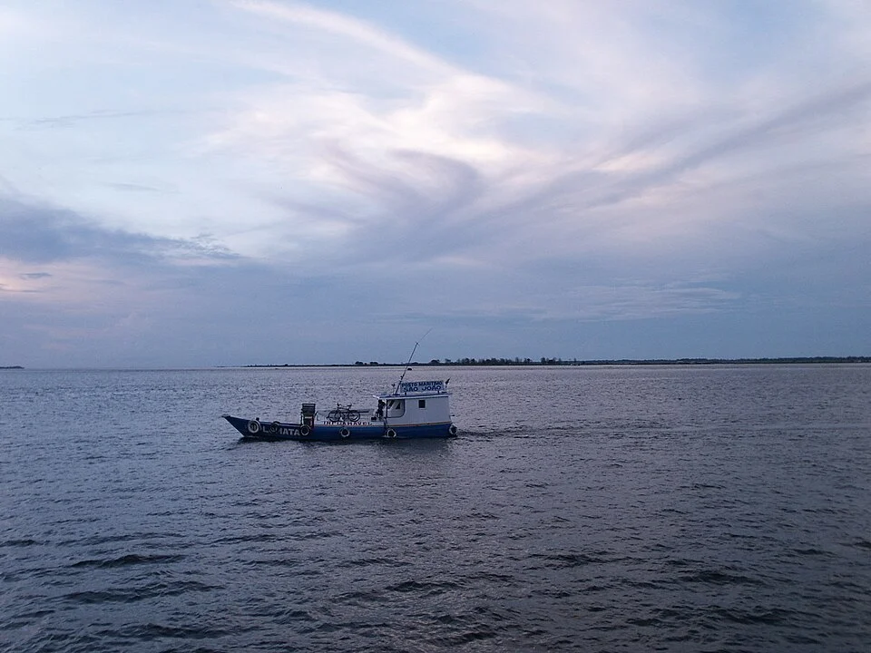

# Río Tapajós / Clearwater Amazónico

> Las aguas cristalinas de Brasil. Transparentes como el vidrio, con fondo arenoso blanco. El hogar del Altum gigante y los Geophagus.

## Descripción

Los "clearwater rivers" brasileños (Tapajós, Xingu, Tocantins) son transparentes y ligeramente ácidos, a diferencia del Río Negro (oscuro) o del Amazonas principal (turbio). Fondo de arena blanca y rocas redondeadas. Vegetación escasa pero presente.

---

## Parámetros

| Parámetro | Valor |
|---|---|
| pH | 6.0 – 7.0 |
| GH | 1 – 5 °dGH |
| KH | 1 – 3 °dKH |
| Temperatura | 26 – 30°C |
| Color | Transparente |

---

## Decoración
- **Sustrato**: Arena de cuarzo blanca (muy característico)
- **Rocas**: Redondeadas, granito, cuarzo — sin calcáreas
- **Madera**: Escasa, troncos blanqueados
- **Sin hojas ni taninos** (a diferencia del Río Negro)
- **Plantas**: Escasas en márgenes — *Echinodorus* en zonas someras

---

## Especies representativas
- *Pterophyllum scalare* (scalar amazónico — forma salvaje)
- *Geophagus surinamensis*, *G. tapajos* (cíclidos tamizadores de arena)
- *Heros efasciatus* (severum — forma salvaje verde-dorado)
- *Satanoperca leucosticta* (cíclido jorobado)
- *Corydoras sterbai* (corydoras de punto naranja)
- *Anostomus anostomus* (pez lápiz nariz roja)
- *Leporinus fasciatus* (barbo rayado)
