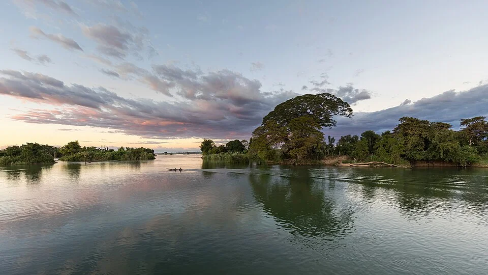

# Ríos de Corriente Rápida — Sudeste Asiático

> Ríos de montaña de Asia: frío, oxigenado, corriente fortísima. Hábitat de los Hillstream Loaches y peces de río.

## Descripción

Los ríos de montaña del Sudeste Asiático (Vietnam, Laos, Birmania, India occidental) tienen características opuestas a los ríos amazónicos: agua fría, muy oxigenada, corriente torrencial, sustrato de roca lisa con biofilm. Los peces y invertebrados están adaptados para adherirse a las rocas.

---

## Parámetros

| Parámetro | Valor |
|---|---|
| pH | 6.5 – 7.5 |
| GH | 5 – 15 °dGH |
| Temperatura | 18 – 24°C |
| O₂ | Saturado (> 8 mg/L) |
| Corriente | Muy alta (3-5 vol/hora) |

---

## Requisitos del acuario
- **Temperatura**: Sin calentador o con enfriador — máximo 24°C
- **Corriente**: Powerhead o Koralia de alta potencia. Acuario tipo "racetrack" (largo y estrecho)
- **Oxigenación**: Alta — corriente crea turbulencia suficiente
- **Sustrato**: Rocas lisas y planas de río (cantos rodados) + arena de grava fina entre ellas
- **Biofilm**: Importante para la alimentación — dejar que las rocas colonicen con película verde de algas

---

## Especies representativas

| Especie | Características |
|---|---|
| *Sewellia lineolata* (Hillstream) | Cuerpo aplanado con ventosa; nada en roca |
| *Gastromyzon punctulatus* | Hillstream de Borneo |
| *Beaufortia leveretti* | Hillstream de China |
| *Homaloptera zollingeri* | Hillstream alargado |
| *Danio choprai* | Danio de Birmania — colores brillantes |
| *Danio kyathit* | Danio azul-naranja |
| *Crossocheilus siamensis* (SAE) | Come algas; corriente alta |
| *Garra flavatra* | Limpiadora de roca; Birmania |
| *Puntius titteya* (barbo cereza) | Bajo y rápido; con vegetación de márgenes |

---

## Decoración
- Roca base: cantos rodados de río planos y lisos
- Arena de grava gruesa entre rocas
- Sin madera prominente (ríos de roca)
- Sin plantas altas — solo algas en roca + quizás *Microsorum* fijado en roca
- Agua cristalina (sin color)
