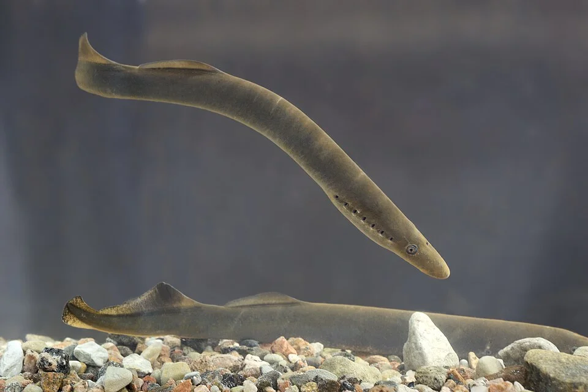

# Ríos Europeos Autóctonos

> La fauna fluvial autóctona del centro y norte de Europa.

## Parámetros

| Parámetro | Valor |
|---|---|
| pH | 7.0 – 8.5 |
| GH | 8 – 25 °dGH |
| Temperatura | 5 – 18°C |
| Corriente | variable (baja en el río bajo, alta en el río alto) |

---

## Especies europeas del río

**Peces:**

| Especie | Características |
|---|---|
| *Gobio gobio* — gobio | Pequeño, fondo, bigotes |
| *Phoxinus phoxinus* — piscardo | Pequeño cardumen; agua muy fría |
| *Alburnoides bipunctatus* — calandino | Plateado con línea lateral doble |
| *Rhodeus sericeus* — amarillo o bitterling | Deposita huevos en mejillones |
| *Cobitis taenia* — lamprehuela | Loach europeo |
| *Misgurnus fossilis* — dojo europeo | Loach grande europeo |
| *Perca fluviatilis* — perca | Depredador con rayas verdes-negras |
| *Cottus gobio* — cavilat | Pez de fondo de río de montaña |

---

## Plantas autóctonas
- *Ranunculus fluitans* — ranúnculo acuático
- *Myriophyllum spicatum* — miriofilo de espiga
- *Potamogeton crispus* — espiga de agua rizada
- *Callitriche stagnalis* — estrellada de agua
