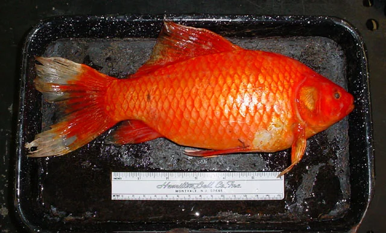
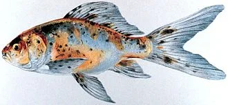
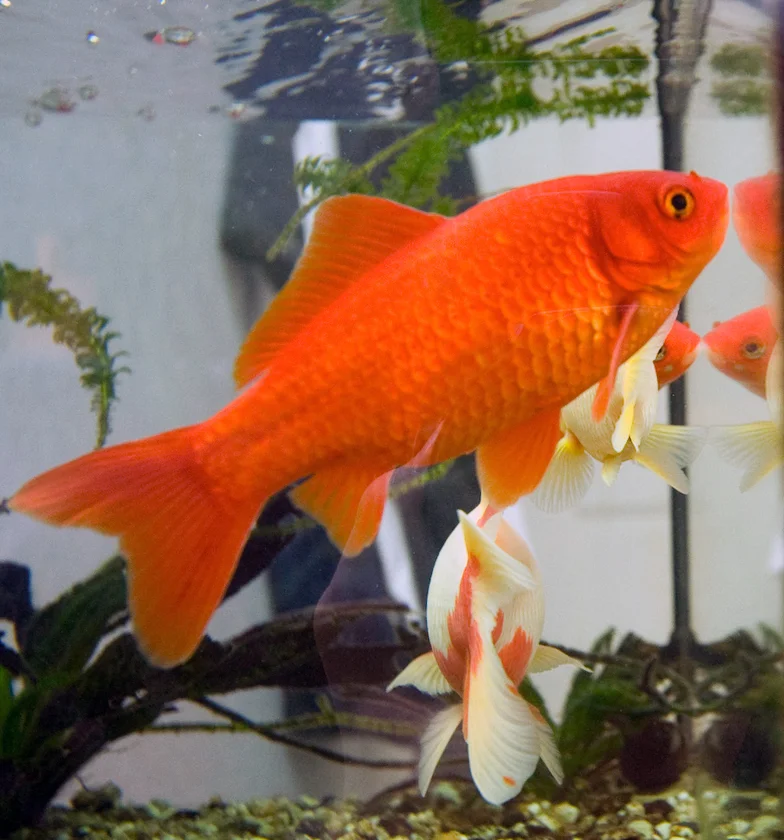

# Variedades de Goldfish de Estanque

> Los goldfish de estanque son las variedades de cuerpo alargado y cola simple, resistentes y activos. Soportan el invierno en estanques con suficiente profundidad.

---

## Goldfish Común (Carassius auratus auratus)

**Cuerpo**: Fusiforme, alargado, robusto
**Cola**: Simple
**Tamaño**: 20 – 35 cm
**Colores**: Naranja, amarillo, blanco, negro, combinaciones
**Temperatura**: 4 – 28°C — el más resistente
**Notas**: La variedad original de la que derivan todas las demás. Extremadamente robusta. Puede sobrevivir bajo el hielo (siempre que haya agua sin congelar y O₂). La variedad de estanque por excelencia. Salta con frecuencia.

---

## Comet Goldfish (Cola de Cometa)

**Cuerpo**: Alargado, como el común pero más estilizado
**Cola**: Simple muy larga y bifurcada — puede ser tan larga como el cuerpo
**Tamaño**: 25 – 35 cm
**Colores**: Naranja, bicolor naranja-blanco ("Sarasa Comet"), amarillo
**Temperatura**: 4 – 28°C
**Notas**: El goldfish más rápido y ágil. Cola larga muy ornamental. El "Sarasa Comet" rojo y blanco es uno de los más populares en estanques japoneses.

---

## Shubunkin

**Cuerpo**: Alargado, similar al comet
**Cola**: Simple
**Tamaño**: 20 – 30 cm
**Colores**: Calicó — azul, rojo, naranja, negro y blanco mezclados en patrón único. El azul es el color más difícil y más valorado.
**Temperatura**: 4 – 28°C
**Variedades**:
- *London Shubunkin*: cola corta, patrón calicó
- *Bristol Shubunkin*: cola larga en forma de abanico
- *American Shubunkin*: cola muy bifurcada
**Notas**: El único goldfish verdaderamente azul (aunque el azul es inestable genéticamente). Muy resistente.

---

## Hi-Fin Goldfish (Cola doble de aleta alta)

**Cuerpo**: Intermedio entre el alargado y el fancy
**Cola**: Doble, con aleta dorsal muy alta
**Tamaño**: 20 – 30 cm
**Temperatura**: 6 – 26°C
**Notas**: Transición entre estanque y acuario interior. Tolera el invierno en estanques profundos.
