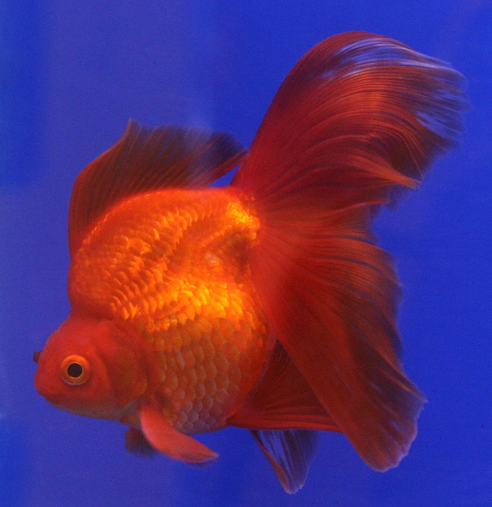
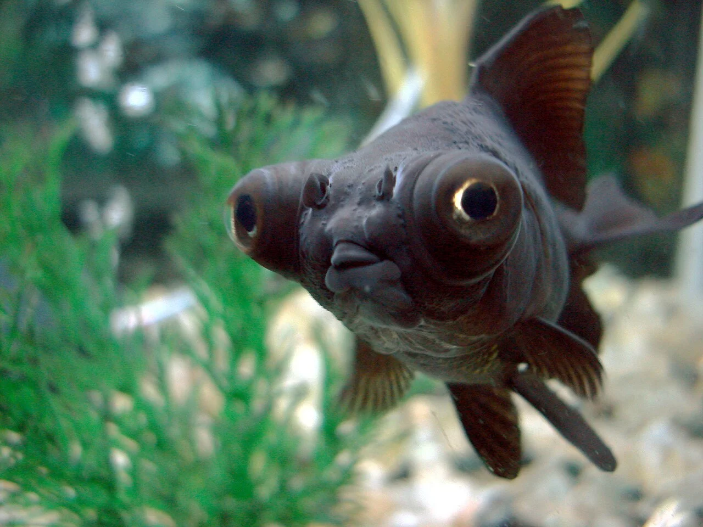
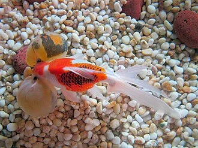
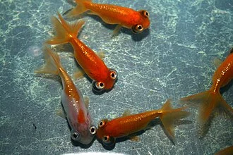

# Variedades de Goldfish Fancy (de acuario)

> Los goldfish fancy tienen cuerpo redondo o "huevo" y colas dobles. Son más delicados, necesitan acuario interior y NO toleran bien el invierno exterior.

---

## Ryukin

**Cuerpo**: Redondo, joroba pronunciada detrás de la cabeza
**Cola**: Doble larga
**Tamaño**: 15 – 20 cm
**Temperatura**: 15 – 24°C
**Notas**: El fancy más robusto. Joroba característica. Activo y vigoroso. Compatible con acuario interior o estanque templado sin inviernos duros.

---

## Oranda

**Cuerpo**: Redondo
**Cabeza**: "Capuchón" (wen) — masa de tejido esponjoso naranja/rojo que cubre la cabeza
**Cola**: Doble
**Tamaño**: 15 – 25 cm
**Temperatura**: 15 – 24°C
**Colores**: Naranja, rojo-blanco ("Red Cap Oranda"), negro, calicó
**Notas**: El capuchón crece con la edad. No mezclar con goldfish de cuerpo alargado (más lentos al comer). El capuchón puede infectarse si el agua no es perfecta. El "Red Cap Oranda" (cuerpo blanco, capuchón rojo) es icónico.

---

## Ranchu

**Cuerpo**: Muy redondo, sin aleta dorsal
**Cola**: Doble, corta, apuntando hacia abajo
**Cabeza**: Capuchón prominente
**Tamaño**: 10 – 18 cm
**Temperatura**: 15 – 24°C
**Notas**: El "rey de los goldfish" en Japón — muy valorado en concursos. Sin aleta dorsal = estabilidad reducida. Nada con movimiento bamboleante característico. Para expertos.

---

## Telescope Eye / Moor

**Cuerpo**: Redondo
**Ojos**: Telescópicos — protruyen del cuerpo en forma de cilindros
**Cola**: Doble
**Tamaño**: 12 – 18 cm
**Temperatura**: 15 – 24°C
**Colores**: Negro (*Black Moor*), naranja, calicó
**Notas**: Los ojos protruyen y son vulnerables a lesiones. No mezclar con peces de cuerpo alargado. Sin decoración con bordes cortantes. El Black Moor puede virar a naranja con la edad y temperatura elevada (normal).

---

## Bubble Eye (Ojo Burbuja)

**Cuerpo**: Redondo, sin aleta dorsal
**Ojos**: Bolsas de fluido bajo cada ojo que se bambolean
**Tamaño**: 10 – 15 cm
**Temperatura**: 15 – 22°C
**Notas**: Las bolsas se pueden pinchar con bordes afilados — sustrato y decoración absolutamente lisos. Sin filtros de aspiración expuestos. Las bolsas se regeneran si se pinchan. Solo con sus propios. El más delicado de todos los fancy.

---

## Lionhead

**Cuerpo**: Redondo, sin aleta dorsal
**Cabeza**: Capuchón que envuelve toda la cabeza
**Cola**: Doble
**Tamaño**: 12 – 18 cm
**Temperatura**: 15 – 22°C
**Notas**: Similar al Ranchu pero con capuchón más prominente que cubre mejillas. El equivalente chino al Ranchu japonés.

---

## Celestial Eye

**Cuerpo**: Redondo, sin aleta dorsal
**Ojos**: Apuntando hacia arriba — visión hacia arriba solo
**Tamaño**: 10 – 14 cm
**Temperatura**: 15 – 22°C
**Notas**: Solo puede ver hacia arriba — no puede ver la comida en el fondo. Alimentar desde la superficie. No mezclar con otros goldfish. Sin filtros de aspiración. El más delicado.

---

## Tabla resumen goldfish

| Variedad | Cuerpo | Cola | Estanque | Dificultad |
|---|---|---|---|---|
| Común | Alargado | Simple | ✅ Sí | ★☆☆☆☆ |
| Comet | Alargado | Simple larga | ✅ Sí | ★☆☆☆☆ |
| Shubunkin | Alargado | Simple | ✅ Sí | ★☆☆☆☆ |
| Ryukin | Redondeado | Doble | ⚠️ Templado | ★★☆☆☆ |
| Oranda | Redondo | Doble | ❌ Interior | ★★☆☆☆ |
| Ranchu | Redondo (sin dorsal) | Doble corta | ❌ Interior | ★★★★☆ |
| Telescope | Redondo | Doble | ❌ Interior | ★★★☆☆ |
| Bubble Eye | Redondo (sin dorsal) | Doble | ❌ Interior | ★★★★☆ |
| Celestial | Redondo (sin dorsal) | Doble | ❌ Interior | ★★★★★ |
