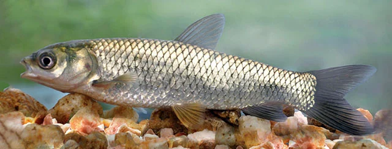
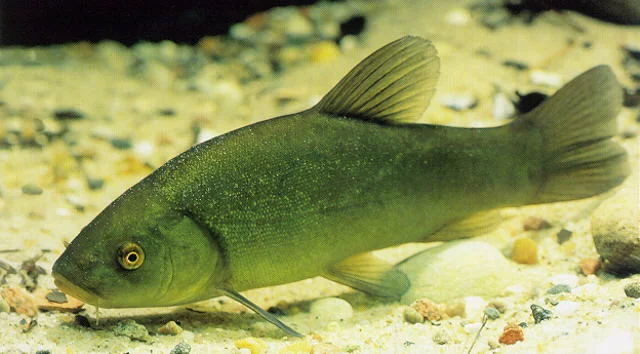
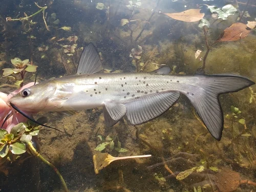

# Otros Peces de Estanque

## Carpa Común (Cyprinus carpio)
**Tamaño**: 60 – 90 cm
**Temperatura**: 4 – 28°C
**Notas**: La carpa ancestral del koi. Marrón-dorado, escamas grandes. Extremadamente robusta. Excava el sustrato buscando alimento — destruye las plantas del estanque. Solo para estanques sin plantas.

---

## Carpa Herbívora (Ctenopharyngodon idella)

**Tamaño**: hasta 120 cm
**Temperatura**: 4 – 28°C
**Notas**: Come vegetación acuática agresivamente. Útil para controlar algas y plantas invasoras. Pero puede eliminar toda la vegetación ornamental del estanque.

---

## Tenca (Tinca tinca)

**Tamaño**: 30 – 60 cm
**Temperatura**: 4 – 25°C
**Notas**: Pez de fondo europeo, verde oscuro o dorado. Come detritos del fondo. Compatible con koi y goldfish. No compite agresivamente por comida. Muy resistente.

---

## Rudd / Rutilo (Scardinius erythrophthalmus)
**Tamaño**: 20 – 35 cm
**Temperatura**: 4 – 22°C
**Notas**: Pez europeo de aguas someras. Aletas rojas, escamas doradas. Activo en superficie. Come insectos, algas y plantas flotantes. Colorido y ágil.

---

## Pez Gato de Canal (Ictalurus punctatus) — para estanques grandes

**Tamaño**: 50 – 100 cm
**Temperatura**: 4 – 28°C
**Notas**: Come detritos del fondo. Activo de noche. Grandes estanques de koi se benefician de tenerlos como "limpiadores del fondo". ⚠️ Especie invasora en Europa.

---

## Gambusia / Pez Mosquito (Gambusia affinis)
**Tamaño**: 3 – 5 cm
**Temperatura**: 10 – 35°C
**Notas**: Come larvas de mosquito. Muy útil para estanques sin filtro activo que tienen problemas con mosquitos. ⚠️ Especie invasora en Europa — verificar legalidad.
