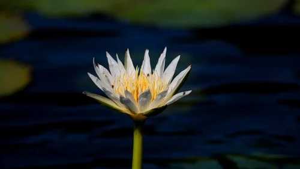

# Plantas Acuáticas de Estanque

## Plantas de orilla / marginal

| Planta | Profundidad | Características |
|---|---|---|
| *Iris pseudacorus* (lirio amarillo) | 0 – 30 cm | Flores amarillas, muy resistente |
| *Typha latifolia* (anea / espadaña) | 10 – 60 cm | Hojas largas, fruto en cilindro marrón |
| *Scirpus lacustris* (junco) | 5 – 50 cm | Junco verde, muy extendido |
| *Glyceria maxima* (cañuela) | 10 – 60 cm | Ornamental, hojas rayadas |
| *Pontederia cordata* (pontederia) | 10 – 40 cm | Flores azules en verano |
| *Alisma plantago-aquatica* | 5 – 30 cm | Flores blancas pequeñas, nativa |

---

## Plantas flotantes de superficie

| Planta | Temperatura mínima | Características |
|---|---|---|
| *Nymphaea* (nenúfar) | Resistente al frío | Flores de verano, sombreado |
| *Nuphar lutea* (nenúfar amarillo) | Muy resistente (4°C) | Autóctono europeo |
| *Eichhornia crassipes* (jacinto) | > 10°C (no inverna) | Flores moradas, absorbe nitratos |
| *Pistia stratiotes* (lechuga) | > 15°C (no inverna) | Roseta flotante |

---

## Plantas sumergidas (oxigenadoras)

| Planta | Características |
|---|---|
| *Ceratophyllum demersum* (cola de zorro) | Extremadamente resistente; 4-30°C |
| *Elodea canadensis* (elodea) | Resistente al frío; naturalizada invasora |
| *Myriophyllum spicatum* (miriofilo) | Autóctona europea; muy ornamental |
| *Potamogeton crispus* (espiga rizada) | Autóctona; invierna bien |
| *Ranunculus aquatilis* (ranúnculo acuático) | Flores blancas emergentes |

---

## Nenúfares (Nymphaea) — detalle

Los nenúfares son las plantas más importantes del estanque: proporcionan sombra (hasta 50% de la superficie), refugio para peces y gran ornamentación.

| Grupo | Temperatura mínima | Tamaño | Características |
|---|---|---|---|
| Resistentes (hardy) | -15°C | Variables | Invernan en el fondo; florecen verano |
| Tropicales de día | > 20°C | Grandes | Flores enormes; no invernan en exterior |
| Tropicales de noche | > 20°C | Grandes | Florecen de noche |
| Miniatura | Resistentes | < 1 m² | Para estanques pequeños |

**Nenúfares resistentes recomendados:**
- *Nymphaea 'Attraction'* — rojo oscuro; para estanques medianos-grandes
- *N. 'Froebeli'* — rojo; uno de los primeros en florecer
- *N. 'James Brydon'* — rojo-rosado; muy perfumado
- *N. 'Marliacea Albida'* — blanco; clásico
- *N. 'Chromatella'* — amarillo; hojas moteadas
- *N. alba* (autóctono) — blanco; el nenúfar nativo de Europa
