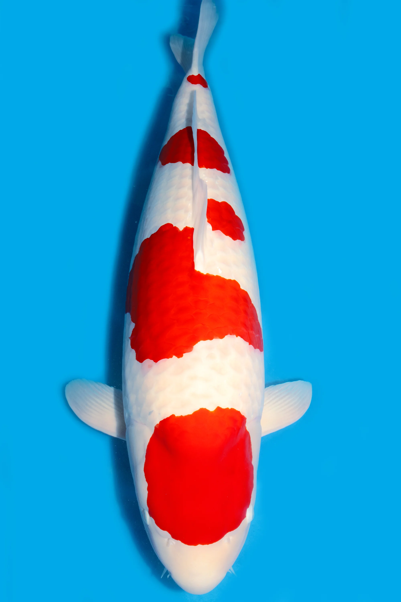
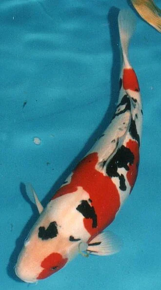
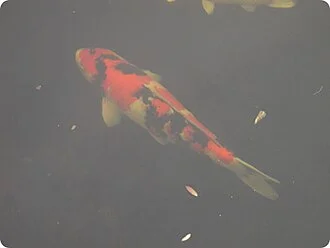
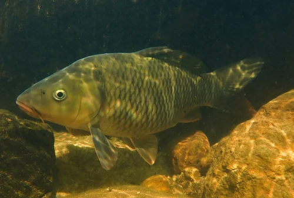
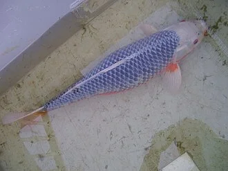
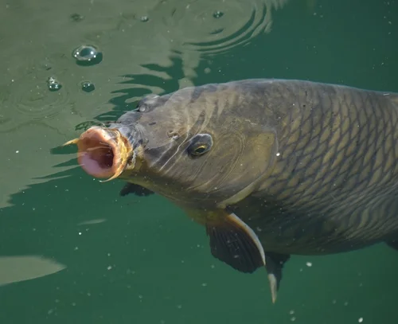

# Variedades de Koi (Nishikigoi)

> Los koi (*Cyprinus rubrofuscus*) son carpas domésticas seleccionadas durante siglos en Japón por su coloración. Existen más de 100 variedades clasificadas en grupos.

**Datos generales del koi:**
- Tamaño adulto: 60 – 90 cm (algunos "jumbo koi" superan el metro)
- Vida útil: 20 – 50 años
- Temperatura tolerada: 4 – 30°C
- Temperatura óptima crecimiento: 20 – 25°C
- Dieta: omnívoro (pellets de koi, vegetales, insectos)
- Reproducción: ovíparo (freza en primavera a 18°C+)

---

## Kohaku

**Aspecto**: Fondo blanco (*shiro*) con manchas rojas (*hi*) — la variedad más clásica y apreciada
**Patrón ideal**: Manchas rojas bien definidas, simétricas, que no lleguen a las aletas. Fondo blanco puro como nieve.
**Grading**: La calidad se juzga por la nitidez de los bordes (kiwa), intensidad del rojo y pureza del blanco.
**Categorías**: Tancho Kohaku (solo un círculo rojo en la cabeza), Ippon Hi (una sola mancha roja larga)

---

## Taisho Sanke (Sanke)

**Aspecto**: Blanco con manchas rojas Y manchas negras pequeñas (*sumi*). Los tres colores nunca se superponen perfectamente.
**Diferencia con Showa**: El negro del Sanke está encima del blanco; el negro del Showa está encima del negro base.
**Patrón ideal**: El sumi (negro) en aletas pectorales y en el cuerpo distribuido simétricamente.

---

## Showa Sanshoku (Showa)

**Aspecto**: Negro base con manchas rojas y blancas. El negro es dominante y envuelve los otros colores.
**Historia**: Surgió en 1927. El tipo "Kindai Showa" moderno tiene más blanco.
**Diferencia clave**: En el Showa, el negro llega a la cabeza y a las aletas pectorales; en el Sanke, no.

---

## Utsuri

**Aspecto**: Bicolor negro + otro color. *Shiro Utsuri* (negro+blanco), *Hi Utsuri* (negro+rojo), *Ki Utsuri* (negro+amarillo).
**Característica**: Patrón en "zigzag" de colores que se alternan.

---

## Asagi

**Aspecto**: Escamas azul-gris en espalda con reticulado oscuro visible. Flancos y vientre naranja-rojo.
**El más "natural"**: Aspecto que recuerda al color original de la carpa salvaje.
**Hikari Asagi**: Versión metálica iridiscente.

---

## Ogon (Monocolor metálico)

**Aspecto**: Un solo color completamente uniforme y metálico iridiscente. *Yamabuki Ogon* (dorado amarillo), *Platinum Ogon* (plateado blanco), *Orenji Ogon* (naranja).
**Origen**: Primer koi metálico, desarrollado en los años 40.
**Nota**: Muy populares por su impacto visual y facilidad de apreciación.

---

## Kumonryu

**Aspecto**: Negro y blanco en patrón variable que cambia con la temperatura del agua y la estación.
**Único**: El único koi que cambia de patrón durante su vida. En agua fría tira a negro; en agua cálida aparece más blanco.

---

## Ginrin (escamas espejo)

**Aspecto**: No es una variedad en sí sino una mutación que afecta a las escamas, que brillan como diamantes o plata. Se combina con cualquier variedad: Kohaku Ginrin, Showa Ginrin, etc.
**Gin Rin**: Escamas con brillo plateado o dorado en el centro.

---

## Doitsu (koi sin escamas o con pocas)

**Aspecto**: Carpa de origen alemán (Deutsche Karpfen) con muy pocas escamas o sin ellas. Piel lisa. Se puede combinar con cualquier patrón de color.
**Tipos**: Doitsu (pocas escamas en línea lateral y dorsal), Leather Koi (totalmente sin escamas).

---

## Koromo

**Aspecto**: Patrón Kohaku (blanco+rojo) pero las escamas rojas tienen borde azul-grisáceo que las reticula.

---

## Tabla de clasificación rápida

| Grupo | Colores | Patrón |
|---|---|---|
| Kohaku | Blanco + Rojo | Manchas rojas sobre blanco |
| Sanke | Blanco + Rojo + Negro | Negro pequeño sobre Kohaku |
| Showa | Negro + Rojo + Blanco | Negro base con manchas |
| Utsuri | Negro + 1 color | Zigzag bicolor |
| Asagi/Shusui | Azul + Naranja | Escamas azules, flancos naranja |
| Ogon | 1 color metálico | Uniforme |
| Bekko | Blanco/Rojo/Amarillo + Negro | Negro sobre fondo liso |
| Tancho | Blanco + círculo rojo en cabeza | Solo un punto rojo en cabeza |
| Kumonryu | Negro + Blanco variable | Cambia con temperatura |
