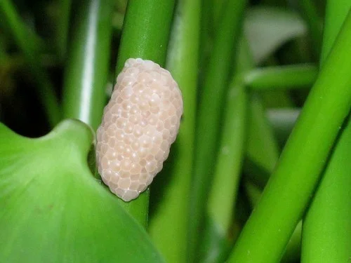

## ESTRUCTURA DE FICHA DE INVERTEBRADO

```
### Nombre Común (Nombre científico)
**Familia**:
**Origen**:
**Tamaño**: adulto
**Temperatura**: °C
**pH**:
**GH / KH / TDS**: (agua dulce) o Salinidad (marino)
**Dificultad**: ★ a ★★★★★
**Tipo de agua**: dulce / marino / salobre
**Comportamiento**: pacífico / semiagrresivo / agresivo
**Compatible con peces**: sí / no / depende (indicar cuáles)
**Dieta**: detritívoro / algívoro / carnívoro / omnívoro / filtrador
**Reproducción**: breve descripción
**Notas**:
```

---

## Invertebrados — Nano Acuario

> Los invertebrados son compañeros habituales del nano acuario. Su pequeño tamaño y función como limpiadores los hacen ideales. Gambas y caracoles mantienen el acuario limpio y añaden movimiento y vida.

---

### Cherry Shrimp / Gamba Cherry (Neocaridina davidi "Red")


**Familia**: Atyidae
**Origen**: Taiwán
**Tamaño**: 2 – 3 cm
**Temperatura**: 16 – 26°C
**pH**: 6.8 – 7.8
**GH / KH / TDS**: GH 6-10 / KH 2-8 / TDS 150-250 ppm
**Dificultad**: ★☆☆☆☆
**Tipo de agua**: dulce
**Comportamiento**: pacífico
**Compatible con peces**: solo con nano-peces de boca muy pequeña (Boraras, Danio margaritatus); peces mayores las cazan
**Dieta**: omnívora detritívora (biofilm, algas, restos vegetales)
**Reproducción**: ovípara; hembra lleva huevos 3-4 semanas; crías idénticas a adultos
**Notas**: La invertebrada más popular del nano acuario. En un nano de 20-30L sin depredadores se reproducen hasta llenar el acuario. El rojo se intensifica con buena alimentación y agua estable. Muy indicadora de calidad de agua: si se esconden o mueren, revisar parámetros.

---

### Amano Shrimp / Gamba de Amano (Caridina multidentata)


**Familia**: Atyidae
**Origen**: Japón, Corea
**Tamaño**: 4 – 5 cm
**Temperatura**: 18 – 26°C
**pH**: 6.0 – 7.5
**GH / KH / TDS**: GH 4-14 / KH 2-10 / TDS 100-300 ppm
**Dificultad**: ★★☆☆☆
**Tipo de agua**: dulce
**Comportamiento**: pacífico
**Compatible con peces**: peces pacíficos y pequeños; ella no ataca a nadie
**Dieta**: principalmente algívora (algas filamentosas, verdes, BBA)
**Reproducción**: no se reproduce en agua dulce
**Notas**: La mejor comedora de algas para nano acuario. Come algas que las Cherry ignoran (BBA, algas filamentosas). No se reproduce en dulce: se compran adultos. Su tamaño (4-5 cm) es grande para un nano muy pequeño; mejor en nanos de 30L o más.

---

### Caracol Nerite (Neritina spp.)


**Familia**: Neritidae
**Origen**: Indo-Pacífico y ríos tropicales
**Tamaño**: 1 – 2.5 cm
**Temperatura**: 22 – 28°C
**pH**: 6.5 – 8.5
**GH / KH / TDS**: GH 6-18 / KH 4-10
**Dificultad**: ★☆☆☆☆
**Tipo de agua**: dulce
**Comportamiento**: pacífico
**Compatible con peces**: con casi todos; los peces no pueden comerlo
**Dieta**: algívoro (algas verdes en cristal, perifiton)
**Reproducción**: pone huevos blancos en cristal y madera (no eclosionan en agua dulce)
**Notas**: El mejor limpiador de cristales del nano acuario. Come las algas verdes que se forman en el cristal con notable eficacia. No se reproduce en agua dulce (las crías necesitan agua marina). Los huevos blancos que pone en el cristal son antiestéticos pero inofensivos. Variedades: Cebra, Oliva, Espiral, Leopardo.

---

### Caracol Misterio (Pomacea bridgesii)


**Familia**: Ampullariidae
**Origen**: Bolivia (cuenca del río Mamoré)
**Tamaño**: 4 – 7 cm
**Temperatura**: 22 – 28°C
**pH**: 7.0 – 8.0
**GH / KH / TDS**: GH 8-18 / KH 5-12
**Dificultad**: ★☆☆☆☆
**Tipo de agua**: dulce
**Comportamiento**: pacífico
**Compatible con peces**: con casi todos; los peces grandes pueden morderle los tentáculos
**Dieta**: detritívora / algívora / come restos vegetales y pellets
**Reproducción**: pone huevos sobre el nivel del agua (racimos de color rosa fuera del cristal)
**Notas**: El "limpiador estrella" visible del nano acuario. Come algas, restos de comida y hojas muertas. Su tamaño es considerable para nanos muy pequeños: mejor en 30L o más. Necesita espacio sobre el agua (tapa con gap) para respirar y poner los huevos fuera del agua. No come plantas sanas con excepción de casos de hambre extrema.
