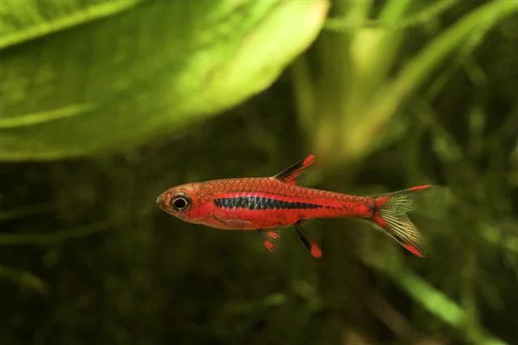
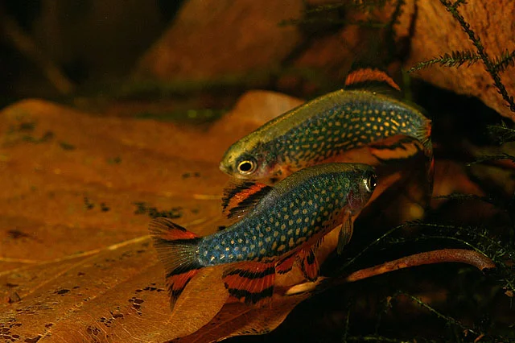
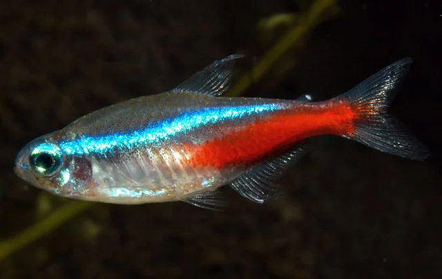
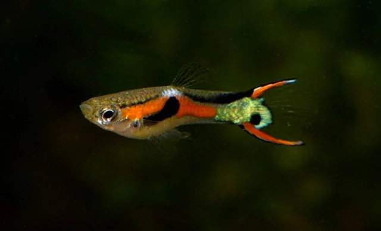
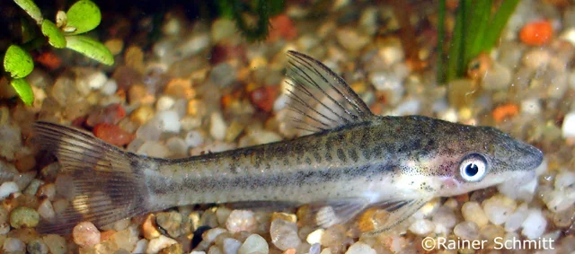

## ESTRUCTURA DE FICHA DE PEZ MARINO

```
### Nombre Común (Nombre científico)
**Familia**:
**Origen**:
**Tamaño**: adulto
**Temperatura**: °C
**pH**: (rango marino estándar salvo excepción)
**Salinidad**: densidad objetivo
**Dificultad**: ★ a ★★★★★
**Tipo de acuario**: FOWLR / Reef / Ambos
**Nivel de nado**: fondo / medio / superficie
**Comportamiento**: pacífico / semiagrresivo / agresivo
**Mínimo de individuos**: (si aplica)
**Tamaño de acuario mínimo**: litros
**Dieta**: omnívoro / carnívoro / herbívoro / planctívoro
**Reproducción**: ovíparo / hermafrodita secuencial
**Reef Safe**: sí / no / precaución
```

## ESTRUCTURA DE FICHA DE PEZ DULCE

```
### Nombre Común (Nombre científico)
**Familia**:
**Origen**:
**Tamaño**: adulto
**Temperatura**: °C
**pH**:
**GH**: °dGH
**Dureza**:
**Dificultad**: ★ a ★★★★★
**Tipo de agua**:
**Nivel de nado**: fondo / medio / superficie
**Comportamiento**: pacífico / semiagrresivo / agresivo
**Mínimo de individuos**: (si aplica)
**Tamaño de acuario mínimo**: litros
**Dieta**: omnívoro / carnívoro / herbívoro
**Reproducción**: ovíparo / vivíparo
**Notas**:
```

---

## Peces — Nano Acuario

> El nano acuario (10 – 60 litros) impone limitaciones estrictas en el tamaño y número de peces. Solo nano-peces (menores de 4 cm en adulto) son aptos. Se prioriza el movimiento en banco y la compatibilidad con gambas y plantas.

---

### Boraras brigittae (Boraras brigittae)


**Familia**: Cyprinidae
**Origen**: Borneo (Kalimantan, Indonesia)
**Tamaño**: 1.5 – 2 cm
**Temperatura**: 24 – 28°C
**pH**: 4.0 – 7.0
**GH**: 0 – 6 °dGH
**Dureza**: muy blanda
**Dificultad**: ★★☆☆☆
**Tipo de agua**: dulce tropical (agua blanda y ácida)
**Nivel de nado**: medio
**Comportamiento**: pacífico (cardumen)
**Mínimo de individuos**: 8 – 10
**Tamaño de acuario mínimo**: 20 litros
**Dieta**: omnívoro (micropresas, polvo, nauplios de artemia)
**Reproducción**: ovíparo libre
**Notas**: El pez más adecuado para nano acuarios plantados con gambas Cherry. Colores rojo-naranja intensos con puntos oscuros. Requiere agua muy blanda y ácida, similar a la del biotopo del río Negro. Banco espectacular en acuario pequeño bien plantado.

---

### Pez Galaxia / Danio margaritatus (Celestichthys margaritatus)


**Familia**: Cyprinidae
**Origen**: Myanmar (Shan, lago Inle)
**Tamaño**: 1.5 – 2 cm
**Temperatura**: 20 – 26°C
**pH**: 6.5 – 7.5
**GH**: 5 – 15 °dGH
**Dureza**: media
**Dificultad**: ★★☆☆☆
**Tipo de agua**: dulce
**Nivel de nado**: medio – superficie
**Comportamiento**: pacífico (cardumen)
**Mínimo de individuos**: 8 – 10
**Tamaño de acuario mínimo**: 20 litros
**Dieta**: omnívoro (nauplios, polvo, micro-pellets)
**Reproducción**: ovíparo libre
**Notas**: Uno de los nano-peces más populares del hobby. Puntos blancos brillantes sobre fondo azul oscuro. Machos con aleta dorsal y anal anaranjadas. Agua ligeramente dura y fría (20-24°C) es el punto óptimo. Compatible con gambas Cherry adultas.

---

### Neón Común (Paracheirodon innesi)


**Familia**: Characidae
**Origen**: Afluentes del Amazonas (Perú, Brasil)
**Tamaño**: 4 cm
**Temperatura**: 20 – 26°C
**pH**: 5.5 – 7.5
**GH**: 1 – 10 °dGH
**Dureza**: blanda – media
**Dificultad**: ★☆☆☆☆
**Tipo de agua**: dulce tropical
**Nivel de nado**: medio
**Comportamiento**: pacífico
**Mínimo de individuos**: 6 (mejor 10)
**Tamaño de acuario mínimo**: 40 litros
**Dieta**: omnívoro
**Reproducción**: ovíparo
**Notas**: Clásico del hobby. En nano de 40+ litros cabe un banco de 8-10 ejemplares. La banda azul iridiscente solo brilla con fondo oscuro. Sensible al síndrome del neón (incurable). No mezclar con peces que puedan comérselos.

---

### Endler (Poecilia wingei)


**Familia**: Poeciliidae
**Origen**: Venezuela (lagunas de Paria)
**Tamaño**: machos 2 – 3 cm / hembras 4 – 5 cm
**Temperatura**: 22 – 30°C
**pH**: 6.7 – 8.5
**GH**: 8 – 25 °dGH
**Dureza**: media – dura
**Dificultad**: ★☆☆☆☆
**Tipo de agua**: dulce (tolera algo de sal)
**Nivel de nado**: medio – superficie
**Comportamiento**: pacífico
**Mínimo de individuos**: 1 macho / 2-3 hembras
**Tamaño de acuario mínimo**: 20 litros
**Dieta**: omnívoro (acepta casi cualquier alimento)
**Reproducción**: vivíparo (parición cada 3-4 semanas)
**Notas**: Nano-pez vivíparo muy colorido. Los machos tienen colores excepcionales (naranja, verde metálico, negro). Se reproduce con facilidad: en nano sin depredadores el acuario se superpoblará rápido. Muy tolerante a parámetros. Hibridiza con Guppy: no mezclarlos si se quieren lineas puras.

---

### Otocinclus (Otocinclus affinis / O. vittatus)


**Familia**: Loricariidae
**Origen**: América del Sur (Brasil, Colombia, Venezuela)
**Tamaño**: 3 – 5 cm
**Temperatura**: 21 – 27°C
**pH**: 6.0 – 7.5
**GH**: 2 – 15 °dGH
**Dureza**: blanda – media
**Dificultad**: ★★★☆☆
**Tipo de agua**: dulce tropical
**Nivel de nado**: fondo – fijado en cristales y plantas
**Comportamiento**: pacífico
**Mínimo de individuos**: 4 – 6
**Tamaño de acuario mínimo**: 40 litros
**Dieta**: algívoro (algas verdes puntiformes, perifiton)
**Reproducción**: ovíparo (pone huevos en cristal)
**Notas**: El mejor limpiador de cristales para nano acuarios. Muy delicado en la aclimatación (alta mortalidad en las primeras semanas); luego es estable. Requiere siempre colonia de 4+ (muy social). Complementar su dieta con pastillas de espirulina y rodajas de calabacín. Incompatible con gambas Caridina si se añaden medicamentos.
