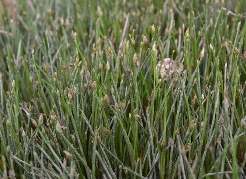

## ESTRUCTURA DE FICHA DE PLANTA

```
### Nombre Común (Nombre científico)
**Familia**:
**Origen**:
**Tamaño**: altura máxima en acuario
**Temperatura**: °C
**pH**:
**GH**: °dGH
**Dificultad**: ★ a ★★★★★
**Luz**: muy baja / baja / media / alta / muy alta
**CO2**: no necesario / recomendable / imprescindible
**Fertilización**: baja / media / alta
**Crecimiento**: muy lento / lento / medio / rápido / muy rápido
**Posición**: primer plano / plano medio / trasera / flotante / fijada en roca o madera
**Sustrato**: inerte / nutritivo recomendado / nutritivo imprescindible
**Propagación**: esquejes / estolones / rizoma / esporas
```

---

## Plantas — Nano Acuario

> En el nano acuario las plantas deben tener un tamaño proporcional al volumen. Se prefieren plantas pequeñas, de crecimiento lento o controlable, que no dominen el espacio. Las plantas fijadas en roca/madera son ideales porque no requieren sustrato profundo.

---

### Anubias Nana (Anubias barteri var. nana)


**Familia**: Araceae
**Origen**: Camerún, Nigeria
**Tamaño**: 5 – 15 cm
**Temperatura**: 20 – 30°C
**pH**: 5.5 – 9.0
**GH**: 0 – 20 °dGH
**Dificultad**: ★☆☆☆☆
**Luz**: muy baja – media
**CO2**: no necesario
**Fertilización**: baja
**Crecimiento**: muy lento
**Posición**: primer plano – plano medio, fijada en roca o madera
**Sustrato**: NO enterrar
**Propagación**: división del rizoma
**Notas**: La planta más versátil del nano acuario. Su pequeño tamaño y crecimiento lento la hacen perfecta. No necesita sustrato nutritivo ni CO2. Variedad "Petite" (A. barteri var. nana "Petite") es aún más pequeña y muy adecuada para nanos de 20L o menos.

---

### Musgo de Java (Taxiphyllum barbieri)


**Familia**: Hypnaceae
**Origen**: Asia del Sur y Sudeste Asiático
**Tamaño**: tapiz de 2 – 5 cm
**Temperatura**: 15 – 30°C
**pH**: 5.0 – 9.0
**GH**: 0 – 20 °dGH
**Dificultad**: ★☆☆☆☆
**Luz**: muy baja – alta
**CO2**: no necesario
**Fertilización**: baja
**Crecimiento**: lento – medio
**Posición**: fijado en roca, madera o como tapiz de fondo
**Sustrato**: no aplica
**Propagación**: división
**Notas**: Imprescindible en nano acuario con gambas: el biofilm que crece entre sus filamentos es el alimento principal de las crías. Crea refugios naturales. Se puede fijar en roca volcánica o madera de raíz con hilo de algodón o malla.

---

### Helecho de Java (Microsorum pteropus)


**Familia**: Polypodiaceae
**Origen**: Sudeste Asiático
**Tamaño**: 20 – 50 cm (variedades enanas: 10-20 cm)
**Temperatura**: 18 – 30°C
**pH**: 5.0 – 8.0
**GH**: 0 – 20 °dGH
**Dificultad**: ★☆☆☆☆
**Luz**: muy baja – media
**CO2**: no necesario
**Fertilización**: baja
**Crecimiento**: lento
**Posición**: plano medio, fijado en roca o madera
**Sustrato**: NO enterrar
**Propagación**: división del rizoma; plántulas en hojas maduras
**Notas**: Para nano acuario usar la variedad "Narrow Leaf" o "Windelov" que son más compactas. Las variedades estándar pueden crecer demasiado para acuarios de menos de 30L.

---

### Cryptocoryne Parva (Cryptocoryne parva)


**Familia**: Araceae
**Origen**: Sri Lanka
**Tamaño**: 3 – 8 cm
**Temperatura**: 22 – 28°C
**pH**: 6.0 – 7.5
**GH**: 2 – 15 °dGH
**Dificultad**: ★★★☆☆
**Luz**: media
**CO2**: recomendable
**Fertilización**: media
**Crecimiento**: muy lento
**Posición**: primer plano
**Sustrato**: nutritivo recomendado
**Propagación**: estolones
**Notas**: La Cryptocoryne más pequeña del hobby. Perfecta para primer plano en nanos. Crece muy lentamente, lo cual en un nano es una ventaja. Puede sufrir "Crypt melt" al trasplantarse: las hojas se disuelven pero rebrota. No tocar una vez plantada.

---

### Hairgrass Enana (Eleocharis parvula)


**Familia**: Cyperaceae
**Origen**: Cosmopolita (Europa, Asia, América)
**Tamaño**: 3 – 10 cm
**Temperatura**: 10 – 28°C
**pH**: 6.0 – 7.5
**GH**: 2 – 12 °dGH
**Dificultad**: ★★☆☆☆
**Luz**: media – alta
**CO2**: recomendable
**Fertilización**: media
**Crecimiento**: lento – medio
**Posición**: primer plano (tapizante)
**Sustrato**: nutritivo recomendado
**Propagación**: estolones laterales
**Notas**: Tapizante en forma de césped muy popular en nano aquascapes. Con CO2 y luz alta forma un tapiz denso. Sin CO2 crece más lento y menos compacto pero viable. Requiere sustrato nutritivo y recortes periódicos para mantenerlo bajo.

---

### HC Cuba (Hemianthus callitrichoides "Cuba")


**Familia**: Linderniaceae
**Origen**: Cuba (afluentes del río San Juan)
**Tamaño**: 0.5 – 2 cm (la planta más pequeña del hobby)
**Temperatura**: 20 – 28°C
**pH**: 5.5 – 7.5
**GH**: 0 – 10 °dGH
**Dificultad**: ★★★★★
**Luz**: alta – muy alta
**CO2**: imprescindible
**Fertilización**: alta
**Crecimiento**: lento
**Posición**: primer plano (tapizante)
**Sustrato**: nutritivo imprescindible (ADA Amazonia u equivalente)
**Propagación**: división de mata; esquejes de tallo
**Notas**: El tapizante más pequeño y exigente del hobby. En nano acuarios bien equipados (CO2 inyectado, luz potente, sustrato activo) crea una alfombra verde esmeralda incomparable. Solo para aficionados avanzados con instalación completa. Sin CO2 y luz alta no prospera.
