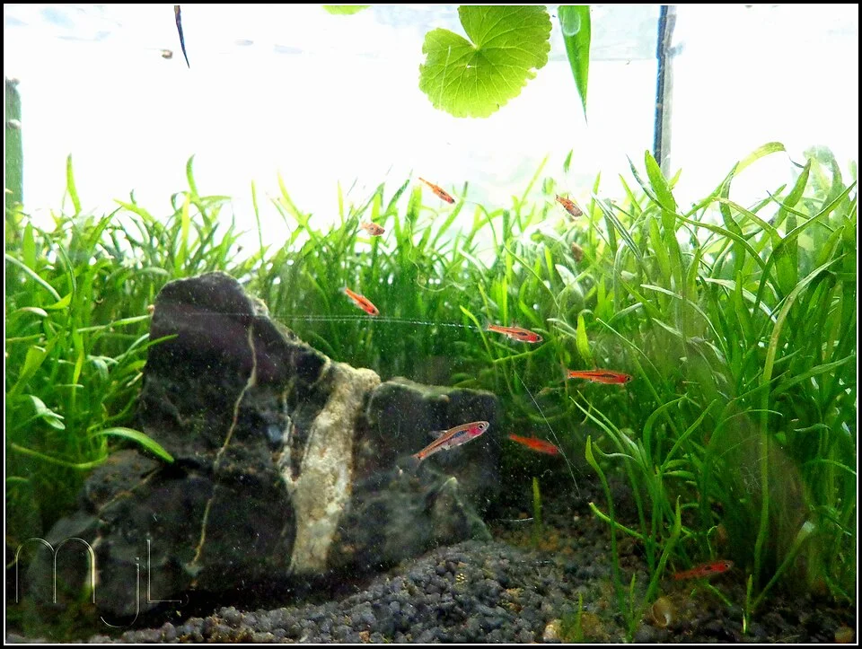

# NANO ACUARIO

**Dificultad general**: ★★★★☆ (paradójicamente más difícil que los grandes)
**Coste de setup**: bajo – medio
**Tamaño mínimo recomendado**: 10 L (para fauna específica)
**Para quién es**: intermedio – avanzado (NO recomendado para principiantes)

---

## Descripción

Acuarios de menos de 30 litros. El principal atractivo es estético y espacial: caben en cualquier sitio. Pero son mucho más difíciles de mantener estables que los grandes: cualquier desequilibrio (muerte de un pez, sobrealimentación) afecta rápidamente a toda el agua.

---

## Por qué los nano son más difíciles

- **Poca inercia química**: un pez muerto contamina el 100% del agua en horas
- **Temperatura inestable**: sube rápido en verano, baja rápido en invierno
- **Cambios de agua más delicados**: retirar 2L de un acuario de 10L es el 20% del volumen total
- **Menos espacio de error**: cada error tiene consecuencias más rápidas

---

## Parámetros del agua (variables según fauna elegida)

| Parámetro | Rango general |
|-----------|--------------|
| Temperatura | Según especie (18-28°C) |
| pH | Según especie (6.5-7.5 para la mayoría) |
| GH | Según especie (5-15 °dGH) |
| NH3 | 0 ppm (tolerancia aún menor que en acuarios grandes) |
| NO2 | 0 ppm |
| NO3 | < 20 ppm (más exigente por el volumen reducido) |

---

## Especies específicas para nano

| Especie | Litros mínimos | Notas |
|---------|---------------|-------|
| Gambas Cherry o Blue Velvet | 10 L | Ideal para nano |
| Boraras brigittae (micro rasbora) | 20 L | Muy pequeño, banco de 8+ |
| Trigonostigma espei | 20 L | Más pequeño que el arlequín |
| Danio margaritatus (Celestial Pearl) | 20 L | Precioso, algo tímido |
| Betta splendens (solo) | 20-40 L | Solo, sin banco |
| Corydoras pygmaeus (enano) | 30 L | En grupo de 6+, sustrato suave |
| Caracoles Nerite | 10 L | |

---

## Equipamiento nano

- Filtro de esponja pequeño o filtro de esquina interno muy pequeño
- Calefactor mini o no calefactor si la habitación es cálida
- Tapa imprescindible (evaporación alta en volúmenes pequeños)
- Iluminación LED específica para nano (Chihiros WRGB, ADA Mini)
- TDS y pH metro pequeño para controles frecuentes

---

## Algas comunes — cuáles son, por qué aparecen, cómo eliminarlas

El nano es el entorno más susceptible a explosiones de algas por la inestabilidad química. Las algas aparecen y se propagan más rápido que en acuarios grandes.

### Diatomas
**Comportamiento en nano:** Pueden cubrir todo el acuario en pocos días al principio. Muy normal.
**Solución:** Otocinclus mini, cambios de agua del 10% diarios. Desaparece en 2-4 semanas.

---

### GHA (Alga Pelo Verde)
**Comportamiento en nano:** Se extiende rápidamente en nano con luz. Un solo exceso de alimento puede desencadenar un boom de GHA.
**Solución:** Reducir fotoperiodo a 6h. Cambios de agua del 20% cada 2-3 días. Gambas Amano (2-3 en un nano de 20L).

---

### Cianobacterias
**Comportamiento en nano:** Especialmente peligrosas en nano por la menor circulación y mayor concentración de materia orgánica.
**Solución:** Revisar la circulación del agua. Cambios de agua diarios pequeños. Oscuridad total 3 días.

---

## Errores más comunes

- Recomendar nano a principiantes (es el setup más difícil de estabilizar)
- Goldfish en nano (incompatible totalmente)
- Peces tropicales de tamaño mediano en nano (muy estresados)
- Sobrealimentar: en 10L, 1 escama de más puede subir el amoniaco

---

## Consejos clave

- El nano funciona bien cuando la densidad de fauna es baja y la alimentación es mínima
- Los cambios de agua frecuentes (10-20% cada 2-3 días) son más importantes en nano que en cualquier otro tipo
- Las plantas de crecimiento rápido (Salvinia flotante, Elodea) son excelentes estabilizadoras de parámetros
- Tener siempre agua preparada (misma temperatura, acondicionada) lista para cambios de emergencia
- El nano plantado con gambas Cherry es la combinación más fácil y estética: muy recomendada
