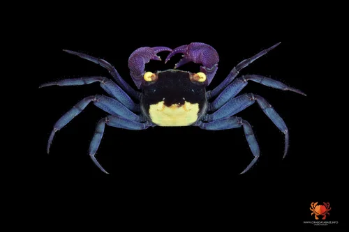
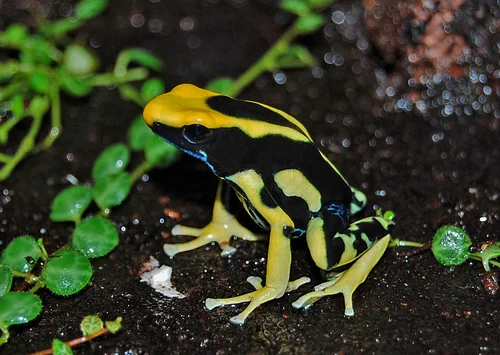

## ESTRUCTURA DE FICHA DE INVERTEBRADO

```
### Nombre Común (Nombre científico)
**Familia**:
**Origen**:
**Tamaño**: adulto
**Temperatura**: °C
**pH**:
**GH / KH / TDS**: (agua dulce) o Salinidad (marino)
**Dificultad**: ★ a ★★★★★
**Tipo de agua**: dulce / marino / salobre
**Comportamiento**: pacífico / semiagrresivo / agresivo
**Compatible con peces**: sí / no / depende (indicar cuáles)
**Dieta**: detritívoro / algívoro / carnívoro / omnívoro / filtrador
**Reproducción**: breve descripción
**Notas**:
```

---

## Invertebrados — Paludario

> El paludario acoge tanto invertebrados acuáticos como semiterrestres y terrestres. Los cangrejos y ranas son los protagonistas de la zona de orilla y tierra, mientras las gambas y caracoles habitan la zona de agua. Se incluyen también anfibios como componente típico de este tipo de biotopo.

---

### Cangrejo de Tierra Rojo (Geosesarma sp. "Red")


**Familia**: Sesarmidae
**Origen**: Sudeste Asiático (Indonesia, Malasia)
**Tamaño**: caparazón 2 – 3 cm
**Temperatura**: 24 – 28°C
**pH**: 7.0 – 8.0
**GH / KH / TDS**: agua dulce; necesita acceso a zona terrestre húmeda
**Dificultad**: ★★★☆☆
**Tipo de agua**: semiterrestre (agua dulce + zona terrestre)
**Comportamiento**: semiagrresivo (puede atacar a peces pequeños o gambas)
**Compatible con peces**: solo con peces medianos rápidos; NO con gambas pequeñas
**Dieta**: omnívoro (frutas, vegetales, insectos, detritos, pellets)
**Reproducción**: ovíparo; las hembras llevan huevos bajo el abdomen; las crías son terrestres desde el principio (excepcional: no tienen fase larval planctónica)
**Notas**: Una de las pocas especies de cangrejo que no requiere agua marina para reproducirse. Las crías nacen ya como miniatura del adulto en tierra. Rojo-naranja brillante con ojos violetas. Necesita igual o más zona terrestre que zona de agua. Tapa imprescindible: escapa fácilmente. Se alimenta principalmente en tierra pero bebe agua regularmente.

---

### Cangrejo de Tierra Violeta (Geosesarma sp. "Violet")
**Familia**: Sesarmidae
**Origen**: Java, Indonesia
**Tamaño**: caparazón 2 – 3 cm
**Temperatura**: 24 – 28°C
**pH**: 7.0 – 8.0
**GH / KH / TDS**: semiterrestre
**Dificultad**: ★★★☆☆
**Tipo de agua**: semiterrestre
**Comportamiento**: semiagrresivo
**Compatible con peces**: igual que G. sp. "Red"
**Dieta**: omnívoro
**Reproducción**: igual que G. sp. "Red"
**Notas**: Mismos cuidados que el Cangrejo Rojo. Coloración violeta-púrpura oscura muy llamativa. Los dos se pueden mantener juntos si hay suficiente espacio y escondites. La ventaja de los Geosesarma sobre otros cangrejos es no necesitar agua marina para criar.

---

### Rana Dardo / Dendrobates (Ranitomeya / Dendrobates spp.)


**Familia**: Dendrobatidae
**Origen**: América Central y del Sur (Amazonía, Centroamérica)
**Tamaño**: 1.5 – 5 cm según especie
**Temperatura**: 22 – 28°C
**pH**: no aplica (terrestre; necesitan humedad >80%)
**GH / KH / TDS**: no aplica (terrestre)
**Dificultad**: ★★★★☆
**Tipo de agua**: terrestre (zona terrestre húmeda del paludario)
**Comportamiento**: pacífico entre sí en espacio suficiente; puede cazar gambas e invertebrados pequeños
**Compatible con peces**: no recomendado (caza insectos e invertebrados)
**Dieta**: carnívoro (insectos pequeños: Drosophila, colémbolos, pequeños grillos)
**Reproducción**: ovíparo; ponen huevos en tierra húmeda; el macho transporta los renacuajos al agua
**Notas**: Las ranas dardo son el punto focal del paludario tropical. En cautividad no son tóxicas (la toxicidad proviene de su dieta de insectos específicos en la naturaleza). Requieren Drosophila melanogaster o hydei como alimento vivo principal. Los renacuajos necesitan pequeñas pozas de agua. Muchas especies están protegidas: solo adquirir ejemplares de criadero legal.

---

### Cherry Shrimp (Neocaridina davidi "Red")


**Familia**: Atyidae
**Origen**: Taiwán
**Tamaño**: 2 – 3 cm
**Temperatura**: 16 – 26°C
**pH**: 6.8 – 7.8
**GH / KH / TDS**: GH 6-10 / KH 2-8 / TDS 150-250 ppm
**Dificultad**: ★☆☆☆☆
**Tipo de agua**: dulce
**Comportamiento**: pacífico
**Compatible con peces**: solo con nano-peces; NO con cangrejos Geosesarma
**Dieta**: omnívora detritívora
**Reproducción**: ovípara; crías idénticas a adultos
**Notas**: En la zona acuática del paludario las Cherry se reproducen y limpian el fondo. Incompatibles con los cangrejos Geosesarma que las cazan. Si se quiere combinar ambos, separar físicamente la zona de agua de la zona de cangrejos.
