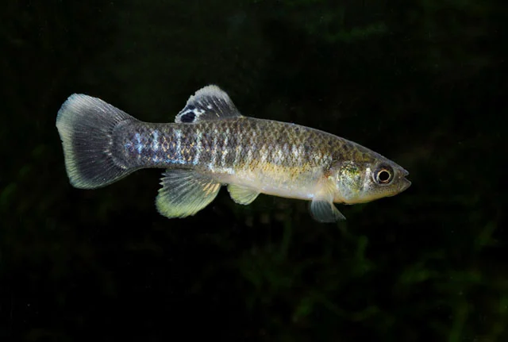
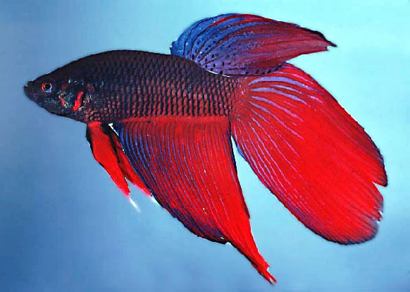
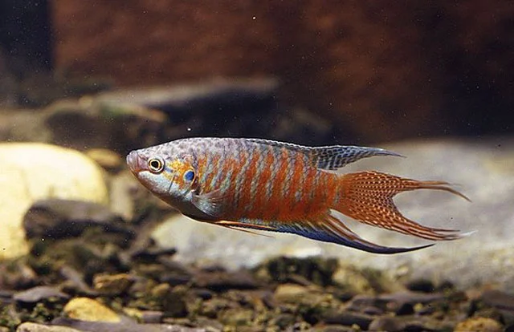

## ESTRUCTURA DE FICHA DE PEZ MARINO

```
### Nombre Común (Nombre científico)
**Familia**:
**Origen**:
**Tamaño**: adulto
**Temperatura**: °C
**pH**: (rango marino estándar salvo excepción)
**Salinidad**: densidad objetivo
**Dificultad**: ★ a ★★★★★
**Tipo de acuario**: FOWLR / Reef / Ambos
**Nivel de nado**: fondo / medio / superficie
**Comportamiento**: pacífico / semiagrresivo / agresivo
**Mínimo de individuos**: (si aplica)
**Tamaño de acuario mínimo**: litros
**Dieta**: omnívoro / carnívoro / herbívoro / planctívoro
**Reproducción**: ovíparo / hermafrodita secuencial
**Reef Safe**: sí / no / precaución
```

## ESTRUCTURA DE FICHA DE PEZ DULCE

```
### Nombre Común (Nombre científico)
**Familia**:
**Origen**:
**Tamaño**: adulto
**Temperatura**: °C
**pH**:
**GH**: °dGH
**Dureza**:
**Dificultad**: ★ a ★★★★★
**Tipo de agua**:
**Nivel de nado**: fondo / medio / superficie
**Comportamiento**: pacífico / semiagrresivo / agresivo
**Mínimo de individuos**: (si aplica)
**Tamaño de acuario mínimo**: litros
**Dieta**: omnívoro / carnívoro / herbívoro
**Reproducción**: ovíparo / vivíparo
**Notas**:
```

---

## Peces — Paludario

> El paludario combina zona acuática y zona terrestre o semiterrestre. Los peces adecuados son los que habitan aguas someras, con vegetación densa o con parte del cuerpo fuera del agua. Se prefieren peces pequeños compatibles con ranas, cangrejos o terrarios semiacuáticos.

---

### Killi Americano / Fundulus (Fundulus heteroclitus)


**Familia**: Fundulidae
**Origen**: Costa Este de Norteamérica (estuarios y marismas)
**Tamaño**: 8 – 12 cm
**Temperatura**: 10 – 26°C
**pH**: 6.0 – 8.5
**GH**: 5 – 25 °dGH
**Dureza**: muy tolerante
**Dificultad**: ★☆☆☆☆
**Tipo de agua**: dulce / salobre
**Nivel de nado**: medio – superficie
**Comportamiento**: pacífico con adultos; puede cazar crías pequeñas
**Mínimo de individuos**: pareja
**Tamaño de acuario mínimo**: 60 litros
**Dieta**: omnívoro oportunista
**Reproducción**: ovíparo; pone huevos en vegetación
**Notas**: Muy resistente y adaptable. Excelente para paludarios con zonas de agua templada o fría. Come insectos que caen al agua desde la zona terrestre. Tolera amplio rango de condiciones.

---

### Betta (Betta splendens)


**Familia**: Osphronemidae
**Origen**: Tailandia (aguas someras, arrozales, paludarios naturales)
**Tamaño**: 6 – 8 cm
**Temperatura**: 24 – 30°C
**pH**: 6.0 – 8.0
**GH**: 0 – 15 °dGH
**Dureza**: blanda – media
**Dificultad**: ★★☆☆☆
**Tipo de agua**: dulce tropical
**Nivel de nado**: superficie (laberíntico)
**Comportamiento**: agresivo entre machos; pacífico con otros peces no similares
**Mínimo de individuos**: 1 macho solo (o grupo hembra)
**Tamaño de acuario mínimo**: 20 litros
**Dieta**: carnívoro (insectos, larvas, pellets)
**Reproducción**: ovíparo; el macho construye nido de burbujas
**Notas**: Pez laberíntico que respira aire de la superficie: necesita acceso al aire. Perfecto para paludarios con mucha vegetación emergida y aguas someras. El macho come insectos de la zona terrestre. No combinar dos machos. Las colas largas de selección son más frágiles.

---

### Pez Paraíso (Macropodus opercularis)


**Familia**: Osphronemidae
**Origen**: Asia del Sur y Sudeste Asiático (arrozales, canales, paludarios)
**Tamaño**: 8 – 10 cm
**Temperatura**: 15 – 28°C
**pH**: 6.0 – 8.0
**GH**: 5 – 20 °dGH
**Dureza**: tolerante
**Dificultad**: ★☆☆☆☆
**Tipo de agua**: dulce
**Nivel de nado**: medio – superficie
**Comportamiento**: semiagrresivo (territorial; puede molestar a otros peces)
**Mínimo de individuos**: pareja (no dos machos)
**Tamaño de acuario mínimo**: 60 litros
**Dieta**: omnívoro (insectos, larvas, pellets)
**Reproducción**: ovíparo; nido de burbujas
**Notas**: Uno de los primeros peces ornamentales traídos a Europa (siglo XVII). Extremadamente resistente. Tolera agua fría (hasta 15°C), mala calidad de agua y condiciones de paludario. Respira aire atmosférico. Buen pez para paludarios de clima templado. Agresivo con otros laberínticos y peces de aletas largas.
